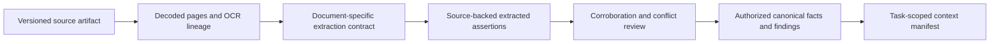

# Document fields and canonical context

Date: 2026-11-08. Document catalog: 0.1.0. Existing skill context schema: 2.0.0.

The document catalog is an evidence vocabulary and extraction contract. It is not another authoritative customer record. It supplies field descriptions, candidate mapping destinations and the provenance needed to propose assertions. Context assembly and canonical writeback remain governed services.

## Canonical flow

Every stage preserves its own identifiers, versions and provenance. An extraction does not mark an identity, ownership relationship, source of funds or risk assessment verified. Source-stated historical approvals are evidence of a recorded claim, not an approval token for a new execution.

## Candidate mappings into existing records

The machine-readable field library contains 13 mapping declarations. Tests check their object types and property paths against the existing ontology. The declarations name destinations and prerequisite transformations; they do not emit full records.

| Document field | Existing candidate destination | Conditions before canonical use |
| --- | --- | --- |
| `person_name`, `entity_name` | `Entity.name` | Resolve the subject, retain source script, reconcile naming conflicts |
| `date_of_birth` | `Identity.attributes.date_of_birth` | Resolve the person; require a complete unambiguous date for this existing shape |
| `subject_address` | `Address.lines` and related address components | Resolve subject and address role; map the structured components rather than casting an object to a string list |
| `registration_number` | `Registration.registration_id` | Retain the issuing authority and jurisdiction |
| `registration_authority` | `Registration.authority` | Resolve authority identity and scope |
| `formation_jurisdiction` | `Registration.jurisdiction` | Distinguish formation, residence and operation |
| `business_activity` | `Party.profile.business_purpose` | Preserve customer-declared versus corroborated status |
| `source_of_funds_statement` | `SourceOfFunds.claim` | Retain transaction scope, underlying origin and evidence; do not set verified true |
| `source_of_wealth_statement` | `SourceOfWealth.claim` | Retain wealth chronology and evidence; do not set verified true |
| `ownership_interests` | `OwnershipInterest` candidate edges | Resolve both parties, class, direct/indirect designation, denominator and dates; convert source percent into the required fraction deterministically |
| `control_rights` | `ControlRight` candidate relationships | Resolve both parties and the right's scope; independently assess interpretation |
| `beneficial_owners_stated` | `BeneficialOwner` candidates | Preserve declaration status; resolve natural persons and apply admitted ownership/control policy separately |

Nested ownership/control data produces a mapping candidate for the enclosing field, not a claim that each scalar belongs in the same canonical property. The validator emits no complete `Record`, `Fact`, `Decision` or effect command. The host must supply tenant, subject, source, access, temporal and verification envelopes through existing authorized ingestion services.

All remaining document fields stay in typed extracted assertions or linked evidence until a specific mapping is designed and approved. Absence of a direct mapping is deliberate and must not cause evidence to be discarded.

## Context gaps exposed by the field inventory

| Area | Existing limitation | Required refinement before lossless canonical promotion |
| --- | --- | --- |
| Document lifecycle | `Document.issued_at` and `Document.expires_at` are required timestamps | Represent unknown issue date, date-only precision, no stated expiry, and actual expired status distinctly. Never invent an expiry for a deed or certificate. |
| Extraction provenance | `ExtractedAssertion` holds subject, field, value and document version | Preserve leaf observations, exact spans, raw versus normalized values, contract/provider versions and review state through an evidence attachment or a versioned schema extension. |
| Identity | Canonical date of birth is a complete date | Retain partial dates in evidence; do not invent a month or day to fit the record. |
| Addresses | Address shape does not itself establish its subject, role or proof status | Add governed relationship and effective-period semantics; distinguish correspondence, registered and operating premises. |
| Ownership | Basic edges hold fractional interest, class and optional voting interest | Preserve source denominator, units, declared indirect basis, nominee capacity, provenance and reconciliation status. |
| Trusts | General relationships and ownership records do not model a complete fiduciary arrangement | Define arrangement identity, role assignments, beneficiary classes, powers, revocation, amendments and effective intervals. |
| Authority | Control rights and officer roles do not express every account mandate | Define business authority scope, represented party, authorized actions, joint-signing rules, amount/currency limits, revocation and evidence. Do not map these to runtime actor permissions. |
| Tax | No dedicated complete CRS/FATCA tax-profile record | Define tax residences, TINs and absence reasons, classifications, form edition, certifications and change events separately from AML beneficial ownership. |
| Financial reporting | Generic evidence does not provide a full statement model | Preserve entity/consolidation scope, periods, currencies, scale, reported line items and audit opinion. |
| Wealth provenance | Claim-plus-evidence objects are intentionally small | Model economic events, contributors, asset acquisition, proceeds and fund-flow links when the workflow needs them. |
| Digital assessments | Provider scores and media artifacts are not identity facts | Preserve method, scale, limitations, capture/version references and separate qualification/verification findings. |
| Historical decisions | A source can state a prior risk rating, approval or exception | Keep it as attributed evidence; independently validate issuer, authority, scope, expiry and current execution binding. |

These are identified design gaps, not newly implemented canonical record types. Existing 87 context shapes, skill versions and runtime contracts remain unchanged. Schema extensions need explicit versioning/migration and the same admission, access and temporal controls already used by the context compiler.

## Context assembler responsibilities

The assembler should resolve evidence requirements into authorized source versions and field projections. It must distinguish document acceptance from assertion corroboration and task sufficiency. It should return explicit gaps for missing, unreadable, redacted, ambiguous, stale or conflicting evidence.

Carry at least the following provenance across the boundary: artifact ID/version/hash; source and submission origin; subject and relationship scope; contract ID/version/hash; parser/OCR version; page/text/geometry lineage; extraction provider/model and invocation; source quote/spans; raw/normalized values; temporal precision; verification/conflict state; purpose/access/retention labels; and the pinned acceptance-policy version.

The existing EHF integration can host this sequence, but its production Authority/context adapters and evidence writeback service still need to be wired explicitly. This catalog does not widen source access, silently reuse unrelated case evidence, or make collection mandatory.
