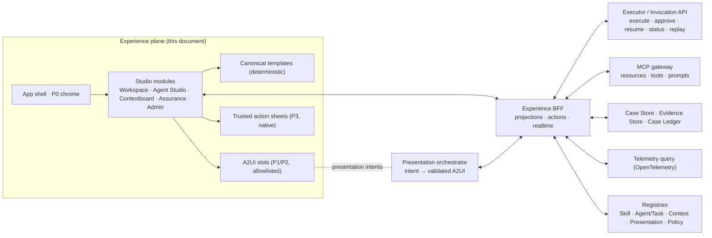

# UI Architecture — Financial Crime Experience Platform

**Version:** 1.0 · **Date:** 2026-11-07 · **Status:** Proposed baseline for Phase 0/1
**Companion artifacts:** [index.html](index.html) (mockup hub) · [style-guide.html](style-guide.html) · [STYLE-GUIDE.md](STYLE-GUIDE.md) · [tokens.json](tokens.json)
**Inputs reviewed:** `docs/UX-specs.md` (v1.0), `docs/visualdesignaddendum.md` (v1.1), `docs/ui-constructs/` (9 concept drawings), `schemas/` (ontology 2.0.0, 87 context types, 19 runtime schemas, 9 provider pairs), `catalog/` (catalog 0.2.0, context matrix, consumers, release lock), `profiles/synthetic-analyst.json`, `policies/synthetic/neutral.json`, `workflows/synthetic-kyb.json`, `examples/`, `docs/context-specification.md`, `docs/integration-guide.md`, `docs/implementation-status.md`.

> **v2 note (2026-11-07):** this UI now replaces `ehfconcept/apps/control-ui`, and kyc 0.3.0 is integrated with EHF. Where this document and [ALIGNMENT.md](ALIGNMENT.md) disagree, ALIGNMENT wins. In particular: F2 is resolved upstream; F1/F3/F6 are superseded by kyc TaskSpec/BusinessAgent and EHF drafts and releases; the approvals and action pipeline (§6) are replaced by EHF human work and case-api business commands; context profiles and 13 banks are replaced by 12 context products × agent ceilings; and the IA gains a domain-neutral Platform console (PLT-01…15). The layout templates, trust classes, epistemic rules and component catalog still apply.

> The repository has no `contracts/` folder at its root. The executable contracts live in `schemas/` and `catalog/`, and this document treats those as the contracts.

---

## 0. Summary

The UX spec and the addendum describe a coherent product: three authoring instruments (Contextboard, Skillboard/Taskboard, Agent Profile), adaptive business workbenches, and an Assurance Studio. All of them sit over one canonical model. The executable contracts already cover the *execution* half very well. The skill manifests, context manifests, approvals, bitemporal records and hash-chained audit events map almost one-to-one onto the inspector, handshake, trusted-approval and lineage designs.

The gaps are on the *authoring and presentation* half. There is **no TaskSpec, no ContextProfile and no presentation contract**. The **AgentProfile and AuditEvent shapes are too thin** for the Agent Profile and Flight Recorder screens. **Composite skills are declared atomic**, which hides exactly the duplicate-execution risk the Skillboard is meant to expose. Section 2 lists 18 findings, with a contract recommendation for each.

The architecture below has these parts:

- **One shell, five studio modules**, a shared design system, and object projections keyed by canonical `Ref`.
- **Two rendering paths:** deterministic canonical templates (default), plus allowlisted A2UI slots for P1/P2 agent-composed content. P3 trusted actions are always native.
- **An experience BFF** that talks to the Executor (Invocation API), the MCP gateway, the Case Store and Ledger, and telemetry. The UI holds no business state of its own.
- **A server-authoritative cache** with an explicit async-state machine and a revision-checked action pipeline (Discover → Preview → Propose → Authorize → Commit → Confirm → Audit).

---

## 1. What was reviewed and how the concepts were interpreted

| Concept drawing | Interpretation in the mockups |
|---|---|
| 1 · Contextboard banks + capability toggles | Kept banks, segment meters and fixed positions. **Replaced Enable/Disable toggles** with a separate *assignment* control (Required / Conditional / Optional / Off) in Tune mode. Readiness is a separate dimension (spec §3.4, see finding F14). |
| 2 · Library / Instrument surface / Inspector / Execution strip | Became the four-region shell: orientation, centre, inspector, and an activity rail that carries the execution strip. |
| 3 · Play / Tune / Engineer | Progressive-disclosure levels used in both Contextboard and Skillboard. |
| 4 · Resolve beneficial ownership capability card | Engineer-mode capability contract with resolution path (primary → enrichment → fallback) and canonical result. |
| 5 · Context profile with Required/Conditional/Optional bars | The assignment summary in the Governance bay, and the Tune table. |
| 6 · Context Signal wave | Rebuilt as an **event-driven** signal: one point per recorded event, height = objects admitted. A replay steps through recorded events only. |
| 7 · Skillboard with six cognitive banks | Six banks over the 20 domains, binding markers instead of "Assigned" buttons, and a skill inspector with the six spec tabs. |
| 8 · Skill → Context handshake + readiness checklist | The inspector Context tab, populated from the real `required_context`/`optional_context`/`policy_context_fields` of `ownership.ubo.resolve`. No single readiness percentage. |
| 9 · "One studio, three instruments" incl. *Flowboard* | Adopted as the hub framing with Contextboard / Skillboard / **Taskboard**. The workflow DAG appears *inside* Taskboard as the dependency map; see F13. |

---

## 2. Review findings — spec ↔ contracts ↔ concepts

Severity reflects impact on the Phase 1 UI vertical slice.

| # | Sev | Finding | Evidence | UI impact | Recommendation |
|---|---|---|---|---|---|
| F1 | **High** | **No TaskSpec contract.** The spec's Taskboard composes `TaskSpec`s (objective, outputs, completion criteria, failure policy, interrupts). Nothing in `schemas/` defines it. The ontology `Task` is a *case work item* (`role, skill_id, status, dependencies, parameters`), and `Workflow` is a step DAG. | `schemas/context/types/Task`, `schemas/runtime/Workflow.schema.json` | AGT-03 has nothing to bind to. "Task" means two different things in the product. | Add `schemas/runtime/TaskSpec.schema.json`: `id, version, agent_profile_ref, objective, inputs, required_context[], skill_bindings[{skill_id, binding: required\|conditional\|eligible\|composed, condition?}], dependencies[], outputs[] (object types), completion_criteria[], failure_policy, interrupts[], authorization[], audit_fields[]`. In business UI, call the ontology `Task` a **work item**. |
| F2 | **High** | **Composite skills declared atomic.** All 222 manifests declare `composition_type: atomic` and `dependencies.skills: []`. `ownership.ubo.resolve`'s SKILL.md says it composes graph expansion, interest maths and control tests, and `synthetic-kyb` *also* runs `ownership_graph_build → ownership_interest_calculate` before it. | `catalog/catalog.json`, `skills/ownership/ubo-resolve/SKILL.md`, `workflows/synthetic-kyb.json` | Skillboard cannot show "Composed dependency" or prove dedup (acceptance §16.5). | Declare internal operations in the manifest (e.g. `composition: {type: composite, internal_operations: [...]}`). Have the compiler report duplicates. The UI shows **"dedup unproven"** until then (see the AGT-04 mockup). |
| F3 | **High** | **AgentProfile is a runtime bound, not a mandate.** The schema has `id, version, instructions, allowed_skills, capabilities, permissions, purposes, budgets`. It has no name, mandate, scope/exclusions, accountable roles, owner, task repertoire, human gates, evaluation profile or publication state. Only one profile exists (`synthetic-analyst`, admitting all 222 skills), against 16 target agents. | `schemas/runtime/AgentProfile.schema.json`, `profiles/` | AGT-01/02 fields have no source. A single all-skills profile undermines least privilege. | Add an `AgentMandate` (authoring) object that references the runtime `AgentProfile`, or extend the profile. Author A01–A16 with narrowed `allowed_skills` before Phase 1 exit. |
| F4 | **High** | **AuditEvent is too thin for the Flight Recorder.** It has `actor_ref, event, event_hash, previous_hash, execution_id, occurred_at`, but lacks `recorded_at, ledger_sequence`, initiator vs executor, `authority_ref`, case/workflow/run/task/skill IDs, `trace_id/span_id`, `context_manifest_ref`, `policy_snapshot_ref`, input/output/evidence refs, `result_status`, and presentation IDs. | ontology `AuditEvent`; spec §10.2; addendum §13.2 | ASR-02 temporal fidelity and causal neighbourhood can't be built from the ledger alone. | Version `AuditEvent` (2.1) with the spec §10.2 envelope plus the addendum §13.2 correlation IDs, or add a `CorrelationRecord` keyed by `execution_id`. The `Record` envelope already carries `observed_at/recorded_at`, so reuse those semantics. |
| F5 | **High** | **No presentation contracts.** There's nothing for presentation intent, the A2UI component descriptor, the surface patch envelope or presentation events. | addendum §5–6, §11.3, §13 | P1 agent-composed surfaces and presentation lineage can't be implemented or audited. | Add `schemas/presentation/`: `PresentationIntent`, `ComponentDescriptor`, `SurfacePatch`, `PresentationEvent`, `RendererProfile`. Section 7.3 gives a starting shape. |
| F6 | Med | **No publication lifecycle.** Draft → Validated → Approved → Published → Deprecated has no enum or object. `maturity` (`implemented_synthetic` / `integration_verified` / `production_qualified`) is a *different* axis. | SkillManifest.maturity | Publish & Diff (AGT-07) and Contextboard versions have no state source. | Add `PublicationState` + `Publication {artifact_ref, state, approvals[], diff_ref}`. The UI always shows publication and maturity as two separate chips. |
| F7 | Med | **No ContextProfile contract.** Per-skill `Requirement`s, the context matrix and reverse consumers exist. The *profile* the Contextboard edits does not: capability assignment per purpose, source priority, fallback, inheritance, versions. | `catalog/context-matrix.json`, `context-consumers.json` | CXT-01/02 are mocked on illustrative data. | Add `ContextProfile {id, version, purpose, inherits, capabilities[{id, object_types, assignment, max_age, source_priority[], fallback_rule}], publication}`. The compiler intersects profile × skill requirements. |
| F8 | Med | **Status vocabulary differences.** `HypothesisStatus` is SUPPORTED/REFUTED/UNRESOLVED, while the spec says supported/contradicted/unresolved/**untested**. `CaseState` is OPEN/REVIEW/CLOSED, while the spec shows a *case stage*. `TaskStatus` has no FAILED. | ontology enums | Labels could drift from the data. | The UI uses the schema enums verbatim. "Untested" is *derived* (no `investigation.hypothesis.test` execution yet). **Stage is derived from `Checkpoint.completed_step_ids`**, not invented. Map skill failure via `SkillStatus`. |
| F9 | Med | **Readiness, Connection and Authorization have no schema.** | spec §3.4 | Bank meters need a source. | A readiness query that runs the context compiler in dry-run mode → `ContextGap` codes (`CONTEXT_MISSING`, `CONTEXT_STALE`) plus provider admission (`ACCESS_DENIED`) plus health. Return per-capability state; never a percentage. |
| F10 | Med | **The reference KYB workflow is a strict 29-step chain.** Spec §11.4 calls for parallel document/registry work, screening/risk overlap and explicit joins. The EDD branch blocks for handoff. | `workflows/synthetic-kyb.json` | The Taskboard DAG and Flight Recorder lanes must render parallelism the data doesn't yet show. | Keep the renderer DAG-native (parallel and join). Update the template with real parallel branches and a conditional EDD path. |
| F11 | Low | **222 vs 220 is resolved.** The catalog has 222 skills across 20 domains, confirmed by `release-lock.json`. | `catalog/release-lock.json` | — | Close spec §18 "Data Quality". Skillboard uses 222 and the fixed bank mapping in §6.4. |
| F12 | Med | **Several scores are explicitly uncalibrated** (`entity.match`, `screening.match.score`, `entity.confidence.assess`). | catalog `business_outcome` text | A % badge would misrepresent certainty (spec §15.7). | Design rule: show *features* and contradictions, never a percentage. |
| F13 | Low | **"Flowboard" (concept 9) vs Taskboard (spec).** | ui-constructs #9 | Naming drift. | Taskboard = TaskSpec composition (the score). Its **Flow** view is the workflow DAG (the conductor). Don't add a fourth top-level instrument until workflow authoring is in scope. |
| F14 | Med | **Concept 1's toggles and green "Healthy" chip** contradict spec §3.4 ("a green switch must never imply success"). | ui-constructs #1 | — | Use assignment segmented controls plus separate readiness. Switches only appear in drafts. |
| F15 | Med | **Every record is synthetic** (`synthetic: true`, synthetic policy, synthetic providers). | `examples/records.json`, policy | Screenshots and demos could be mistaken for real verification. | A persistent P0 **Synthetic** pill in the chrome, plus a disclosure on every decision surface. |
| F16 | Low | **Decision and Approval have no rationale or attestation field.** | ontology `Decision`, `Approval` | The trusted sheet collects an attestation and the review sheet collects a rationale. | Add `rationale_ref` and `attestation {text_version, accepted_at}` to `Approval` or `Decision`. |
| F17 | Low | **Effects → tier mapping.** The `proposal` and `external_write` enum values are unused. `regulatory.filing.submit` is `human_gated` but irreversible and external. | catalog effects counts: 207 read_only, 8 internal_write, 7 human_gated | Tier display. | read_only → L0, internal_write → L1, human_gated → L2 by default and **L3 when irreversible or SoD-bound** (disposition, filing submit, case close). Make the tier an explicit manifest field. |
| F18 | ✓ | **Strong fits worth protecting:** `Approval` binds `request_hash`, `context_hash`, `execution_lock_hash`, `expires_at` → trusted sheet. `Record` is bitemporal → temporal fidelity. `ContextManifest` gaps and hashes → Context Preview. SkillManifest fields cover all six inspector tabs. `OwnershipGraph.complete` + `unresolved[]` → honest graphs. `Conflict` → reconciliation. Hash-chained `AuditEvent` → integrity badge. | — | — | Keep these stable. The UI depends on them directly. |

---

## 3. Architectural position



Rules that never bend (ADR-01…12 in the addendum):

1. The UI is **never a system of record**. Every mutation is a typed command and is shown as done only after server confirmation.
2. **Authorization is enforced server-side.** The UI hides what the `Principal` can't use, but never relies on hiding for safety.
3. **P0 chrome and P3 actions are application-owned.** Agents may only fill approved P1/P2 component slots.
4. **Every screen has a deterministic fallback.** An invalid A2UI payload never blanks a workspace.

---

## 4. Application architecture

### 4.1 Shell and studio modules

One web application with route-level code splitting. Studios are modules, not separate apps, so they share navigation language, the design system and object projections (spec §1.1).

| Module | Routes (prefix) | Owns | Primary personas |
|---|---|---|---|
| **Workspace** | `/work` | My Workspace, Case Room, workbenches (CDD, EDD, AML, Screening, Risk/Decision, QA/Policy, Ops/Review) | 12 business personas |
| **Agent Studio** | `/agents` | Workforce Atlas, Agent Profile, Taskboard, Skillboard, Rehearsal, Publish & Diff, Skill registry | Agent Architect, Skill Engineer, QA/Model Risk |
| **Contextboard** | `/context` | Overview (Play), Composition (Tune), Provider Workbench (Engineer), Context Preview | Context Architect, Platform Admin |
| **Assurance** | `/assurance` | Mission Control, Flight Recorder, Decision Lineage, Assurance Lab, Packages | Auditor, QA, Compliance, Platform Eng |
| **Admin** | `/admin` | Tenants, providers, credential refs, environments, access, retention | Platform, Security & Privacy Admin |

Shared packages: `design-tokens`, `ui` (primitives + semantic components), `contracts` (generated types), `projections` (object projections), `a2ui-catalog` (descriptors + renderer), `actions` (action pipeline).

### 4.2 Layout system

Every route renders into the four-region **WorkspaceLayout**: chrome, orientation, centre, inspector, rail. Region visibility is part of the template, not ad hoc:

| Template | Orient | Inspector | Rail | Used by |
|---|---|---|---|---|
| `Instrument` | profiles / versions | bank / capability | execution strip | CXT-01/02/03, AGT-03/04 |
| `Queue` | queues / saved views | item preview (overview projection) | recently changed | BIZ-01, ASR-01 |
| `CaseRoom` | case sections + lenses + handoff | verification drawer | agent stream / events | BIZ-02…09 |
| `DecisionDesk` | awaiting decisions + package | approval requirements | case events | BIZ-07 |
| `Recorder` | business chronology | event inspector | technical trace (expanded) | ASR-02 |
| `Lineage` | direction + epistemic key | node inspector | lineage source | ASR-03 |
| `Preview` | — | recorded events | lifecycle | CXT-04, AGT-06 |
| `Atlas` | filters | — | registry status | AGT-01 |

### 4.3 Rendering paths

| Path | When | Who composes | Validation |
|---|---|---|---|
| **Canonical template** (default) | All high-stakes and stable layouts: workbenches, decision desk, recorder | Product code | Type-checked against generated contracts |
| **A2UI slot** | Contextual summaries, agent work products, evidence comparisons, investigation panels (about 20%, addendum §5.5) | Presentation orchestrator from a `PresentationIntent`; agent may choose and populate | Server: schema + catalog allowlist + data-binding authorization. Client: re-validate, reject unknown components, **fall back to the canonical projection** |
| **Trusted sheet** (P3) | Approvals, dispositions, filings, case close, risk acceptance | Application only; agent can supply a *proposal ref* | Server-generated action reference bound to hashes. The client cannot substitute payload. |

Every agent-composed surface renders with a lineage tag (`agent · template@version · surface rev`), so the person always knows what was composed.

### 4.4 Data flow and the experience BFF

The browser talks only to the **Experience BFF**. The BFF:

1. Resolves identity to a trusted `Principal` (`permissions, purposes, classifications, readable_fields, case_ids, subject_ids`). Headers from the browser are never trusted (integration guide, "HTTP transports").
2. Serves **projections** (§6.1) assembled from `RecordView`s, so only selected and authorized fields cross the wire.
3. Proxies **invocations** to the Executor (`execute`, `approve`, `resume`, `status`, `cancel`, `replay`) with idempotency keys generated per preview.
4. Exposes MCP **resources/tools** to the presentation orchestrator. The BFF does not give the browser generic write access.
5. Streams **realtime patches** over SSE (§4.6).
6. Emits **presentation events** for audit (§7.4).

### 4.5 Client state model

- **Server cache** (TanStack Query or equivalent) keyed by canonical identity: `[tenant_id, object_type, object_id, version_id, projection]`. Versioned keys make historical views immutable and cacheable.
- **Local UI state** covers selection, panel layout, density, and unsaved drafts. Drafts are clearly marked and never confused with server state.
- **Async state machine** for every data-bearing component: `idle → loading → streaming → ready → stale → conflict → offline → degraded → retryable_failure → terminal_failure`, plus action states `awaiting_approval → committing → confirmed` (addendum §11.4). These map to tokens and copy in the style guide.
- **Optimistic updates** only for L0/L1 reversible actions (filters, notes, feedback capture). L2/L3 actions show *Committing…* until confirmed.

### 4.6 Realtime

SSE stream per open object scope, carrying a patch envelope:

```json
{ "surface_id": "s-88", "surface_revision": 3, "sequence": 1182,
  "correlation_ref": "exec:7c1e…a9", "object_ref": {"object_type":"Case","object_id":"KYB-1042","version_id":"r7"},
  "data_revision": 7, "patch_type": "replace|merge|append|delete", "freshness": "2026-11-07T13:58:04Z",
  "source_status": "complete|qualified|degraded", "integrity": {"alg":"sha256","value":"…"} }
```

The client drops duplicates (`sequence`), refuses out-of-order patches (`data_revision` lower than the cached one), marks the view `stale` on gaps, and refetches. Queues never reorder under the cursor. A "N new items" pill appears instead. Values update in place in reserved space.

### 4.7 Action pipeline

`Discover → Preview → Propose → Authorize → Commit → Confirm → Audit` (addendum §9.2), bound to the executor as follows:

| Stage | Executor / contract | UI |
|---|---|---|
| Discover | Allowed actions from projection (`Principal` × policy × object state) | `ActionBar` shows only eligible actions; others show *why not* on hover |
| Preview | Dry-run invocation, or `decision.preview` tool | Impact preview (before/after diff, new tasks, audit events) |
| Propose | Run human-gated skill → `SkillResult.lifecycle = WAITING_FOR_HUMAN` + `UnresolvedItem.approval_id` | Proposal card; case shows "Approval required" |
| Authorize | `Executor.approve(approval_id, reviewer)` by a **different** actor with `approve:<skill_id>` | Trusted sheet: hashes, expiry countdown, attestation, re-auth |
| Commit | `resume(invocation, approved_task)` → executor re-checks action/input/context hashes, execution lock, policy, expiry, case revision | Button → *Committing…* |
| Confirm | `SkillResult.effects_committed = true` | Success only now. Conflict → comparison and resolution view |
| Audit | `AuditEvent` appended (hash chain) + presentation event | Rail event; Flight Recorder link |

Autonomy tier display (finding F17): `read_only` L0 · `internal_write` L1 · `human_gated` L2, or **L3** for `decision.disposition.record`, `screening.alert.disposition`, `case.close`, `monitor.review.close`, `regulatory.filing.submit`, `evidence.retention.enforce`.

### 4.8 Authorization in the UI

- Navigation, studios and routes are filtered by `Principal.permissions` and `purposes`. A business user never sees engineering surfaces unless authorized (spec §3.1).
- Field-level: render only `RecordView.selected_fields`. Missing fields show as **redacted** (lock glyph plus reason), never blank.
- Purpose restriction is visible: Contextboard shows "connected, not authorized for this purpose" (acceptance §16.5).
- Segregation of duties is shown *before* a user attempts an action (the "Your authority" inspector section).

---

## 5. Information architecture and navigation

### 5.1 Global navigation

Chrome (P0): brand → studio switcher (Workspace · Agent Studio · Contextboard · Assurance · Admin, filtered by authorization) → global search (⌘K) → **Synthetic/environment pill** → pinned policy snapshot → notifications → identity + active role.

### 5.2 Route map

| Route | Screen |
|---|---|
| `/work` | BIZ-01 My Workspace |
| `/work/cases/:caseId` | BIZ-02 Case Room (Summary) |
| `/work/cases/:caseId/:section` | Activities · Evidence · Findings · Tasks · Decisions · History · Audit |
| `/work/cases/:caseId/lens/:lens` | `ownership` (BIZ-03) · `edd` (BIZ-04) · `aml` (BIZ-05) · `screening` (BIZ-06) · `risk` (BIZ-07a) · `qa` (BIZ-08) |
| `/work/decisions/:caseId` | BIZ-07 Decision Desk |
| `/work/ops` · `/work/reviews` | BIZ-09 Operations / Periodic Review |
| `/agents` | AGT-01 Workforce Atlas |
| `/agents/:agentId[@ver]` | AGT-02 Agent Profile |
| `/agents/:agentId/tasks/:taskId` | AGT-03/04 Taskboard + Skillboard (`?skill=` opens the inspector; `&tab=context` = AGT-05) |
| `/agents/:agentId/rehearsal/:runId` | AGT-06 |
| `/agents/:agentId/publish` | AGT-07 |
| `/agents/skills/:skillId[@ver]` | Skill registry detail |
| `/context` | CXT-01 (`?profile=&mode=play\|tune\|engineer` covers CXT-02/03) |
| `/context/providers/:providerId` | CXT-03 deep link |
| `/context/preview/:dryRunId` | CXT-04 |
| `/assurance` | ASR-01 Mission Control |
| `/assurance/recorder/:workflowRunId` | ASR-02 (`?event=` selects) |
| `/assurance/lineage/:decisionId` | ASR-03 (`?dir=back\|reverse&node=`) |
| `/assurance/lab` · `/assurance/packages` | ASR-04 · ASR-05 |

**URI ↔ route.** MCP resource URIs resolve to routes deterministically: `fincrime://case/KYB-1042` → `/work/cases/KYB-1042`, `fincrime://execution/EX-812/summary` → `/assurance/recorder/…?event=EX-812`. Every inspector offers "Open in…" jumps across studios. Examples are Skillboard → Contextboard binding, Case → Flight Recorder, and Decision → Lineage.

### 5.3 Search

One index over cases, parties, skills, agents, executions, events and policies, with typed result groups and permission-filtered results. Exact-ID queries (`KYB-`, `exec`, a hash prefix, a skill ID) jump directly.

---

## 6. Domain-to-UI model

### 6.1 Object projections (addendum §3.3)

Every UI-addressable object has three projections served by the BFF:

| Object | Overview (queue, card, glance) | Working (workbench) | Assurance (history) |
|---|---|---|---|
| `Case` | id, subject, derived stage, next step, urgency, SLA | header, roles, risk context, revision, sections, lenses | state transitions, revisions, ledger events |
| `Finding` | claim, status, evidence count | claim, `evidence_ids`, question, epistemic kind, actions | producing execution, context hash, superseding findings |
| `Evidence` | source, verified, freshness | content excerpt/spans, `content_hash`, provenance, conflicts | source versions, integrity verification, lineage |
| `OwnershipGraph` | complete flag, #unresolved, verified UBO count | nodes/edges with verified vs candidate, interests, gaps | graph versions (as-of), producing skills |
| `Decision` | disposition, actor, date | memorandum, findings, policy, approvals | lineage, `context_hash`, hash-chain position |
| `Approval` | action, status, expiry | trusted sheet fields | consumption record |
| `SkillManifest` | name, id, binding, readiness | six inspector tabs | versions, eval history, executions |
| `ContextManifest` | gaps, objects, hash | refs, selected fields, gaps, scope, hashes | replayability, retained artifacts |
| `AuditEvent` | event, actor, time | inspector (times, authority, inputs/outputs, integrity) | chain verification |

### 6.2 Derived values (and their sources)

| UI value | Derived from | Never |
|---|---|---|
| Case **stage** | `Checkpoint.completed_step_ids`/`pending_step_ids` × workflow step → stage map | invented from CaseState |
| Bank **readiness** | compiler dry-run gaps + provider admission + health | a percentage |
| Effective **ownership %** | `ownership.interest.calculate` paths (exact decimals) | recomputed client-side |
| **Urgency** | `SLA.deadline` vs as-of + `Severity` | colour without text |
| **Hypothesis untested** | `Hypothesis` without a test execution | a new enum in the UI |
| **Autonomy tier** | `effects` + action list in §4.7 | inferred from button colour |

### 6.3 Contextboard banks → ontology types

Banks are arranged in three fixed bays. Positions never change with availability.

| Bay | Bank | Canonical types |
|---|---|---|
| Subject | Identity | Identity, IdentityIdentifier, Alias, Address, VerificationRecord, Device, Session, AuthenticationEvent, FraudSignal |
| | Entity | Entity, EntityCandidate, OfficerRole |
| | Ownership | OwnershipInterest, ControlRight, OwnershipGraph, BeneficialOwner, Relationship |
| | Party 360 | Party, CustomerRelationship, Account, Product, ExpectedActivity, GeographyExposure |
| | Network | NetworkGraph, Relationship, Counterparty, PEPRelationship |
| Sources | Documents | Document, DocumentVersion, DocumentPage, ExtractedAssertion |
| | Registry | RegistryRecord, Registration, Filing, License |
| | Screening | WatchlistEntry, ScreeningHit, AdverseMediaEvent, SanctionsRegime |
| | Transactions | Transaction, Payment, PaymentRail, DatasetScope, TradeRecord, Invoice, Shipment, Alert, DetectionRule, Typology |
| | Evidence | Evidence, SourceRecord, Provenance, Assertion, Fact, Finding, Conflict, Hypothesis, TimelineEvent |
| Governance | Risk | RiskFactor, RiskAssessment, RiskModel, SourceOfFunds, SourceOfWealth |
| | Case | Case, Task, WorkflowDefinition, Checkpoint, SLA, Investigation, MonitoringPlan, ReviewTrigger, Event |
| | Policy | Policy, Requirement, Control, Obligation, Exception, Jurisdiction, RetentionRule, BusinessCalendar, Decision, Approval, Actor |

Business contexts = `Invocation.purpose`: onboarding · review · monitoring · investigation · fraud · reporting. Assurance and evaluation types (`AuditEvent`, `EvaluationCase`, `ExpectedOutcome`, `ModelVersion`) are deliberately **not** banks. They're denied to production reasoning (context spec §3).

### 6.4 Skillboard banks → canonical domains (222 skills)

| Cognitive bank | Domains | Skills |
|---|---|---|
| Identify | entity · party · document · registry | 12 + 10 + 12 + 10 = 44 |
| Relate | ownership · network | 12 + 10 = 22 |
| Detect | screening · transaction · aml · alert · fraud | 14 + 12 + 12 + 10 + 12 = 60 |
| Assess | risk · edd | 12 + 10 = 22 |
| Investigate | investigation · evidence | 12 + 10 = 22 |
| Govern | case · decision · monitor · regulatory · quality | 10 + 12 + 10 + 10 + 10 = 52 |

The banks are navigation groups. The canonical domain and ID are always shown on each skill key.

### 6.5 Personas → default lens

| Persona | Landing | Default lens | Decision authority shown |
|---|---|---|---|
| Relationship Manager | My Workspace | Relationship & intake | requests only |
| KYC Onboarding Specialist | My Workspace | Intake | handoff |
| CDD / KYB Analyst | My Workspace | Ownership & control | review outcome (L2) |
| EDD Analyst | My Workspace | EDD hypotheses | findings, escalation |
| AML Investigator | My Workspace | Fund flow | escalation, SAR evaluation (not filing) |
| Sanctions & Screening Analyst | Screening queue | Screening comparison | propose disposition (L3 with independent approval) |
| KYC Risk Analyst | My Workspace | Risk attribution | overrides via exception |
| QA Reviewer | QA queue | Evidence coverage | challenge, remediation |
| Compliance Officer / MLRO | Decision Desk | Memorandum | ACCEPT/REJECT/ESCALATE (L3) |
| KYC Operations Manager | Ops | Flow, SLA, capacity | allocation (L1) |
| Periodic Review Analyst | Reviews | Before/after | review close (L3) |
| Policy & Governance Specialist | Policy | Diff & impact | policy publication |

---

## 7. Component architecture

### 7.1 Layers

```
tokens (tokens.json → CSS vars / TS)                    ← design-tokens
  └─ primitives: Button, Segmented, Tabs, Chip, Id, Hash, Switch, Field, Table, Sheet
      └─ semantic components (= A2UI enterprise catalog, versioned)
          └─ templates (§4.2): Instrument, Queue, CaseRoom, DecisionDesk, Recorder, Lineage, Preview, Atlas
              └─ screens (25)
```

### 7.2 Semantic component catalog

| Component | Trust | Binds to (ontology / runtime) | Key states | Non-visual alternative | Mockup |
|---|---|---|---|---|---|
| `StatusHeader` / Canonical Object Header | P1 | any `Ref` + projection | publication, connection, execution | text | all |
| `ObjectCard` | P1 | any overview projection | async states | text | BIZ-01 |
| `WorkQueue` | P1 | `Case`, `Task`, `SLA` | new-items pill, no reorder | list | BIZ-01 |
| `ContextBank` (Instrument Bank) | P1 | ContextProfile capability set | readiness segments | listbox + counts | CXT-01 |
| `SkillBank` / `SkillKey` | P1 | `SkillManifest` + TaskSpec binding | binding kind, readiness | list | AGT-04 |
| `TaskComposition` | P1 | TaskSpec, `Workflow` | DAG, conditional, gate, dup | table | AGT-04 |
| `ContextHandshake` | P1 | `Requirement[]`, `ContextManifest` | met / missing / runtime / must-surface | checklist | AGT-04 |
| `ContextSignal` | P1 | context lifecycle events | per-event points, replay | event list | CXT-04 |
| `OwnershipGraph` | P1 | `OwnershipGraph`, `OwnershipInterest`, `ControlRight`, `BeneficialOwner`, `Conflict` | verified / candidate / unresolved / control | **table** + `<desc>` | BIZ-03 |
| `FundFlowGraph` | P1 | `Transaction`, `DatasetScope`, `NetworkGraph` | coverage, allocation disclaimer | table | spec |
| `EvidencePanel` / Verification drawer | P1 | `Assertion`, `Evidence`, `Provenance`, `VerificationRecord` | epistemic kind, freshness | text | BIZ-03 |
| `EvidenceTimeline` | P1 | `TimelineEvent` | business vs recorded time | list | spec |
| `ComparisonView` | P2 | `ScreeningHit`, `Conflict`, versions | agree / partial / contradict / missing | table | BIZ-06, BIZ-03 |
| `RiskAttribution` | P1 | `RiskAssessment.contributions`, `RiskFactor` | model version, reproducible | table | BIZ-07 |
| `PolicyEvaluation` | P1 | `Control.outcome`, `Requirement` | PASS / FAIL / UNKNOWN / N/A | list | BIZ-07 |
| `AIWorkProduct` | P1 | `Finding` + evidence + trace refs | 8 sections | text | BIZ-03 |
| `AgentActivity` (stream) | P1 | `SkillExecution`, events | proposed / running / completed / failed / interrupted | live list | BIZ-03 |
| `ImpactPreview` | P2 | dry-run result | diff | text | BIZ-03 sheet |
| `ApprovalSheet` | **P3** | `Approval`, `ExecutionLock` | pending / expiring / committing / confirmed | dialog | BIZ-07 |
| `ExecutionTimeline` (lanes) | P1 | `AuditEvent` + correlation | causal highlight, gaps | table | ASR-02 |
| `TraceInspector` / Span rows | P1 | OTel spans | ok / error / sampled-out | table | ASR-02 |
| `LineageGraph` | P1 | Decision → Finding → Fact → Evidence → Source | backward / reverse | list | ASR-03 |
| `DiffImpactInspector` | P2 | Publication diff | changed, consumers, regressions | table | spec (AGT-07) |
| `Disclosure` | P1 | `ContextGap`, `UnresolvedItem`, coverage | missing / stale / restricted / sampled | text | all |
| `InterruptBanner` | P0/P1 | `Checkpoint`, approval | paused | live region | BIZ-03 |
| `ActionBar` | P2 | allowed actions | eligible / ineligible with reason | buttons | all |

### 7.3 A2UI component descriptor (proposed shape)

```yaml
component_id: OwnershipGraph
version: 1.0.0
trust_class: P1                    # P0|P1|P2|P3 — P3 never agent-composable
purpose: Corporate control relationships with verification status
props_schema: $ref presentation/OwnershipGraph.props.schema.json
data_binding:
  object_types: [OwnershipGraph, OwnershipInterest, ControlRight, BeneficialOwner, Conflict]
  projection: working
  freshness: per ContextManifest
  classifications: [internal, confidential]
interactions:
  events: [node.select, edge.select, view.toggle_table]
  actions: [evidence.request]       # action ids, server-validated
accessibility:
  alternative: table
  keyboard: roving-focus over nodes; Enter selects
  reduced_motion: no layout animation
attention: { glance: false, card: summary_only, detail: true, workspace: true }
devices: [desktop, tablet]
```

### 7.4 Presentation events

Emitted by the renderer through the BFF and appended to the ledger for consequential surfaces (addendum §13.1):

`presentation.intent_resolved · surface.created · surface.patched · surface.rendered(surface_id, revision, object versions, renderer profile) · interaction(ix_id, component, action_ref) · preview.shown · approval.presented · approval.confirmed`

---

## 8. Screen specifications

All 25 screens from spec §13. "Mock" means an interactive mockup exists in `mockups/`.

| ID | Route | Template | Primary components | Reads (contracts) | Actions (tier) | Status |
|---|---|---|---|---|---|---|
| CXT-01 | `/context` | Instrument | ContextBank ×13 in 3 bays, assignment summary, execution strip | ContextProfile*, readiness query*, provider health | select profile/bank (L0) | **Mock** |
| CXT-02 | `/context?mode=tune` | Instrument | assignment segmented rows, draft bar, inheritance | ContextProfile*, context-consumers | stage draft (L1), validate, propose (L2) | **Mock** (tab) |
| CXT-03 | `/context?mode=engineer` | Instrument | resolution path, mapping table, test binding | provider bindings, ProviderResponse schemas | test with synthetic input (L0), propose mapping (L2) | **Mock** (tab) |
| CXT-04 | `/context/preview/:id` | Preview | ContextSignal, included/excluded refs, ContextGap list, manifest | `ContextManifest`, lifecycle events | new dry run (L0), export manifest | **Mock** |
| AGT-01 | `/agents` | Atlas | agent cards by domain, orchestration services | AgentProfile (+ mandate*), catalog | new profile (L1 draft) | **Mock** |
| AGT-02 | `/agents/:id` | Instrument | object header, mandate, scope/exclusions, roles, budgets, versions | AgentProfile + mandate* | edit draft (L1) | Header in AGT-04 |
| AGT-03 | `/agents/:id/tasks/:t` | Instrument | task strip, TaskSpec card | TaskSpec* | edit TaskSpec (L1 draft) | **Mock** |
| AGT-04 | same | Instrument | SkillBank ×6, SkillKey + binding, dependency map (graph/table), skill inspector ×6 tabs | `SkillManifest`, TaskSpec*, Workflow | change binding (L1 draft) | **Mock** |
| AGT-05 | `…?skill=&tab=context` | Instrument | ContextHandshake, readiness checklist | `Requirement`, `ContextManifest` (dry run) | dry run on golden case (L0) | **Mock** (inspector) |
| AGT-06 | `/agents/:id/rehearsal/:run` | Preview | AgentActivity, ExecutionTimeline, outputs, policy evals, interrupts | `SkillResult`, `EvaluationCase`, `ExpectedOutcome` | run rehearsal (L0, isolated), create improvement candidate (L1) | Spec |
| AGT-07 | `/agents/:id/publish` | Instrument | DiffImpactInspector, validation checklist, approvals | Publication*, catalog hashes | propose publication (L2), approve (L3) | Spec |
| BIZ-01 | `/work` | Queue | KPIs with freshness, WorkQueue groups ×6, preview, handoff package | `Case`, `Task`, `SLA`, projections | open, claim (L1) | **Mock** |
| BIZ-02 | `/work/cases/:id` | CaseRoom | case header + derived stage, interrupt banner, sections | `Case`, `Checkpoint`, `Finding`, `Evidence` | section-specific | **Mock** (with BIZ-03) |
| BIZ-03 | `…/lens/ownership` | CaseRoom | OwnershipGraph (+table), AIWorkProduct, reconciliation, verification drawer | `OwnershipGraph`, `Conflict`, `Assertion`, `Evidence` | request evidence (L1), record review (L2), escalate (L2) | **Mock** |
| BIZ-04 | `…/lens/edd` | CaseRoom | hypothesis matrix, SoF/SoW, chronology, gaps | `Hypothesis`, `SourceOfFunds`, `SourceOfWealth`, `TimelineEvent` | test hypothesis (L0), findings (L1), escalate (L2) | Spec |
| BIZ-05 | `…/lens/aml` | CaseRoom | FundFlowGraph, transaction timeline, typology indicators, exculpatory evidence | `Transaction`, `DatasetScope`, `Alert`, `Typology` | escalate (L2), SAR evaluation (L0) | Spec |
| BIZ-06 | `…/lens/screening` | CaseRoom | ComparisonView, match features, disposition proposal | `ScreeningHit`, `WatchlistEntry`, `VerificationRecord` | propose disposition (L3 via independent approval) | **Mock** |
| BIZ-07 | `/work/decisions/:id` | DecisionDesk | three separate objects, PolicyEvaluation, RiskAttribution, QA, ApprovalSheet | `Decision`, `Control`, `RiskAssessment`, `Approval` | sign & commit (L3), escalate, return | **Mock** |
| BIZ-08 | `…/lens/qa` | CaseRoom | control checklist, coverage, unsupported-assertion detection, challenge register | `Control`, `Finding`, quality.* results | challenge (L1), remediation plan (L1) | Spec |
| BIZ-09 | `/work/ops`, `/work/reviews` | Queue | WIP by stage, aging, capacity, bottlenecks, before/after review | `Case`, `SLA`, `MonitoringPlan`, `ReviewTrigger` | allocate (L1), review close (L3) | Spec |
| ASR-01 | `/assurance` | Queue | role-adaptive metrics with definitions and freshness, exception queues | metrics, ledger aggregates | drill-through (L0) | Spec |
| ASR-02 | `/assurance/recorder/:run` | Recorder | chronology, ExecutionTimeline lanes ×5, event inspector, span rail, replay-mode switch | `AuditEvent`*, correlation*, OTel, presentation events* | reconstruct surface (L0), add to package | **Mock** |
| ASR-03 | `/assurance/lineage/:id` | Lineage | LineageGraph backward/reverse, known-at-time, authority | `Decision`, `Finding`, `Fact`, `Evidence`, `SourceRecord`, `Provenance` | propose re-review (L1), package | **Mock** |
| ASR-04 | `/assurance/lab` | Queue | failure clusters, representative traces, regression | `EvaluationCase`, `ExpectedOutcome`, `quality.*` | create improvement candidate (L1) | Spec |
| ASR-05 | `/assurance/packages` | Queue | package builder, manifest, integrity verification, redaction disclosures | `evidence.bundle.compile`, `decision.audit.verify` | generate (L2, audited export) | Spec |

\* = contract missing or incomplete; see §2.

---

## 9. Interaction patterns

1. **Play / Tune / Engineer.** Three disclosure levels on the same instrument and the same spatial layout. Tune and Engineer edits are drafts with a persistent draft bar ("N staged changes — not production"), validated, and proposed for approval.
2. **Stream · Canvas · Verification.** The bottom rail streams observable agent activity. The centre canvas holds structured work products. The right drawer gives provenance, freshness, conflicts and authority, so a user can go from finding to source without re-running anything.
3. **Interrupt & resume.** `workflow.interrupted` shows as a banner with the reason, the checkpoint, the time since interrupt, and the actions that can resume it. Resumption is visible in the stream and correlated in the Recorder across traces.
4. **Three separate objects.** Recommendation (system), Control evaluation (deterministic) and Authorized decision (human) are always rendered as three distinct objects (spec §8.10).
5. **Conflict, never overwrite.** A commit with a stale `expected_revision` opens a side-by-side comparison and a choice. It never merges silently.
6. **Degraded mode.** If an agent or the presenter fails, the UI keeps the last valid surface, marks it stale, disables actions it can't safely authorize, and offers the canonical screen (addendum §11.7).
7. **Replay modes.** Historical (info tone, read-only), Re-execution (isolated run, new execution ID) and Counterfactual (hatched banner, never mixed with historical) are visually and technically distinct.
8. **Handoff package.** A versioned package travels with each handoff: objective, completed tasks, verified facts, open issues, policy snapshot, due date. It's shown in the receiver's orientation region.
9. **Negative search disclosure.** Every "no hits" result states its coverage (lists, versions, captured sources).

---

## 10. Adaptive presentation

The principle is to render the intent, not a scaled desktop (addendum §10).

| Level | Device | Content | Max action |
|---|---|---|---|
| Glance | watch / notification | one status, one change | navigate |
| Card | mobile | why it matters, status | L0–L1 |
| Detail | tablet / mobile detail | full evidence and context | L0–L2 |
| Workspace | desktop | linked analysis | L0–L3 (trusted) |
| Raw | desktop (assurance) | payload, ledger, spans | read-only |

Renderers advertise a `RendererProfile` (catalog version, input modalities, screen class, trusted-confirmation support). Unsupported interactions are omitted and replaced with "Review on a supported device", never approximated.

---

## 11. Accessibility and performance

- **WCAG 2.2 AA.** Contrast is measured in the style guide. Every graph has a table view and an SVG description. Graph nodes are focusable. Keyboard patterns are listed in STYLE-GUIDE §9. Focus is preserved on live updates.
- **Performance targets** come from measured workloads (addendum §18). Structurally:
  - virtualise queues, tables and span lists
  - render graphs incrementally and respect server-side `max_graph_depth`/`max_graph_edges`
  - keep patches bounded by the envelope in §4.6
  - reserve space for live metrics
  - fetch inspector tabs lazily

---

## 12. Implementation recommendation

| Concern | Recommendation | Why |
|---|---|---|
| Framework | React + TypeScript, Vite, file-based routing (TanStack Router) | Ecosystem for complex workbenches, typed routes |
| Server state | TanStack Query keyed by canonical `Ref` | Versioned, cacheable, invalidation by revision |
| Contracts | Generate TS types from `schemas/runtime`, ontology and the 444 skill I/O schemas (`json-schema-to-typescript`). Validate inbound payloads with Ajv at the BFF and in A2UI slots. | Schemas are closed and versioned, so the UI should never hand-type them |
| Tokens | `tokens.json` → Style Dictionary → CSS vars + TS constants | Single source; density, motion and contrast modes |
| Graphs | ELK.js layout + custom SVG renderer (optionally React Flow for interaction), always paired with a table | Honest edge styling and accessibility control |
| Component workbench | Storybook with a11y (axe) and interaction tests; one story per state dimension value | The catalog doubles as the A2UI allowlist documentation |
| Testing | Playwright: visual regression of templates, keyboard journeys, and acceptance scenarios §16.5 as e2e tests | Encodes the "never imply" rules |
| Realtime | SSE from the BFF; WebSocket only where bidirectional is needed | Transport separate from semantics |

Proposed packages:

```
apps/web                    # shell + studio modules (routes)
apps/bff                    # experience BFF (projections, actions, SSE, presentation events)
packages/design-tokens      # tokens.json → css/ts
packages/ui                 # primitives + semantic components (Storybook)
packages/contracts          # generated types + Ajv validators from schemas/
packages/projections        # overview/working/assurance projection builders
packages/a2ui-catalog       # component descriptors, renderer, validators, fallback map
packages/actions            # action pipeline client (preview/propose/approve/resume)
```

---

## 13. Delivery plan (aligned to spec §17 and addendum §17)

| Step | Scope | Exit |
|---|---|---|
| 0a · Contracts | F1 TaskSpec, F3 AgentMandate, F4 AuditEvent 2.1/correlation, F6 Publication, F7 ContextProfile, F2 composition declarations | Schemas merged and generated types compile |
| 0b · Foundations | tokens package, primitives, shell, WorkspaceLayout, async-state machine, BFF skeleton with Principal resolution | Storybook + a11y green |
| 1 · KYB slice | CXT-01…04, AGT-03…05, BIZ-01…03, BIZ-07, ASR-02 on `synthetic-kyb` | Journey §17.1 runs end-to-end on synthetic data, with acceptance §16.5 as e2e tests |
| 2 · Presentation | `schemas/presentation/*`, presenter, 6–8 A2UI components (ObjectCard, EvidencePanel, ComparisonView, AIWorkProduct, AgentActivity, ImpactPreview), presentation events | Same work product renders from a validated contract, with fallback |
| 3 · Depth | BIZ-06, BIZ-08, BIZ-09, ASR-03, ASR-05, AGT-06/07 | Decision reconstruction without raw logs |
| 4+ · Expansion | BIZ-04/05, ASR-01/04, mobile renderer | Per roadmap |

---

## 14. Open decisions

1. **Taskboard vs Flowboard** naming, and whether workflow authoring becomes its own instrument (F13).
2. **Where TaskSpecs live:** an Agent & Task Registry service, or the catalog bundle (F1).
3. **Correlation store:** extend `AuditEvent`, or add a separate correlation graph (F4).
4. **L3 list:** confirm with Compliance which human-gated actions require dual control (F17).
5. **Presentation registry ownership** and publication workflow (addendum §14.2).
6. **Retention of presentation payloads** for historical surface reconstruction (privacy vs audit).
7. **Mobile scope** for Phase 5 and which intents are eligible beyond notification.

---

## Appendix A — Mockup inventory

| File | Screens | Demonstrates |
|---|---|---|
| `mockups/cxt-01-contextboard.html` | CXT-01/02/03 | 13 banks in 3 bays; Play/Tune/Engineer; restricted-for-purpose; missing mapping; draft bar; execution strip |
| `mockups/cxt-04-context-preview.html` | CXT-04 | Event-driven Context Signal with replay; ContextManifest fields; ContextGap codes |
| `mockups/agt-01-workforce-atlas.html` | AGT-01 | 16 agents by domain; publication vs maturity; single-profile warning (F3) |
| `mockups/agt-04-skillboard.html` | AGT-02/03/04/05 | TaskSpec card; six banks; binding kinds; DAG with conditional/gate; duplicate-execution warning (F2); 6-tab inspector with real manifest data |
| `mockups/biz-01-my-workspace.html` | BIZ-01 | Six attention groups; metric freshness; no-reorder new-items pill; handoff package |
| `mockups/biz-03-case-cdd.html` | BIZ-02/03 | Derived stage; interrupt banner; ownership graph (verified/candidate/unresolved/control) + table; AI work product; reconciliation; verification drawer; L2 review sheet |
| `mockups/biz-06-screening.html` | BIZ-06 | Side-by-side comparison; uncalibrated features; negative-search disclosure; human-gated disposition |
| `mockups/biz-07-decision-desk.html` | BIZ-07 | Three separate objects; control outcomes; risk attribution; **P3 trusted approval** (`#sign`) |
| `mockups/asr-02-flight-recorder.html` | ASR-02 | Ledger chronology; 5 lanes incl. presentation; 21 h gap; two traces linked by run; temporal fidelity; sampled-out spans |
| `mockups/asr-03-decision-lineage.html` | ASR-03 | Backward and reverse lineage; epistemic key; known-at-time; corrected source |
