# UI improvement audit

2026-11-09 · `ehf-concept` · source release 0.5.0 · baseline commit `d001c06be212233a3a4b694de707766163b86600` plus the existing working-tree changes.

The UI has a reusable visual foundation, but the requested category/icon rules are not consistently enforced. The most serious functional issue is the gap between the working mock UI and the registered BFF routes. Fix wiring and authentication paths alongside the shared category presentation; polishing catalog cards alone will leave the main gaps intact.

The implementation sequence, ownership, affected surfaces, and acceptance criteria are in [PLAN.md](PLAN.md). A complete proposed assignment of existing icons is in [proposed-icon-map.json](proposed-icon-map.json). No product source was changed by this audit.

The subsequent implementation and its verification are recorded in [implementation/README.md](implementation/README.md). The findings and captures below remain the original audit baseline.

## Scope and evidence

Reviewed the current checkout's catalog, agent, context, platform, shell, authoring, UI kit, token pipeline, client, BFF, operation contracts, source snapshot, and related tests. Captured the representative flows below in the in-app browser, including architect and administrator personas and a 390px mobile viewport. Code-only findings are labeled as such; those surfaces were not all interactively exercised.

Vite and Vitest could not start with the installed dependencies (`TypeError: pico is not a function`); direct `tsx` loading also failed in Ajv (`Name is not a constructor`). A temporary esbuild preview rendered this checkout's actual source, CSS modules, fonts, assets, and mock handlers. This is visual/mock evidence, not evidence that the normal development build or production HTTP stack passes. Desktop captures use the requested 1440×900 browser setting; later search/atlas recaptures used a scaled browser with a 1600×1000 effective CSS viewport. Mobile was measured at 390px with a 390px document width.

An existing preview on port 5199 was discovered to belong to `/private/tmp/ehf-context-connectors-pr`. Its captures were rejected and removed. Every retained image comes from the current-source preview on port 5299. Saved captures were reopened; an initial atlas loading capture was replaced with a loaded view.

## Findings and priorities

P1 = blocks a requested behavior or core HTTP journey. P2 = consistency, clarity, usability, or supporting engineering repair. “Code” means source-backed evidence rather than a claimed end-to-end result.

| ID | Priority | Finding and impact | Evidence | Direction |
| --- | --- | --- | --- | --- |
| UI-01 | P1 | Skills default to one alphabetical table. Category is only a cell; there is no category browse mode. | Step 3; `catalogs/copy.ts:30`, `catalog-page.tsx:97` | Add skill categories and keep category sections in every view. |
| UI-02 | P1 | Capability domains disappear as structural groups in Table mode. Sorting by Group leaves a flat table. | Step 4; `catalog-page.tsx:162` | Grouped tables/boards must retain headings, icons, and counts. |
| UI-03 | P1 | All capability-domain directory tiles use `layers`; all skill cards/details use the kind-level `grid` icon. Table items have no descriptive icon. | Steps 3–4; `GroupDirectory`, `EntryDetail`, card rendering in `catalog-page.tsx` | Apply a typed category/item icon resolver. |
| UI-04 | P1 | Search groups by object kind only. Skill categories and capability domains appear as subtitles, not groups; definitions and bindings are mixed. | Step 5; `shell/search.tsx:85` | Nested category groups, explicit entry type, shared icons. |
| UI-05 | P1 | Agent allowed skills are a flat ID-sorted table; related references and selection controls also flatten skills/capabilities. | Step 6; `agent-profile.tsx:71`; code: `RelatedGroup`, `skill-sections.tsx`, authoring `AgentsTab.tsx`/`CapabilitiesTab.tsx`, context `Play.tsx`/`Engineer.tsx` | Reuse one grouped collection and identity presentation. |
| UI-06 | P1 | 115 of 171 non-mock operations do not have handlers at the client-addressed URL. Of these, 112 have no matching handler and three auth operations are registered at another base. 108 mismatches are referenced by UI source. | Fastify registration check and injected requests; [coverage JSON](bff-operation-coverage.json) | Implement reviewed relays/compositions, or clearly mark unsupported functions. |
| UI-07 | P1 | Sign-out calls `/api/auth/logout`; the BFF registers `/auth/logout`. The shell catches the failure and still presents the session-ended UI, leaving server-side invalidation unconfirmed. | Injected POST: `/api/auth/logout` → 404; `/auth/logout` → CSRF 403 without a session; `ui-client/src/client.ts:61`, `shell/app-root.tsx`, BFF `session.ts` | Align auth transport paths and handle failed logout visibly. |
| UI-08 | P1 | Catalog home depends on the external-binding registry for capability readers. Its outage hides otherwise readable catalogs. | Injected registry outage: `/api/v1/catalogs` → 503 while `?kind=skills&limit=1` → 200; BFF `app.ts:37` | Isolate the failed source and preserve independent catalog access. |
| UI-09 | P2 | Intelligence appears twice with the same navigation ID/path for administrators. | Step 8; `platform/routes.ts:72` and `:74` | Deduplicate and check nav IDs/routes. |
| UI-10 | P2 | Summary counts combine different objects: 881 “External capabilities” is 56 definitions plus 825 bindings; 529 Documents is 293 document types plus 236 fields. | Steps 2/4; [asset/category inventory](asset-category-inventory.json) | Display section-specific counts and explicit nouns. |
| UI-11 | P2 | Agent catalog/search use short names, but atlas/profile headings use full mandate sentences. Technical IDs/persona keys dominate related lists. | Steps 5–7; `agents/components.tsx`, `agent-profile.tsx`, context model | Shared authored names; mandate/ID as supporting information. |
| UI-12 | P2 | `--font-body` is not declared, invalidating three font declarations. `--space-7` is undeclared at four uses and falls back to 32px. | Code: onboarding CSS:16/26/33/43, intelligence CSS:52/61; [token inventory](token-inventory.json) | Use established `--font-ui`/spacing tokens or deliberate source aliases. |
| UI-13 | P2 | Some presentation bypasses semantic roles: 22 CSS lines use raw palette tokens; selected workflow rows use positive/success tokens. | Code: [token inventory](token-inventory.json), authoring CSS:80 | Semantic action/selection/graph aliases; selected is not success. |
| UI-14 | P2 | Long descriptions crowd catalog row borders; profile IDs can wrap mid-token; long mandate headings crowd title/status hierarchy. | Steps 3/4/6 | Content-aware row height, usable identity-column width, consistent title/metadata alignment. |
| UI-15 | P2 | Ontology opens with small, densely fitted node text, while the large empty inspector consumes reading width. | Step 7 | Readable initial focus/zoom and clear object-list alternative. |
| UI-16 | P2 | Mobile page fits, but the horizontally scrolling table and navigation conceal content without a strong continuation cue; Save view wraps onto a separate row. | Step 9; measured document width 390 = viewport 390 | Keep bounded overflow, improve scroll affordance and toolbar priorities. |
| UI-17 | P2 | Shared terminology is inconsistent: skill/capability, Domain/group/bank, Waiting human, Implemented synthetic, and preview/dry run. Some task preview copy still says an upstream hook is absent even though HTTP now supports a qualified preview. | Steps 1–7; code: `catalogs/copy.ts`, `taskboard.tsx`, `context-preview.tsx`, BFF `context.ts` | Apply the copy matrix in the plan, with mode-specific availability text. |
| UI-18 | P2 | Existing BFF scaffold tests count declared operations instead of verifying handlers, and readiness reports metadata count rather than coverage. | Code: BFF `app.test.ts`, `app.ts:25/62` | Test actual registered routes and representative authorized HTTP journeys. |
| UI-19 | P2 | Three brand PNGs total 3.76MB; chrome and session UI directly import two totaling 2.79MB before compression. | `apps/web/icons`, source import references, [asset inventory](asset-category-inventory.json) | Size-appropriate brand exports; measure actual loading after optimization. |
| UI-20 | P2 | Development/test entry points are not reproducible with the current installed dependencies; mock worker resolution depends on an undeclared package at the web config boundary. | Vite/Vitest/tsx startup failures; `apps/web/vite.config.ts`; isolated-preview workaround | Restore normal toolchain startup before implementation acceptance. |

## Category and icon asset audit

| Inventory | Result |
| --- | --- |
| Skill definitions | 229 across 20 categories |
| External capability definitions | 56 across 20 domains |
| Provider bindings | 825 across 17 represented domains |
| Category labels across skills/capabilities | 32 authored labels; normalize display aliases intentionally |
| Product-owned outline icons | 79; 24px grid, 1.6 stroke, 14/16/20/24px display sizes |
| Context examples already using descriptive icons | Identity/fingerprint, Ownership/branch, Party/users, Registry/building, Screening/shieldcheck, Risk/gauge |
| Per-entry icon metadata in current skill/capability/binding snapshot | None; the renderer chooses kind-level icons |
| Other assets | Three brand PNGs, eight self-hosted font files; no standalone SVG icon assets in the inspected asset directories |

Reuse the existing outline family first. The proposal resolves all 1,110 skill/capability/binding entries using their categories, and leaves room for explicit action-specific overrides. It does not require 1,110 unique drawings. Finance/crypto/credential/questionnaire symbols deserve a semantic review before adding new assets. Keep icons paired with labels and keep readiness/state separate from identity.

The [icon usage inventory](icon-usage-inventory.json) found no identical duplicate sprite paths. Eleven icons have no string-literal reference in the inspected runtime source: chevl, globe, scan, compass, bell, pin, keyboard, mic, phone, watch, and monitor. These are reuse/removal review candidates, not proven dead assets, because dynamic values can still select icons. Globe, scan, and bell are useful existing candidates for the proposed category mapping.

## Links and BFF wiring results

The catalog snapshot has **258 workspace URLs, zero unmatched route patterns, and zero dangling cross-catalog relationships**. This checks the source destination structure; it does not prove role access, a successful detail response, or successful upstream execution.

The BFF has 178 declared operations, seven marked mock-only. At the client-addressed `/api` base, **56/171 non-mock operations are registered**. Three missing client URLs correspond to the existing unprefixed auth handlers; the other 112 have no matching handler. The route coverage diagnostic excludes UI test files when finding references. “Referenced” means source reference, not proof that every conditional path is visible to every persona.

Injected requests returned plain Fastify 404 responses for search, agent atlas, skill detail, run list, case list, human work, and runtime administration. Those responses also lack the experience API's normal error envelope/correlation fields. These are route-registration defects, not evidence that an upstream provider is unhealthy. Detailed affected files, screen tags, and all missing operation IDs are in [bff-operation-coverage.json](bff-operation-coverage.json); actual registered routes are in [bff-routes.txt](bff-routes.txt).

The catalog outage probe uses a local injected resolver/source and a simulated failing registry; it calls no external service. Production dependencies and authenticated production journeys were not exercised.

## Captured flow

### 1. Workspace — usable, copy needs alignment

The queue hierarchy, explicit synthetic marker, and status-plus-text treatment are useful foundations. “Waiting human,” a raw agent ID, and terse gate values need the shared copy treatment. Contrast and assistive-technology behavior require separate testing.

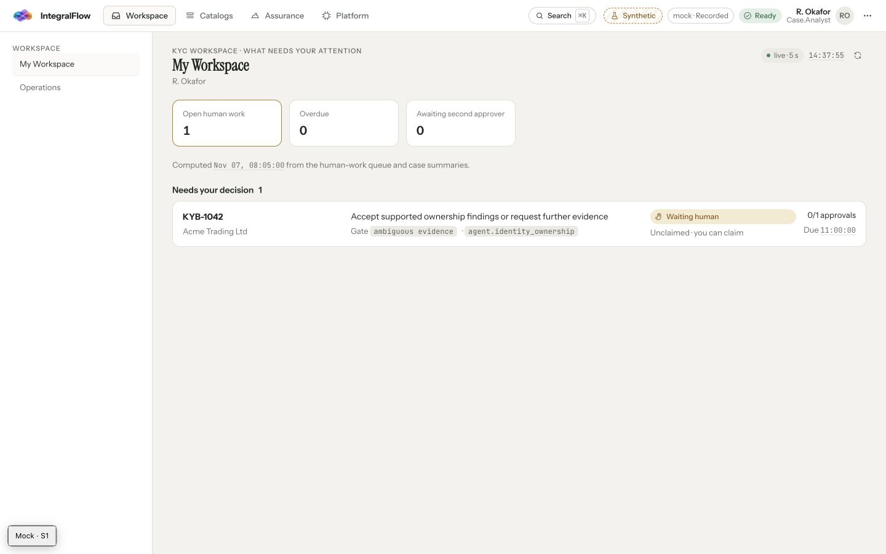

### 2. Catalog home — usable, counts and nouns need correction

The six catalogs and role recommendations are clear. Combined definition/binding counts are misleading, and Skills is described as a capability. Catalog tiles currently use understandable kind-level icons; deeper category/item views need richer assignments.

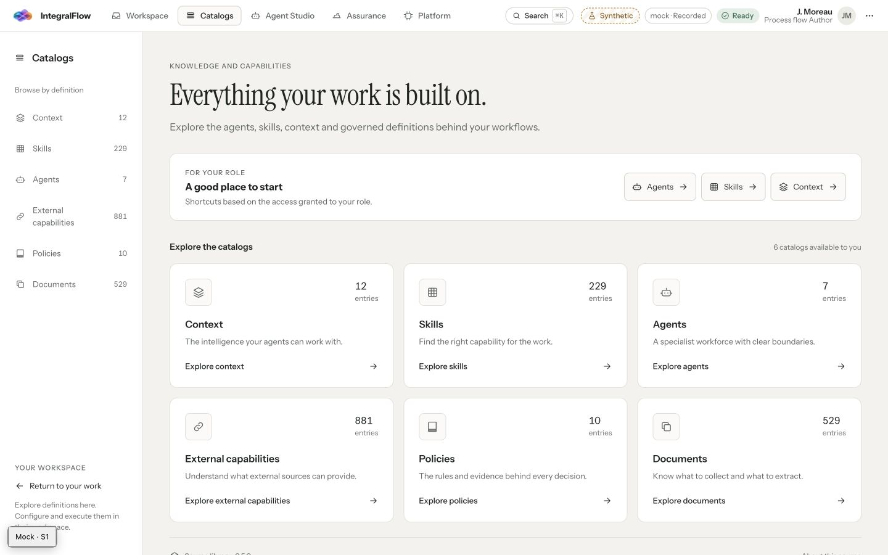

### 3. Skills — category grouping and item icons missing

The default table mixes categories alphabetically, with category only in a Domain column. “Name A–Z” must sort within category sections. Long descriptions need more row breathing room. Table captions and labels exist, but category heading semantics are absent.

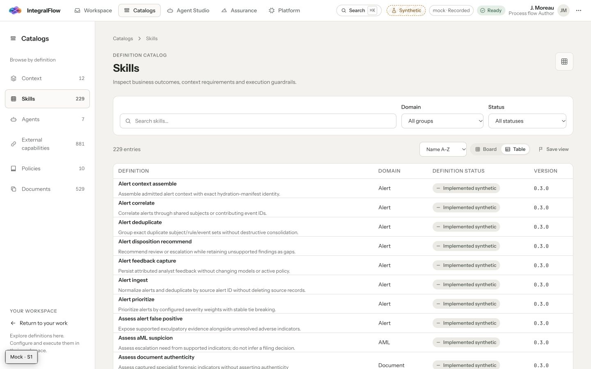

### 4. Capabilities — partial grouping; alternate view loses structure

The domain directory is a good starting point. Every domain repeats the layers icon. Switching to Table preserves category cell values but removes category sections, even when sorted by Group. Both the directory and table need meaningful icons and consistent category boundaries.

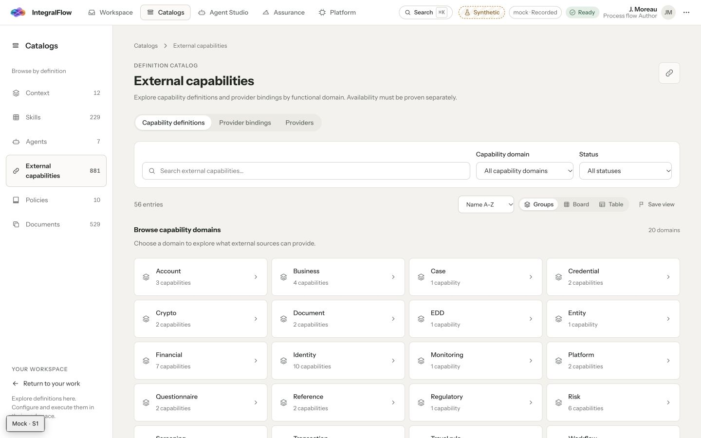

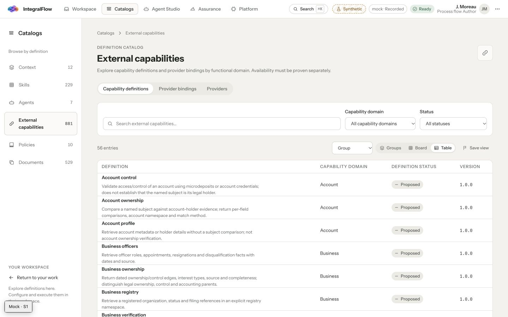

### 5. Search — functional in mock, grouping and semantics need work

The palette can find skills, tasks, context, agents, and external capability entries. Ownership and Screening skill results share a kind-only block. Capability definitions and bindings share the same result block. Category text is a subtitle, not a heading/group. Category/result-type labels are marked `presentation`; add named group semantics and verify keyboard navigation with long lists.

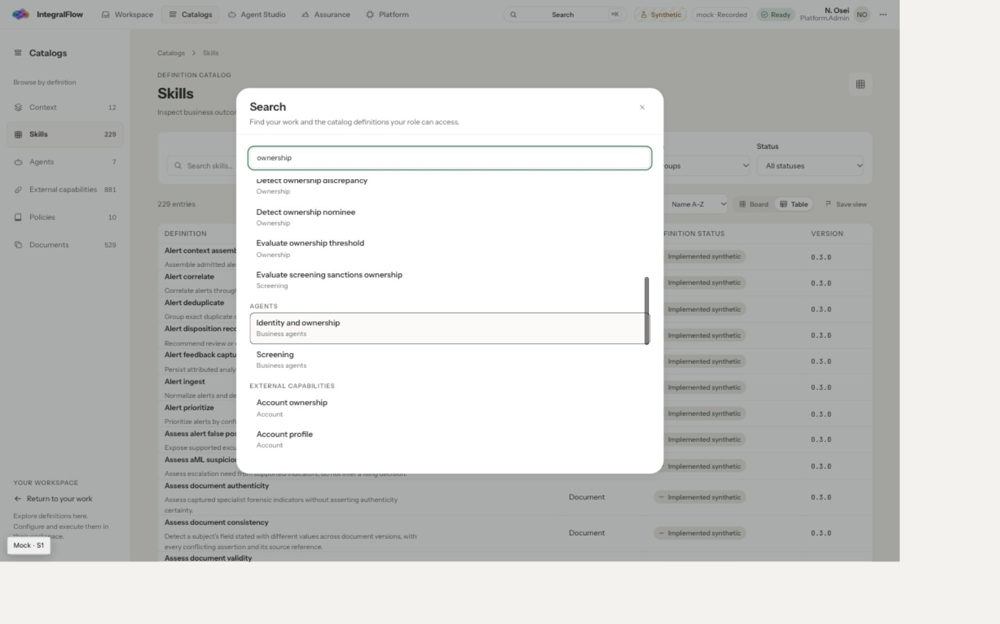

### 6. Agents — navigable with keyboard, naming and skills need alignment

The loaded atlas exposes mandate sentences as card headings, while search/catalog use short names. The profile repeats that long sentence as its main heading. Allowed skills are a flat list of canonical IDs without category icons. Keyboard activation reached the profile and showed a visible focus ring; pointer activation of the atlas link did not navigate in this tooling session, so pointer behavior needs a normal-browser reproduction before assigning an application defect.

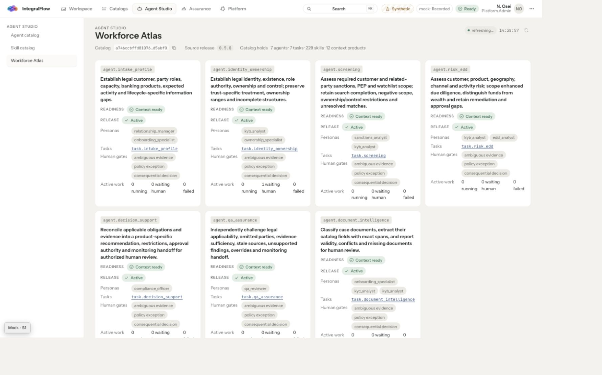

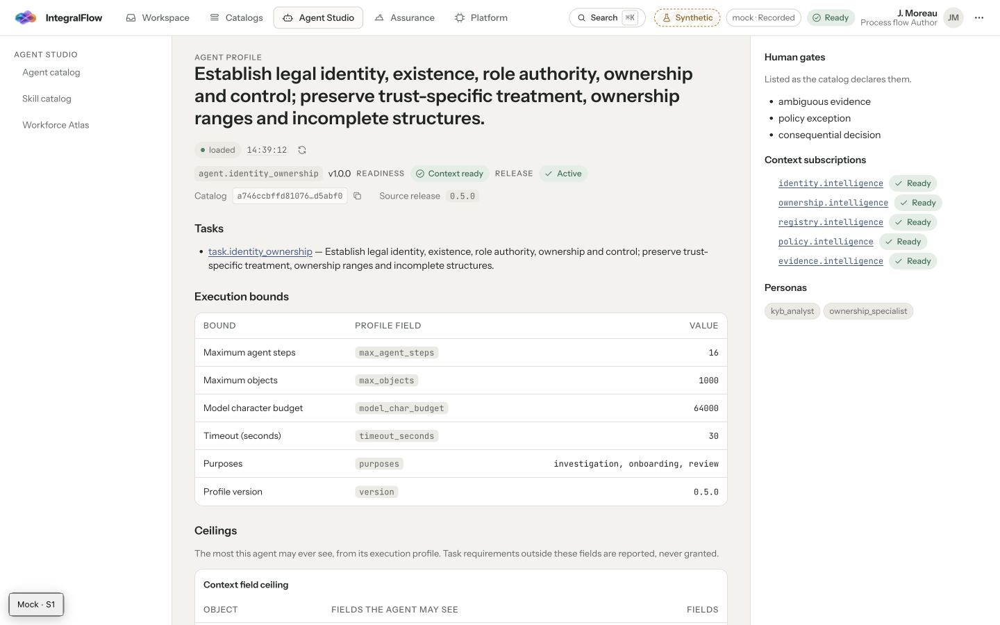

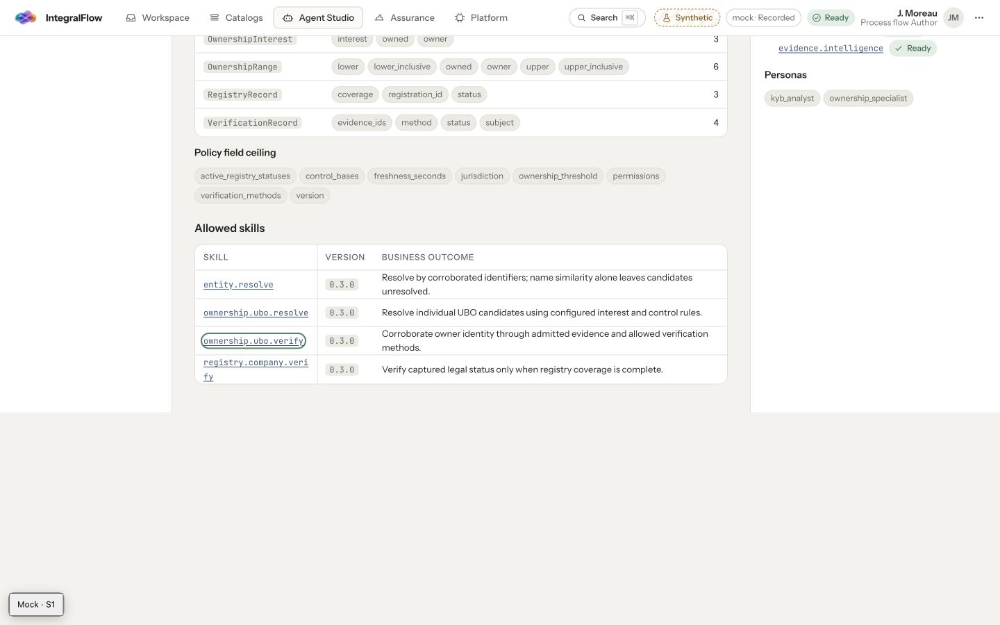

### 7. Context — structured, readability and language need work

Subject/Sources/Governance grouping is a useful existing pattern. The ontology graph is dense at its initial fit, with small text and an empty inspector occupying width. Ontology, object-list, and access-bank concepts plus Play/Tune/Engineer labels add interpretation effort. Descriptive labels and readable initial focus would help. Code inspection found flat consuming-skill and gateway-capability lists in related views; those were not all clicked through.

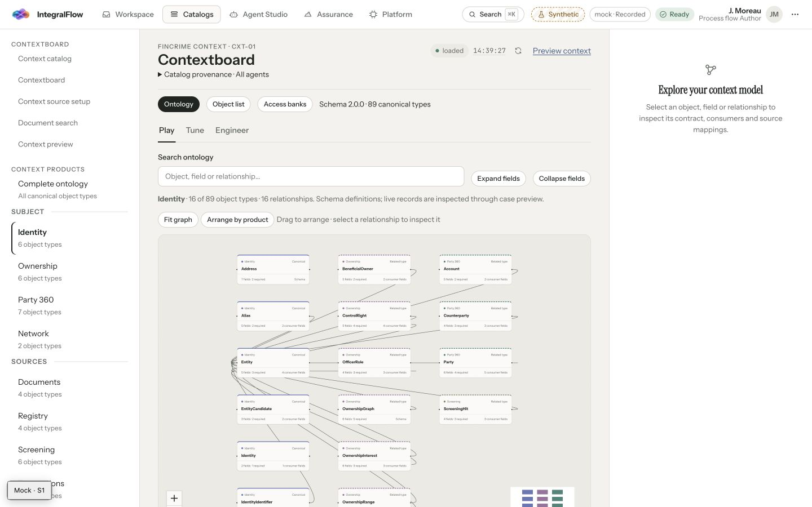

### 8. Platform — duplicate navigation; HTTP data paths blocked

Administrator navigation displays Intelligence twice. The mock overview also shows Active runs 4 alongside an empty active-run table; this is a fixture/projection consistency issue to reconcile, not evidence of live runtime state. The existing visual treatment distinguishes synthetic/recorded data, but the underlying overview/run reads need BFF registration before HTTP acceptance.

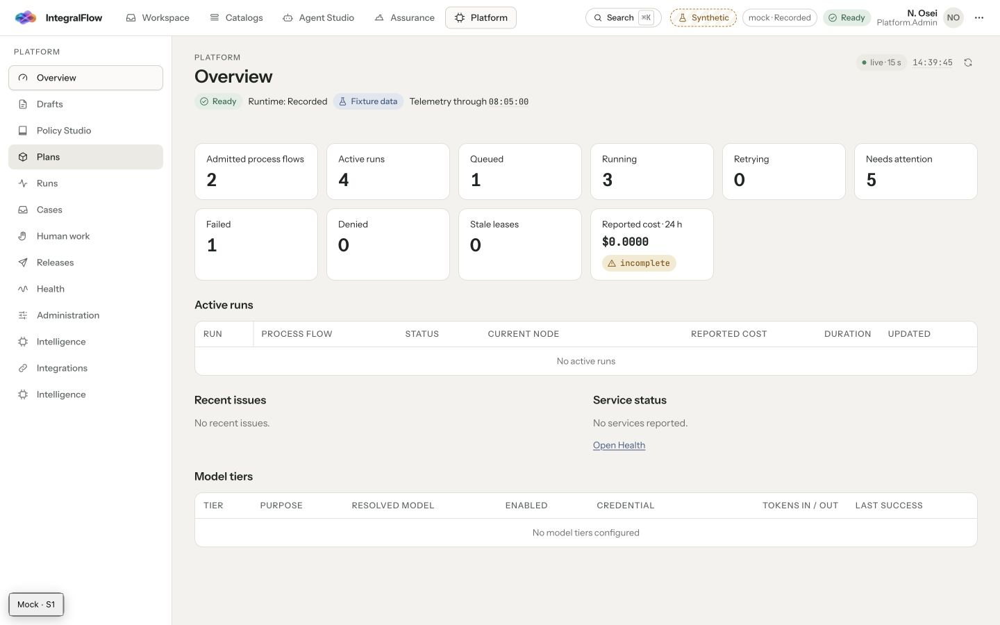

### 9. Mobile skills — page fits, discovery and table reading need improvement

At 390px, document and body widths both measured 390px. Navigation and the data table scroll within their own areas. The page-level fit is good; hidden columns/navigation destinations need stronger continuation cues. Toolbar actions wrap. This capture does not establish 200% zoom or full accessibility compliance.

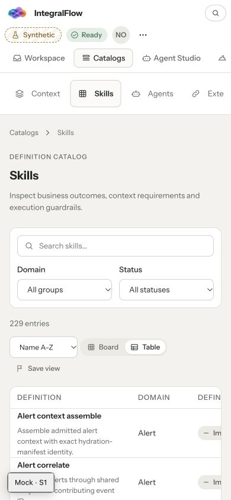

## Token and accessibility conclusions

The token source/vendor JSON hashes match. Thirty authored UI CSS files use 151 generated tokens; no literal color lines were found in that CSS scope. That is a good base. The two unresolved design-token names, direct palette uses, local geometry, and selection/success semantics still need repair. `--extraction-width` and `--object-color` are intentionally provided by TSX and must not be reported as missing global tokens.

Observed strengths include visible focus, labels, semantic tables, synthetic-state disclosure, and decorative icons hidden from assistive technology by default. Risks include absent category semantics, very small fitted graph text, dense descriptions, and horizontal content discovery. Contrast ratios, screen-reader announcements, all keyboard interactions, 200% zoom, reduced motion, high contrast, and compact density have **not** been fully validated. No WCAG compliance claim is made.

## Verification and reproducibility

- `python3 docs/audits/2026-11-09-ui/inventory.py` — completed; category/assets/tokens/source-link inventories generated.
- `node docs/audits/2026-11-09-ui/check-wiring.mjs` — completed; actual Fastify registrations plus local injected missing-route/auth/outage probes recorded. The wrapper bundles with the same ESM strategy used by the service build script.
- `node docs/audits/2026-11-09-ui/preview.mjs` — current-source mock preview, temporary output only; used to capture the reviewed screens.
- Existing focused BFF Vitest suites — could not start because of the installed `picomatch` runtime failure. They are not reported as passing.
- Normal Vite and direct tsx — failed as described above; no application-code repair was made as part of this audit.
- No deployments, external messages, production mutations, or commits were made.

Implementation should begin with route coverage/auth-path repairs and the category/icon presentation registry, following [PLAN.md](PLAN.md).
