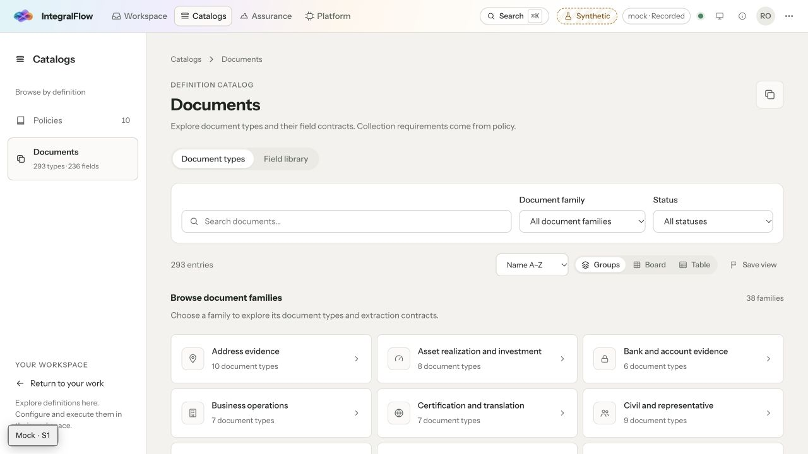
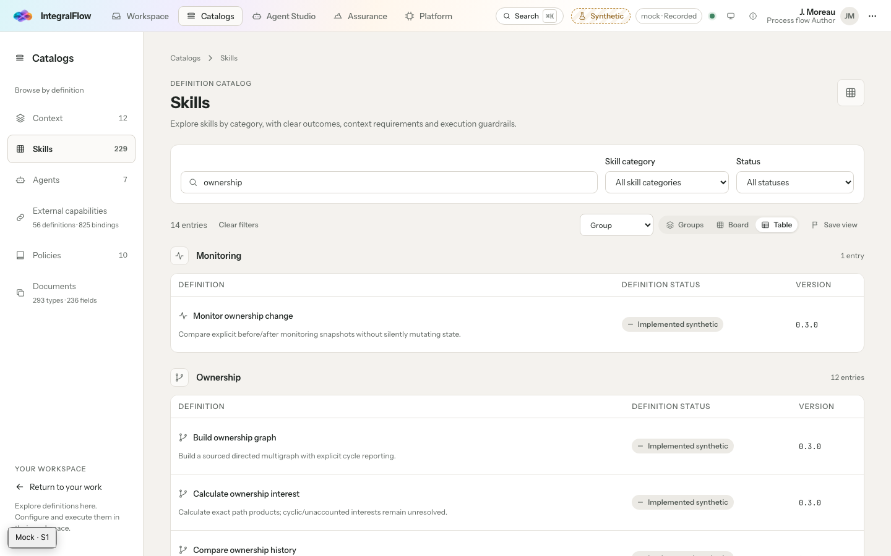
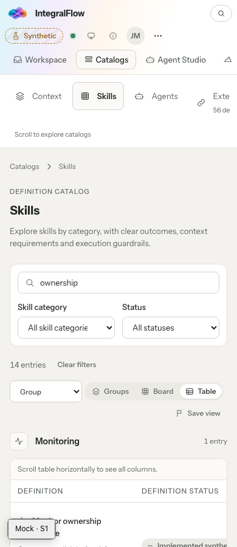
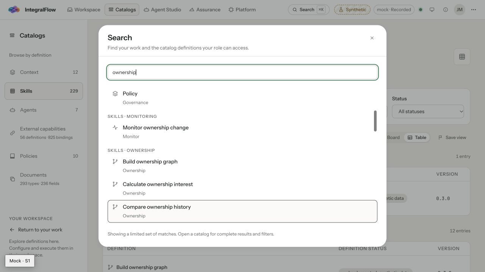

# UI implementation and acceptance

2026-11-09 · shared workspace implementation snapshot · source release 0.5.0

This report preserves the implementation acceptance before PR isolation. See [PR validation](PR-VALIDATION.md) for the final branch scope and checks against current `main`. The historical build manifest and check results below refer to that earlier workspace snapshot.

The approved [audit plan](../PLAN.md) is implemented across the catalog, search, Agent Studio, context, authoring, platform, shared controls, client and BFF. The original audit remains the before-state. This report describes the resulting behavior and distinguishes implemented service wiring from explicitly unavailable projections.

[Build provenance](build-manifest.json) records the checkout head, artifact digests and hashes of 301 relevant source files. [Check results](checks.json) retain the full-run and focused-rerun outcomes separately.

Local preview: http://127.0.0.1:5302/catalogs/skills?view=table&q=ownership (fixed build, recorded mock mode). The retained browser tab uses J. Moreau, the author persona; a fresh tab can select that persona from the Mock toolbar. HTTP production build: `/tmp/ehf-ui-polished-build`. No commit, deployment or production mutation was performed. The checkout already contained substantial unrelated work; it was preserved.

## Result against the audit

| Findings | Result |
| --- | --- |
| UI-01–02: category structure | Skill categories and capability domains persist through directory, board, table, filtering, sorting, saved views and pagination. Categories sort consistently; member sorting stays within the category. Partial category counts disclose shown versus matching entries. |
| UI-03: icons | All 229 skills, 56 capability definitions and 825 provider bindings resolve to descriptive icons from the existing outline family. The generated presentation registry covers all 1,668 catalog identities. Category inheritance is intentional; it does not imply 1,110 distinct drawings. |
| UI-04: search | Named type/category result groups, capability definition/binding separation, icons and keyboard selection with scrolling. Search discloses its bounded result set. Typed inventory links preserve the correct destination. |
| UI-05: other collections | Shared grouping adopted for agent allowed skills, task skill inventory, related references, context consumers/requirements, capability registries, authoring pickers and provider bindings. Ordered execution graphs retain execution order; their grouped inventory is separate. Unresolved IDs remain visible under Other. |
| UI-06: BFF | All 171 originally audited non-mock operations have actual handlers at client-addressed URLs. The final inventory also includes four context operations added concurrently in this shared checkout. Reviewed compositions/relays replace missing routes. Eighteen operations have explicit unavailable responses, listed below; they are not successful data responses. |
| UI-07: auth | Auth uses the BFF's unprefixed `/auth` base and CSRF protection. Failed sign-out keeps the workspace and session state; successful acknowledgement clears the query cache and ends the session. The account menu closes when sign-out is selected. |
| UI-08: source isolation | Catalog home no longer requires the external-binding registry to load independent catalogs. Binding overlays are fetched only for the relevant inventory. |
| UI-09: navigation | Duplicate Intelligence navigation removed. Catalog workspace and relationship destinations pass the source inventory check. Older admitted-plan deep links search admission pages instead of returning a false first-page 404. |
| UI-10–11: counts and identity | Definitions/bindings and document types/fields have separate counts. Agent headings use short authored names, mandates support the heading, and technical identifiers remain available as secondary information. |
| UI-12–13: tokens | Undefined font/spacing references fixed. Authored CSS uses semantic roles for actions, selection and graph edges. Selection no longer suggests success. Measured muted-text contrast corrected in the token source. |
| UI-14–16: alignment and reflow | Content-aware table row padding, consistent icon/identity alignment, readable initial ontology focus, bounded table scrolling and visible navigation/table continuation cues. Mobile inspector sheets retain Escape/focus restoration. Mapping graphs label both database and API resources using their actual source identity. |
| UI-17: copy | Shared skill/capability terminology, authored titles, awaiting-review status, synthetic-data labels, destination-specific actions and mode-specific preview guidance. Ordinary unavailable states explain the next step; technical details remain inspectable. |
| UI-18: proof of wiring | Route coverage tests inspect Fastify registrations. Representative real HTTP tests exercise delegated headers, authorization, catalog→agent→skill navigation, conditional responses and unavailable errors. Readiness reports registration scope and does not claim upstream health was probed. A broader browser regression also found and fixed missing affected-read refresh after a revision conflict, preserving local edits while showing the current server revision. |
| UI-19: assets | Preserved source artwork; added size-appropriate chrome, sign-in and About exports. Chrome/sign-in imports fell from approximately 2.79 MB to 268,796 bytes, a reduction of about 90%. About's source PNG fell from 1,546,639 to 623,395 bytes. Original artwork remains available. |
| UI-20: toolchain | Restored the normal Vite, Vitest and contract-generation workflow. Mock-worker resolution is anchored to its owning package. Local package-store copies are excluded from test discovery. |

## Document icon follow-up · 2026-11-09

Document presentation now assigns descriptive outline icons to all 38 document families and 18 field sections, covering 293 document types and 236 fields. Directory tiles, category headings, cards/tables, detail inspectors, related references and search share the mapping. The source-coverage checks and document browse/drill-down browser check pass. Web type checking also passes after correcting an existing nullable-resource guard in the API source editor.



## BFF behavior

The shared relay preserves verified identity, tenant, delegation, purpose, correlation, CSRF, conditional requests, idempotency and upstream errors. Literal action suffixes such as `:activate` and `:verify` now register as literal URL suffixes in Fastify. Binary export bytes and download headers survive both transport layers.

Service-backed compositions now cover catalog/agent/skill/task reads, plans/runs/execution/events, case lists and details, case room/attention/decision projections, documents and version-bound reviews. Human commands obtain actor and authority from verified server state. Case creation requires the admitted release's unique published policy authority; it does not select an arbitrary policy pin.

Unavailable gateway traffic/denial metrics and connection tests are null and read as “Not reported.” Source-only agent definitions do not fabricate runtime activity or publication status. This is separate from mock mode, which remains clearly synthetic.

### Explicitly unavailable operations

These 18 contracts return a correlated, nonretryable 501 after authorization. Each has an owner and actionable explanation. No generic catch-all serves fixture successes in HTTP mode. Their exact operation IDs, actions and user guidance are in [verification.json](verification.json).

| Owner | Unavailable function | Operations |
| --- | --- | ---: |
| Deployment platform | Runtime deployment administration, managed outside the console | 2 |
| Platform experience | Combined operational overview totals | 1 |
| Platform observability | System telemetry and trace-store reader | 2 |
| FinCrime assurance | Mission Control aggregate, lineage, combined recorder, causal links and recorder entry detail | 5 |
| FinCrime evidence projections | Ownership workbench and contradiction comparison | 2 |
| FinCrime screening | Screening workbench and watchlist comparison | 2 |
| Document execution | Document-only extraction rerun requiring a configured plan and authorization | 1 |
| Presentation platform | Generated presentation catalog, case surfaces and event collection | 3 |

These exclusions use the plan's explicit implementation-or-retirement option. They remain upstream product work, with canonical case, evidence, plan/run and environment-tool alternatives described in the UI. Route coverage must not be read as 171 completed business features.

## Verified checks

| Check | Evidence/result |
| --- | --- |
| Source inventory | [verification.json](verification.json): 1,110/1,110 skill/capability entries mapped; no missing icons, undefined CSS tokens, direct graphite/porcelain/emerald palette references, unmatched catalog workspace links, dangling relationships or duplicate platform nav IDs. 175 registered non-mock operations; 18 explicit unavailable operations. |
| Contrast | [contrast.json](contrast.json): all 24 measured base text/surface pairs across light and dark modes meet 4.5:1. This is a bounded token check, not a claim that every possible state is conformant. |
| Unit suites | 45 files / 213 tests pass across UI contracts, client, mock, tokens, kit, shell, web and BFF. BFF tests include real HTTP transport with local upstream test services, actor/tenant isolation, authority completion, binary/error responses, literal action paths and plan pagination. |
| Browser acceptance | 147 unique acceptance checks verified; two dedicated live-context tests skipped without their environment. The complete run passed 146 checks and found one outdated jurisdiction-copy assertion. That assertion was corrected, strengthened to verify the submitted case type, and passed a focused rerun alongside responsive/compact checks (3/3). Exact full-run and rerun totals are in [checks.json](checks.json). Coverage spans catalogs, agent, context, case, document, authoring, platform, shell and theme journeys. |
| Layout | Grouped table captures at 1440, 1200, 768 and 390 CSS pixels; additional 320px navigation/detail-sheet check. A 720×450 CSS-pixel check exercises 200%-equivalent reflow from 1440×900 with compact-density tokens, filter/selection, Escape and focus restoration. It does not certify browser-specific native zoom controls. |
| Types | Web, experience BFF, control API and case API type checks pass. |
| Contracts | 1,086 validation checks, zero failures; Redocly lint clean; generated pack/presentation sync current. The route scanner includes the concurrently added case-context route module. Historical source drift stays explicitly acknowledged under GAP-015 rather than silently repinned. |
| Production build | HTTP-mode Vite build and BFF service build pass; bundle scan excludes mock code. |

### Reproduce

Use a standard supported Node installation. This machine's default `node` shim was unreliable; verification used `/opt/homebrew/opt/node/bin/node` (26.5.0). Python contract validation needs PyYAML, jsonschema and referencing; the local audit environment is `/tmp/ehf-ui-tools`.

```sh
node scripts/ui-sync.mjs --check
node --import tsx docs/audits/2026-11-09-ui/implementation/verify.mts
pnpm ui:contracts
pnpm ui:test
WEB_E2E_PORT=5302 pnpm ui:test:e2e
pnpm --filter @ehf/web typecheck
pnpm --filter @ehf/experience-bff typecheck
pnpm --filter @ehf/control-api typecheck
pnpm --filter @ehf/case-api typecheck
pnpm --filter @ehf/web build
node scripts/build-service.mjs experience-bff
git diff --check
```

The unit test runner was invoked from each owning package so its configured environment applied. The HTTP web build used the temporary output directory above because macOS File Provider prevented emptying the existing local `dist` directory. Dependencies were restored with the frozen lockfile and an isolated package store; that local environment repair does not change the product dependency versions. The mock validity matrix explicitly recognizes the two new live case-context reads' `503 context.service_required` boundary instead of fabricating source-binding/pull data; other unexpected errors still fail it.

Concurrent context-contract edits invalidated earlier generated outputs, and the live Vite server reloaded during stateful checks. Final browser acceptance therefore uses the fixed mock build at `/tmp/ehf-ui-polished-preview`, served on 5302. Its service worker was copied into that temporary mock artifact only; the HTTP production build excludes it. Earlier interrupted/failed runs are diagnostic history, not the final acceptance result.

## Accepted visual evidence

1. **Desktop grouped skill table — healthy.** Authored skill names, descriptive category/item icons, semantic category headings, aligned rows and explicit definition/binding/type/field counts. Filtering retains category structure.



2. **Mobile grouped table — healthy with intentional internal scrolling.** The page fits 390px; navigation and table scrolling have visible continuation cues. Filters and view controls reflow; additional columns remain reachable in the table's scroll region.



3. **Grouped keyboard search — healthy.** Skill category headings remain visible while keyboard selection scrolls to the active match. Names, icons and the bounded-results disclosure align with the catalog.



Other retained captures: [final browser preview](screenshots/03-final-preview.png), [1200px](screenshots/skills-1200.png), [768px](screenshots/skills-768.png). The earlier manual search capture is intermediate evidence and is not used to claim the final copy is verified.

The provider wizard was also inspected through capability selection and review in the final fixed build. An adapter's unmapped runtime capability remained explicitly under Other with an icon in both steps. The temporary review draft was cancelled; no connection was saved.

## Limits and remaining work

No production tenant, external provider, live SSO identity provider or deployed service health was certified. The HTTP journey uses actual sockets and the production BFF transport against controlled local upstream services; additional projection tests inject canonical service records. Mock acceptance proves interaction behavior, not production integration. The dedicated live-context browser checks remain environment-gated.

Legacy frozen plan view fields still limit precise representation of undeclared per-node cost/timeout values; global admitted-plan budgets are the values displayed in the UI. A future pack migration should make unreported legacy node limits nullable. Search is bounded and does not claim a complete cross-service index. Advanced projections in the availability table require their owning services.

Accessibility checks include semantic grouping, keyboard/focus flows, automated serious/critical axe checks on representative journeys, token contrast and responsive reflow. A complete screen-reader, high-contrast, reduced-motion and browser-specific zoom assessment remains separate work; no blanket WCAG compliance claim is made.
