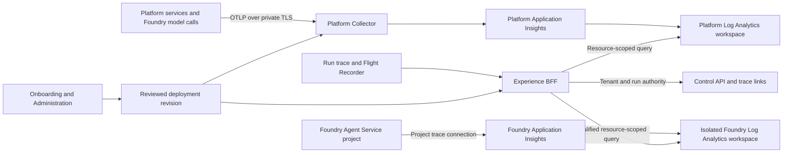

# Azure observability and Foundry tracing

Architecture design · 2026-11-12 · [Implementation and rollout plan](azure-observability-plan.md)

Use workspace-based Application Insights for Azure trace ingestion and Azure Monitor Logs for trace reads. Show platform spans and correlated Foundry spans in the existing run trace waterfall. Configure the destination during onboarding and show its effective configuration and verification in **Platform → Administration → Settings → Observability**. Keep the existing Jaeger recipe for local Compose and support a time-bounded legacy reader during Azure migration.

## Pre-migration behavior

| Surface | Current implementation | Gap |
| --- | --- | --- |
| Export | Services use the shared `@ehf/telemetry` OTLP bootstrap. Azure foundation already provisions a workspace and Application Insights and can deploy an internal Collector with the `azuremonitor` exporter. The standalone Azure bootstrap resource recipe still creates an in-memory Jaeger app. | Use one Application Insights recipe across Azure installation paths and verify the actual export end to end. [Telemetry bootstrap](../../packages/telemetry/src/index.ts), [Azure foundation](../../deploy/azure/foundation.bicep), [bootstrap Collector](../../deploy/azure/bootstrap.bicep), [resource executor](../../scripts/provision-azure-resources.mjs) |
| Trace reads | The Experience BFF calls Jaeger's JSON API after control-api confirms trace ownership. The Azure runtime recipe supplies an OTLP endpoint and does not wire a trace reader. The trace waterfall is shared by the platform trace page and Flight Recorder. | Add an Azure reader behind the same authority and normalized trace contract. [Trace route](../../apps/experience-bff/src/trace-experience.ts), [trace authority](../../apps/control-api/src/app.ts), [runtime recipe](../../apps/launcher/src/recipes/azure.ts), [waterfall](../../apps/web/src/platform/surfaces/runs/trace-waterfall.tsx) |
| Foundry | The Azure setup creates or connects a Foundry account and model deployments. The `azure_foundry` choice resolves to OpenAI v1 model inference. The intelligence catalog lists `azure_foundry_agents` as unimplemented. The gateway already emits GenAI span attributes for model calls. | Make the model call visible immediately. Qualify and implement the Agent Service invocation path for native agent and tool spans. [Intelligence catalog](../../packages/contracts/src/intelligence.ts), [Azure resources](../../scripts/provision-azure-resources.mjs), [gateway](../../apps/capability-gateway/src/app.ts) |
| Setup and health | The wizard stores a single collector endpoint. Administration already has an Observability settings section and locks infrastructure settings under the production profile. System Health can probe whether the OTLP receiver accepts an empty export. | Show the read backend, Foundry project connections, active deployment revision, and separately verified ingestion and query health. [Deployment profile](../../packages/contracts/src/deployment.ts), [admin policy](../../apps/control-api/src/admin-config.ts), [health probe](../../apps/control-api/src/platform-operations.ts) |

## Architecture

- Retain the existing service instrumentation, W3C trace context, and parent-based sampling. Route through an internal Collector with bounded memory and queues, batching, redaction, and export health. Use its existing Azure Monitor exporter for approved connection-string ingestion. Keep the connection string in a deployment secret reference. For Entra-only platform ingestion, qualify an identity-capable ingress path such as Azure API Management authenticating to Application Insights with its managed identity. The existing Collector exporter alone cannot satisfy that policy. Keep native Azure OTLP ingestion out of the default recipe while it is in preview. [Collector authentication](https://github.com/open-telemetry/opentelemetry-collector-contrib/blob/main/exporter/azuremonitorexporter/AUTHENTICATION.md), [Application Insights connection strings and proxy](https://learn.microsoft.com/en-us/azure/azure-monitor/app/connection-strings), [native OTLP ingestion](https://learn.microsoft.com/en-us/azure/azure-monitor/containers/collect-use-observability-data)
- Reuse the platform Application Insights component and workspace if qualified. Give Foundry projects dedicated Application Insights components by default and reuse a project's approved existing destination where possible. The components can share a workspace when retention, region and content policy allow it. Use separate workspaces where required by those policies. Query each registered component by ARM resource ID with resource-context access. Keep production and test destinations distinct. [Azure Monitor log access](https://learn.microsoft.com/en-us/azure/azure-monitor/logs/manage-access)
- Preserve the current Container Apps log pipeline and platform health signals. The first release adds trace ingestion, trace queries and trace health. Diagnostic logs for Foundry Models can be connected separately after content review. Logs and evaluation data do not populate span rows. [Foundry diagnostic logging](https://learn.microsoft.com/en-us/azure/foundry/how-to/diagnostic-logging), [existing observability architecture](identity-authorization-observability.md)
- Use an explicit BFF query managed identity with resource-scoped log read permissions on approved components. Grant the collector or ingestion proxy, Foundry project identity, and hosted-agent identity only the ingestion access each needs under the chosen auth mode. Use the existing scoped executor for resource and role changes. Keep deployment authority separate from the BFF and runtime identities. Foundry Agent Service project-managed-identity ingestion is documented as preview, so qualify it separately for deployments that permit it. [JavaScript Logs Query client](https://learn.microsoft.com/en-us/javascript/api/overview/azure/monitor-query-logs-readme?view=azure-node-latest), [Foundry Entra ingestion](https://learn.microsoft.com/en-us/azure/foundry/observability/how-to/trace-ingestion-entra-authentication)

## Foundry traces

### Existing Foundry Models calls

Instrument the actual outgoing inference path used by `packages/adapters` and the gateway, including model calls from Workbench and the document adapter path where it uses a Foundry model. Identify Foundry from verified provider metadata carried through deployment configuration. The deployed provider can use the generic OpenAI-compatible kind. Use one client span per outbound call attempt beneath the existing gateway or Workbench span. Record the operation, deployment/model, elapsed time, status, error category, and token counts when reported. Capture the provider response or request ID for correlation when the API returns it. Propagate `traceparent` and `tracestate` only to the qualified provider origin. Disable baggage and prompt, message and tool-payload capture.

The platform can verify these client spans with the existing model inference test extended to read a unique synthetic span back from Application Insights. Label them **Foundry model call**. A model deployment at `/openai/v1` does not establish a Foundry Agent Service trace connection. Count any native telemetry from model inference only once a supported source and deterministic correlation have been demonstrated for that endpoint. [Foundry client-side propagation](https://learn.microsoft.com/en-us/azure/foundry/observability/how-to/trace-agent-client-side), [Foundry model monitoring](https://learn.microsoft.com/en-us/azure/foundry/foundry-models/how-to/monitor-models)

### Native Foundry Agent Service traces

A Foundry Agent Service project emits server-side traces to its connected Application Insights component. The [ehf-test pilot](azure-observability-plan.md#foundry-pilot-evidence) verified W3C parent propagation and exact response IDs for a prompt agent on its dedicated Responses endpoint. Use that endpoint for the first adapter. Instrument client-executed functions as client spans, since the pilot's local tool ran outside Foundry and had no native tool span. Add a narrow invocation path through the existing intelligence/runtime adapter boundary. Qualify hosted agents against their own response IDs, identity and span schema before advertising hosted-agent support. Keep the Foundry project and agent identifiers distinct from the account model endpoint. Provision or connect the project and check the actual trace connection in Azure. Reuse a matching connection and surface a conflict if it points elsewhere. [Foundry server-side setup](https://learn.microsoft.com/en-us/azure/foundry/observability/how-to/trace-agent-setup), [hosted-agent tracing](https://learn.microsoft.com/en-us/azure/foundry/observability/quickstarts/quickstart-tracing-hosted-agent)

1. Persist a restricted correlation record for each authorized agent invocation as part of its existing execution or receipt path. Record tenant, run, attempt, parent trace/span IDs, approved project binding revision, agent identity, provider response ID when returned, and invocation times. Use an idempotent attempt key, validate the IDs, and store no provider payload. Retain sufficient provenance to query the original connection after a redeploy. Scope writer and reader permissions to these operations.
2. Resolve correlation records only after control-api confirms the caller owns the platform trace and any associated run attempt. For a qualified endpoint, first resolve native roots that use the same W3C operation and demonstrably descend from the recorded outbound span. For independent trace IDs, match the exact response ID inside the recorded project/component and a bounded invocation interval, then fetch that native operation. Qualify `gen_ai.response.id` for prompt agents and check `azure.ai.agentserver.response_id` and request-level agent identity for hosted agents. Conversation ID and time are context for diagnosis. Ambiguous matches or an absent anchor yield **Uncorrelated**. [Foundry trace setup and Response ID lookup](https://learn.microsoft.com/en-us/azure/foundry/observability/how-to/trace-agent-setup), [hosted-agent trace lookup](https://learn.microsoft.com/en-us/azure/foundry/observability/quickstarts/quickstart-tracing-hosted-agent)
3. Show native children in the platform waterfall when parent IDs are proven. Show a separately timed **Linked Foundry trace** on the invocation when only the response ID establishes a link. Preserve the native root and parent IDs, including gaps from sampling. Only expose associated native traces through the authorized platform trace response or a drill-down that repeats the same authority check. The provider's operation ID alone grants no access.
4. Model source-specific states as **Pending ingestion**, **Available**, **Partial**, **Uncorrelated**, **Expired** when retention is known, and **Unavailable**. An agent call that fails before a provider ID is returned still shows its platform error span. A failed Foundry query leaves the platform trace usable. A model-only environment shows **Model calls** and can later add an Agent Service project.

### Foundry content and access

The platform Collector can scrub platform spans. Native Agent Service telemetry is written directly by Foundry and has its own data-handling controls. Verify what the selected agent type stores with synthetic sentinels before sending production inputs. Use a dedicated approved destination, apply `AppGenAIContent` table protection where supported, and verify the effective subscription routing policy. Microsoft's documented migration changes newly ingested content. Historical rows and deployments that opted out can still contain content in ordinary properties. The `ehf-test` pilot found synthetic content markers in ordinary dependency properties, so treat newly provisioned Foundry destinations as capable of holding inline content until the deployment check proves otherwise. The BFF reads only operational columns and allowlisted scalar attributes. It never needs the privileged content-reader role. An Azure portal or Foundry viewer link requires separate Azure authorization and should be omitted by default for shared destinations. Allow native production tracing only when the verified storage, access and content behavior meet deployment policy. [Foundry data handling](https://learn.microsoft.com/azure/foundry/observability/concepts/trace-data), [sensitive-content protection](https://learn.microsoft.com/en-us/azure/foundry/observability/how-to/traces-sensitive-content)

## Azure trace reader

- Extract a reader boundary from `trace-experience.ts`. Select the active adapter from the applied environment configuration. Keep Jaeger transport behavior and legacy trace ID compatibility. For Azure, require valid nonzero W3C trace IDs and typed inputs derived from control-api. Browser callers supply the platform trace ID. The browser receives the same normalized waterfall, with additive source/availability information for Foundry.
- Use the Logs REST resource-context endpoint with a dedicated managed identity against reviewed Application Insights ARM IDs. Use fixed KQL templates with strictly validated literals, explicit resource, trace and UTC time bounds, projected columns, span caps, and a short server/client deadline. Derive the query window from the authorized run/attempt data and the configured retention. Use Application Insights `requests` and `dependencies` in the component-scoped query, as confirmed in the `ehf-test` pilot. Normalize `name`, `operation_Id`, `id`, `operation_ParentId`, `timestamp`, `duration`, `cloud_RoleName`, `success` and allowlisted values in `customDimensions` to the trace contract. Workspace diagnostics use `AppRequests` and `AppDependencies` with `Name`, `OperationId`, `Id`, `ParentId`, `TimeGenerated`, `DurationMs`, `AppRoleName`, `Success` and `Properties`. Normalize duration and ID formats using fixtures from the query context and exporter actually in use. [Application Insights data model](https://learn.microsoft.com/en-us/azure/azure-monitor/app/data-model-request-telemetry), [AppRequests schema](https://learn.microsoft.com/en-us/azure/azure-monitor/reference/tables/apprequests), [AppDependencies schema](https://learn.microsoft.com/en-us/azure/azure-monitor/reference/tables/appdependencies)
- Deduplicate by source, operation and span ID, flag conflicting rows, detect cycles and keep valid orphan spans visible. Include completeness markers on result caps or Azure partial failures. Limit concurrency and back off on throttling. Report backend failure, known sampling, ingestion delay and expiry through the authorized trace view where evidence supports each state. Keep unknown and unauthorized lookups indistinguishable and issue zero Azure queries on either path. Keep the response private with `Cache-Control: no-store`.
- Restrict the platform query to the approved platform component and trace, then enforce authorized run/attempt anchors. Where one operation can contain work across tenants, allow only demonstrably owned subtrees or reject the ambiguous operation. Treat Azure dimensions as diagnostic metadata. Resolve access through the existing control-plane ownership data before the query and validate returned rows against the authorized scope. Project safe labels in addition to allowlisted attributes, because a span name, URL or exception message can contain payload.
- Keep ledger events, receipts, run attempts and the durable trace index independent of telemetry availability. OpenTelemetry sampling, retention and backend health have no effect on business execution or audit records. Operational trace health alerts can be computed without prompting an agent on each status refresh.

## Onboarding and Platform Administration

| Surface | Experience |
| --- | --- |
| Onboarding → Foundation → Observability | Azure defaults to **Application Insights + Log Analytics**. Offer **Create**, **Use existing**, and **Manual setup** through the resource wizard. Show component, backing workspace, region, retention, collector endpoint and ingestion auth mode. Discovery returns scoped resource choices or accepts typed ARM IDs that the executor resolves. Reuse the foundation resources when present. Keep the existing OTLP option for operator-managed destinations and legacy profiles. |
| Onboarding → Intelligence → Foundry | Show **Model calls** from the selected model binding. Offer **Agent Service traces** when an eligible project and agent binding are available. Show the resolved project, connected component, workspace, permissions and content policy. Offer **Verify model tracing** and **Verify agent tracing** independently. The agent check invokes one nominated synthetic agent and reports whether native spans correlate. |
| Onboarding → Review and launch | Include the planned resource, connection and role changes, read/write identities and trace policy in the versioned resource/deployment plan. Record results against the applied revision. Show **Receiver reachable**, **Query authorized**, **Platform span received**, and **Foundry trace correlated** as separate results. A pending probe is resumable and distinguishes Azure lag from a configuration failure. Publish runtime health and trace qualification separately. |
| Administration → Settings → Observability | Show effective and pending configuration, source, revision, collector/backend, configured Foundry projects, applied retention/sampling and last probe results. Provide **Verify connection** and **Edit deployment**. A production infrastructure edit opens the existing deployment console with the active revision prefilled, then uses its review and deploy flow. The current generic settings write continues to enforce the production infrastructure boundary. Use `admin.read` for effective settings, `admin.write` with reason and CSRF for verification or change requests, and `telemetry.read` plus run authority for trace data. |
| Platform → Health and run views | Report receiver, Azure export/read and each enabled Foundry connection separately using cached verification results. In the run trace and Flight Recorder, show source labels and linked Foundry traces alongside the existing platform spans. Preserve run navigation for expired or missing telemetry. |

Use the versioned deployment profile and executor receipt as the source for desired and applied infrastructure. Keep `foundation.telemetryEndpoint` as a legacy input during migration and add a typed observability selection. Resolve ingestion and reading separately. The resolved binding carries the adapter, approved resource IDs, workload identity reference, collector endpoint, retention/sampling policy and Foundry project connections. Exporters and the BFF read deployed values at process startup. Include a deployment-level cutover timestamp and previous reader binding when needed for historical runs. For an authorized run that crosses the boundary, use both approved bindings within its attempt windows and deduplicate the result. Project safe read-only settings into the application at activation. Keep tenant-scoped settings from overriding environment-scoped routing, and keep secret values out of profiles, receipts, API responses and change diffs.
