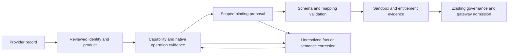

# Capability catalog organization and provider prioritization proposal

**Date:** 11 November 2026

**Status:** proposal for review; no catalog, connector, approval, or routing changes

**Scope:** the complete local provider and binding inventory, public-source research for a first priority cohort, and an implementation plan

**Baseline:** working tree at Git HEAD `d001c06be212233a3a4b694de707766163b86600`; generated Catalog snapshot release `0.5.0`, digest `28c4e15aa3a2258e7d15dd2ecdf576dea9d555c828e22a7d3aed5a5446a63482`

**Reading guide:** [Recommendation](#1-recommendation) · [Catalog findings](#2-current-catalog-what-the-numbers-mean) · [Provider research](#4-researched-provider-shortlist) · [Capability organization](#5-capability-organization) · [Implementation](#7-implementation-proposal) · [All 376 records](#appendix-a-complete-provider-record-triage) · [All 56 definitions](#appendix-b-exact-membership-of-all-56-definitions)

## 1. Recommendation

Organize discovery around **capabilities, providers, and source collections**, with provider priority separate from research confidence, jurisdiction resolution, and runtime readiness. Start with a small researched provider shortlist, keep specialists easy to find, and put the remaining candidates in an explicit research backlog.

The apparent “800+ providers” are **825 canonical provider-capability bindings across 376 provider records**. Those records include products, services, government sources, networks, and legacy brands. The catalog has **748 bindings with unresolved semantic jurisdiction (90.7%)**. This is primarily a scope and evidence problem: every binding already references a capability definition, but none is enabled and all have unknown coverage.

Adopt the following initial organization:

| Discovery lane | Provider records | Canonical bindings | Proposed treatment |
| --- | ---: | ---: | --- |
| T1 — Core shortlist | 29 | 78 | Research and display first for common integration choices; provisional selection, subject to tenant needs. |
| T2 — Specialists | 13 | 35 | Highlight a concrete regional, product, or workflow fit; promote within the relevant capability or jurisdiction. |
| T3 — Discovery backlog | 245 | 617 | Preserve searchability and provenance; research when needed or when stronger evidence emerges. |
| J — Jurisdiction, source, network, and eID review | 88 | 93 | Separate collection prioritized by jurisdiction and source role; no commercial popularity ranking. |
| H — Quarantined | 1 | 2 | Preserve the existing Finantier quarantine; remediation review required before any other promotion. |
| **Total** | **376** | **825** | Every source record receives exactly one initial research lane in Appendix A. |

These lanes are a proposed research allocation, not verified market-share tiers. **Use “Core shortlist” initially. Reserve “Most used in your organization” for measured tenant usage.** A specialist or a national authority can be essential even when it has low global usage.

This review includes a complete local census and public-source research for **49 records: 29 core candidates, 13 specialists, and 7 source/network records**. The other **327 records have local inventory review only**. The appendix makes that distinction explicit; this document does not claim 376 completed vendor due-diligence reviews or 825 verified integrations.

## 2. Current catalog: what the numbers mean

### 2.1 Inventory and confidence

| Inventory | Observed count | Interpretation |
| --- | ---: | --- |
| Provider records | 376 | 351 `organization_or_service`, 20 `product_family`, 5 `registry_or_network_family`; current types are too coarse for final source classification. |
| Distinct declared `family_id` values | 360 | A count of labels, not verified distinct corporate groups. Identity issues remain. |
| Legacy provider-capability operations | 824 | 815 proposed-only mappings; 9 fixture-tested mappings. |
| Canonical v2 bindings | 825 | One legacy operation splits into two canonical rows; counts cannot be used interchangeably. |
| Canonical capability definitions | 56 | 36 have at least one binding; **20 have no binding**. All 56 have `schema_status=not_defined`. |
| Unresolved jurisdiction | 748 / 825 | 302 / 376 provider records have only unresolved bindings. |
| Concrete proposed jurisdiction | 77 / 825 | 65 national-source hints and 12 publisher-authority assignments; all still proposed. |
| Enabled canonical bindings | 0 / 825 | Unknown coverage and approval, entitlement, schema, mapping, and acceptance blockers remain. |
| Canonical binding operation mappings | 0 / 825 | All `operation_mapping_refs` are empty. Nine legacy synthetic fixtures do not establish v2 acceptance. |
| Existing provider evidence labels | 18 reviewed; 358 candidate/unverified | Ten `public_docs_reviewed`, eight `public_material_reviewed`; these are inherited source labels, separate from research in this proposal. |
| Canonical migration rows | 811 vocabulary mappings; 12 semantic corrections; 2 conditional branches | The 14 non-vocabulary rows represent 13 legacy operations; preserve their migration blocks. |
| Generated platform connector catalog | 86 capabilities; 853 connectors | Includes 56 canonical definitions and platform-specific capabilities. Of the connectors, 824 are `wiring`; the remaining 29 are other adapters. |
| Wiring connector status | 822 `available`; 2 `quarantined`; 0 `live_ready` | `available` means registered; it does not establish production readiness. |
| Full UI source snapshot | 1,668 entries | Includes 56 external definitions and 825 binding entries, plus the other catalogs. |

The platform catalog also contains 16 non-wiring connectors marked `live_ready`. That count must not appear as evidence that any of the 825 canonical atlas bindings is live. The two inventories express different facts.

### 2.2 Where the unresolved scope sits

This table uses the provider catalog's existing categories, before the proposed reorganization. A provider contributes to its source category; each canonical binding is counted once.

| Existing provider category | Records | Canonical bindings | Unresolved bindings |
| --- | ---: | ---: | ---: |
| Identity | 94 | 274 | 274 |
| Monitoring | 33 | 99 | 99 |
| KYB | 31 | 92 | 92 |
| Screening | 26 | 76 | 76 |
| Registry | 66 | 70 | 5 |
| Fraud | 20 | 58 | 58 |
| Account | 26 | 48 | 48 |
| Crypto | 15 | 30 | 30 |
| Bureau | 13 | 26 | 26 |
| Enhanced due diligence | 17 | 17 | 17 |
| Official lists | 15 | 15 | 3 |
| Orchestration | 7 | 7 | 7 |
| Travel Rule | 7 | 7 | 7 |
| Network | 6 | 6 | 6 |
| **Total** | **376** | **825** | **748** |

The 77 concrete assignments are all in the Registry and Official lists categories. This reflects the existing backfill rules, not a verified difference in vendor quality. Commercial vendors often span many countries and datasets; a single vendor-wide country label is insufficient.

### 2.3 Why the experience is hard to understand

1. **The primary inventory unit is often a binding.** One provider appears several times. The current provider projection deduplicates by provider ID, but does not expose family grouping, public research evidence, or provider tiers.
2. **“Canonical” and “scope established” are being read as the same thing.** `identity.document` can be defined while a particular provider/product's issuer scope remains unknown. The current UI already uses “Not established” for `unresolved`; retain that distinction and expose the actual blockers.
3. **Coverage, source jurisdiction, and commercial reach are different fields.** “Global” marketing coverage cannot fill a canonical jurisdiction or a tenant's approved scope. A headquarters address cannot do so either.
4. **The seed catalog assigns broad capability bundles.** Fingerprint, MaxMind, and Twilio Lookup each have device, email, and phone bindings locally. Research below supports narrower product-specific conclusions. Each operation needs its own evidence rather than inheriting a category's bundle.
5. **Family relationships need reconciliation.** The source uses `moody-s-compliance` for the main Moody's record, while Orbis and kompany use `moodys-compliance`. Resolve this through reviewed identity relationships, preserving record IDs. The 360 family labels are therefore provisional.
6. **Defaults reflect implementation convenience.** `sync-connector-catalog.mjs` ranks fixture/native implementation support and then connector ID, with explicit overrides. That is useful for the current platform but is not a popularity ranking. Discovery priority must not silently change defaults or release-pinned bindings.

## 3. Provider tiers and evidence policy

### 3.1 Use three independent dimensions

| Dimension | Proposed values | Purpose |
| --- | --- | --- |
| Provider priority | `core`, `specialist`, `discovery`; separate source-review lane | Allocate research and organize browsing. Assign with a rationale, reviewer, date, and evidence references. |
| Research state | `not_started`, `public_product_reviewed`, `native_contract_reviewed`, `sandbox_verified`, `stale`, `unavailable` | Describe exactly what has been established for an assertion or binding. Preserve failed or inaccessible research attempts. |
| Runtime state | Existing disabled/available, live-ready, quarantined, retired, plus binding-specific blockers | Show what the gateway and policy actually allow for the tenant/environment. Reuse existing readiness semantics. |

Store publisher type separately: commercial provider, government authority, reference-data publisher, network, standards body, or unresolved type. A “Registry” seed category does not prove government authority: that category also contains private electronic-ID services.

T1 is a **29-record initial editorial cohort**, not a permanent cap. T2 currently has only 13 researched candidates; T3 contains several potentially important vendors that were not individually researched in this pass. A T3 assignment means “review pending,” not “rarely used,” “unsupported,” or “inferior.” Product-family records do not inherit the parent's evidence or readiness.

### 3.2 What “most used” can responsibly mean

There is no usage census in the reviewed provider catalog or provider projection. Implement tenant-specific “Most used” only after measuring eligible **production activity**, using a documented 90-day window:

- Rank first by distinct production cases in which a provider executed a capability, then by distinct active production days; use execution volume as a tie-breaker.
- Exclude mocks, synthetic fixtures, sandbox rehearsals, retries, duplicate receipts, and failed authentication attempts. Preserve unsuccessful business outcomes as executed checks when execution completed.
- Display `usage_window`, `observed_case_count`, sample availability, and `last_observed_at`. Zero observed activity and unavailable telemetry are different states.
- Apply tenant authorization before aggregation and display. Do not expose another tenant's volumes or build a cross-tenant ranking without an explicit data-governance decision.
- Keep “Used here,” “Configured here,” “Core shortlist,” and “Public adoption evidence” as separate labels. A heavily used provider may still have other unsupported or unresolved capability bindings.

For initial research prioritization, assess actual customer demand, relevant public adoption evidence, product documentation, local implementation reuse, and country/capability fit. Record each factor as supported, unknown, or contradicted; do not invent weighted scores when inputs are missing. Reassess quarterly or after a material product, ownership, or customer-demand change.

### 3.3 Public adoption signals found in this review

These are **publisher-reported observations**, retrieved on 11 November 2026. They have different units and timeframes and must not be combined into a cross-category market-share score.

| Provider | Evidence | Meaning and limit |
| --- | --- | --- |
| Sumsub | Reports 4,000+ companies. [Company page](https://sumsub.com/about/) | Customer-scale signal across sectors; not a bank-only count. |
| Socure | Reports 3,000+ customers. [Company page](https://www.socure.com/company) | Customer-scale signal; validate product and cohort relevance separately. |
| Plaid | Describes 9,000+ apps/services and connections to 12,000+ institutions. [Network explanation](https://plaid.com/why-is-plaid-involved/) | Apps and connected institutions are different measures; institutions are not all paying customers. |
| Alloy | Its H1 2026 release reports 900+ financial institutions and fintechs. [Company release](https://www.alloy.com/about/press/alloy-h1-momentum) | Relevant adoption evidence for orchestration; does not establish ownership of upstream data. |
| NICE Actimize | Reports 1,000+ clients. [Fraud solution page](https://info.niceactimize.com/LP-Fraud.html) | Enterprise footprint signal; individual modules still need separate qualification. |
| Nasdaq Verafin | February 2026 material describes 2,700+ financial institutions. [Consortium infographic](https://verafin.com/wp-content/uploads/2026/02/consortium-advantage-infographic-nasdaq-verafin-20260203.pdf) | Platform/consortium footprint, not a universal external-data API. |
| Chainalysis | Reports 1,500+ organizations. [Why Chainalysis](https://www.chainalysis.com/why-chainalysis/) | Crypto-specific customer-scale signal, not general KYC adoption. |

These signals support including the named providers in an initial shortlist. The other T1 selections rely on product relevance and/or local integration work, with adoption confidence still unknown. No tenant purchasing history or production telemetry was reviewed.

## 4. Researched provider shortlist

All research observations below were checked through public web material on **11 November 2026**. “Candidate capability” is a research direction, not a finding that the current binding satisfies its canonical contract. Product descriptions do not approve countries, endpoints, processing regions, entitlements, or substitutions. Links support the specific observation in their row.

### 4.1 T1 — Core shortlist: 29 records

| Provider record | Candidate capability / selection rationale | Next binding-resolution task | Public evidence |
| --- | --- | --- | --- |
| `entrust-identity-verification` — Entrust IDV | Document and identity verification; reconcile the Onfido identity already present across local layers. | Select exact API/report/workflow and issuer scope; keep `entrust-onfido` as an explicit alias relationship. | [Entrust API v3](https://documentation.identity.entrust.com/api/3.0.0) |
| `jumio` — Jumio | Identity/document verification; a relevant multi-market alternative. | Separate document, liveness, reusable identity, and source-check operations. | [Jumio verification overview](https://www.jumio.com/selfie-id-verification/) |
| `veriff` — Veriff | Identity/document verification; local fixture support. | Establish the integration's accepted issuer countries and document types rather than copying the provider's global reach. | [Country/document restrictions](https://help.veriff.com/s/article/How-to-manage-country-and-document-type-restrictions) |
| `trulioo` — Trulioo | Person and business verification from selected data sources. | Identify the purchased product, underlying source, country, and returned checks. | [Payments verification](https://www.trulioo.com/industries/payments) |
| `persona` — Persona | Inquiry-based identity workflow; local native subset and fixture. | Reconcile local API pins `2023-01-05` and `2026-09-29`; pin the actual verification types and template. | [Versioned inquiry documentation](https://docs.withpersona.com/2026-09-29/api-reference/inquiries) |
| `sumsub` — Sumsub | Identity verification; local fixture and public customer-scale evidence. | Pin verification-level configuration, required steps, issuer scope, and webhook outcomes. | [Conduct ID verification](https://docs.sumsub.com/docs/conduct-id-verification) |
| `socure` — Socure | Identity/risk platform with substantial reported adoption. | Separate identity assurance, document checks, and risk scores by purchased product and geography. | [Company and customer description](https://www.socure.com/company) |
| `lseg-world-check` — LSEG World-Check | Screening data and matching workflow. | Separate World-Check One screening from On Demand data retrieval; identify dataset entitlements and sanctions authorities. | [One API quick start](https://developers.lseg.com/en/api-catalog/customer-and-third-party-screening/world-check-one-api/quick-start), [On Demand](https://developers.lseg.com/en/api-catalog/customer-and-third-party-screening/world-check-data-api) |
| `dow-jones-risk-compliance` — Dow Jones | Screening and risk-data products are described in the parent's filing. | Confirm the actual product and native contract; direct product/developer pages were inaccessible during this review. | [News Corp annual report, Dow Jones products](https://www.sec.gov/Archives/edgar/data/1564708/000110465926109973/tm2624691d4_ars.pdf) |
| `lexisnexis-risk-solutions` — LexisNexis | Screening/data family; needs product-level treatment. | Keep WorldCompliance data, matching applications, Bankers Almanac, and fraud products distinct. | [WorldCompliance delivery options](https://risk.lexisnexis.com/-/media/files/product%20pages/brochure/lnrs-worldcompliancedata_brochure-2024-nxr16703-00-1124-en-us.pdf) |
| `moody-s-compliance` — Moody's | Grid screening, Orbis entity data, and entity-verification products. | Resolve the family-ID mismatch; separate source datasets, entity verification, ownership, and screening operations. | [Compliance data and solutions](https://www.moodys.com/web/en/us/solutions/compliance-third-party-risk.html) |
| `complyadvantage` — ComplyAdvantage | Screening API with regional service roots. | Select product/version, regional endpoint, policy jurisdiction, and dataset filters; do not equate service region with list authority. | [API reference](https://docs.complyadvantage.com/api-docs) |
| `opensanctions` — OpenSanctions | Existing direct integration and explicit dataset-scoped matching. | Preserve separate sanctions/PEP datasets, licensing, source provenance, and update expectations. | [Dataset-scoped API](https://api.opensanctions.org/), [documentation and licensing](https://www.opensanctions.org/docs/) |
| `dun-bradstreet` — Dun & Bradstreet | Business verification and ownership data candidate. | Scope by the particular regional product and source entitlement; the reviewed ownership example is Norway-specific. | [Beneficial ownership integration](https://www.dnb.com/developers-nordics/beneficial-ownership-identification.html) |
| `opencorporates` — OpenCorporates | Local native subset for company data. | Bind registry jurisdiction and company number, source dates, fields, and licensed usage; avoid treating aggregated data as universal UBO verification. | [API reference](https://api.opencorporates.com/documentation/API-Reference) |
| `middesk` — Middesk | Business verification API with explicit Business lifecycle. | Define submitted inputs, verification checks, asynchronous completion, and ownership evidence separately. | [Verify a business](https://docs.middesk.com/quickstart) |
| `plaid` — Plaid | Existing native subset; account identity/ownership comparison. | Use the correct Identity/Identity Match operation. Keep holder retrieval, comparison, Auth, and document evidence distinct. | [Identity API semantics](https://plaid.com/docs/identity/) |
| `tink` — Tink | Account Check with consent-based report flow. | Pin the report product, institution/country availability, data returned, and matching semantics. | [Account Check integration](https://docs.tink.com/entries/articles/tink-link-web-api-reference-account-check) |
| `truelayer` — TrueLayer | Account verification with holder-name comparison. | Bind the selected verification API version, supported institutions, consent, and comparison outcomes. | [Verification API basics](https://docs.truelayer.com/docs/verification-api-basics) |
| `seon` — SEON | Modular fraud intelligence combining email, phone, IP, and device data. | Map each returned signal and native score separately; only claim modules actually enabled and populated. | [Fraud API](https://docs.seon.io/api-reference/fraud-api) |
| `fingerprint` — Fingerprint | Device/visitor identification events. | Prioritize `risk.device`; re-review the local email/phone bindings because this source does not establish those capabilities. | [Server API](https://dev.fingerprint.com/docs/server-api) |
| `nice-actimize` — NICE Actimize | Fraud/AML platform with reported enterprise adoption. | Identify installed cloud/on-premise module and integration contract; distinguish scoring, alerts, and case operations. | [Fraud platform overview](https://info.niceactimize.com/LP-Fraud.html) |
| `nasdaq-verafin` — Nasdaq Verafin | Monitoring platform and consortium insights. | Distinguish a platform deployment from a separately entitled consortium API and define data-sharing boundaries. | [Consortium Insights API factsheet](https://verafin.com/wp-content/uploads/2025/08/consortium-insights-api-fact-sheet-nasdaq-verafin-20250828.pdf) |
| `feedzai` — Feedzai | Transaction fraud monitoring with named bank deployment evidence. | Scope the deployed product, input transaction stream, native decisions, and operational ownership. | [BTG Pactual case study](https://www.feedzai.com/customer-stories/btg-pactual/) |
| `alloy` — Alloy | Orchestration and identity-risk decisioning with reported adoption. | Represent orchestration separately from underlying data suppliers; preserve upstream provider provenance. | [H1 2026 company release](https://www.alloy.com/about/press/alloy-h1-momentum) |
| `chainalysis` — Chainalysis | Crypto intelligence with reported customer-scale evidence. | Confirm the specific wallet/transaction product and chain coverage; do not assume every product shares the same data access. | [Product/customer overview](https://www.chainalysis.com/why-chainalysis/) |
| `trm-labs` — TRM Labs | Wallet screening and transaction-monitoring products. | Separate address screening from transaction monitoring; capture chain, asset, exposure, and policy configuration. | [Wallet screening](https://www.trmlabs.com/crypto-compliance/wallet-screening) |
| `elliptic` — Elliptic | API distinguishes transaction and wallet analysis. | Scope analysis type, network/asset coverage, asynchronous lifecycle, and rescreening behavior. | [AML API introduction](https://developers.elliptic.co/docs/aml-api-introduction) |
| `notabene` — Notabene | Travel Rule messaging/integration. | Pin platform/API version, counterparty network, message schema, and jurisdictional policy; exchange completion is not a sanctions result. | [Developer hub](https://devx.notabene.id/v2.0/) |

### 4.2 T2 — Specialists: 13 records

These selections demonstrate why specialists need a visible lane. They are examples from the researched cohort, not an exhaustive ranking of every regional market.

| Provider record | Fit established by public material | Research task / semantic limit | Public evidence |
| --- | --- | --- | --- |
| `signicat` — Signicat | Document and biometric verification through named services/APIs. | Pin the specific service; an orchestrated third-party check must preserve its underlying provider. | [ID document and biometric verification](https://developer.signicat.com/docs/id-document-and-biometric-verification/) |
| `smile-id` — Smile ID | Africa-focused digital KYC; country/ID-specific product documentation. | Resolve each identity authority, ID type, supported fields, and sandbox outcome. | [Developer documentation](https://docs.usesmileid.com/), [Kenya national-ID example](https://docs.usesmileid.com/supported-id-types/for-individuals-kyc/backed-by-id-authority/supported-countries/kenya/national-id) |
| `signzy` — Signzy | Publishes its own KYC/KYB/API product descriptions. | Obtain first-party native operation documentation; disregard its comparative vendor rankings for tier assignment. | [Vendor's API overview/comparison](https://www.signzy.com/blogs/best-kyc-api-companies-for-global-fintech-expansion) |
| `idfy` — IDfy | Specific India-related identifier/document APIs. | Separate OCR and name extraction from authoritative database verification, and pin each source. | [API suite](https://www.idfy.com/identity-verification-solutions-by-idfy/api-solutions-overview/) |
| `iproov` — iProov | Biometric/liveness integration with backend token validation. | Define enrollment versus authentication and the reference-image source; do not label all results document verification. | [Integration documentation](https://www.iproov.com/integrations) |
| `kyckr` — Kyckr | Registry and document access with jurisdiction-specific differences. | Establish actual register/product/document coverage; web-search availability is not API availability. | [Spain registry integration discussion](https://kyckr.com/guides-and-reports/spain-business-registry-search) |
| `surepay` — SurePay | Confirmation of Payee API. | Scope the scheme, requester/participant role, account namespace, and response interpretation. | [CoP API quick setup](https://developer.surepay.nl/cop-uk/quick-setup) |
| `twilio-lookup` — Twilio Lookup | Phone/carrier intelligence and optional packages. | Prioritize `risk.phone`; local device/email bindings need separate evidence. | [Lookup quick start](https://www.twilio.com/docs/lookup/quickstart) |
| `maxmind` — MaxMind | IP geolocation/enrichment web services. | Review all three local device/email/phone claims. IP geolocation by itself proves none of them; assess a new upstream capability only if its contract is needed. | [GeoIP web services](https://dev.maxmind.com/geoip/docs/web-services/) |
| `hawk` — Hawk | Configurable transaction checks for AML/screening. | Separate transaction intake, monitoring, alert/case effects, and any screening datasets. | [Transaction Checks API](https://docs.hawk.ai/apidocs) |
| `unit21` — Unit21 | Entity/event ingestion for monitoring and rules. | Define transaction/action event handling and downstream alert/case contracts individually. | [Data model overview](https://support.unit21.ai/hc/en-us/articles/7798484685716-Data-Overview) |
| `fenergo` — Fenergo | CLM workflow integration with Moody's data and screening. | Distinguish workflow platform from data supplier; don't infer every local monitoring/risk binding from the integration page. | [Moody's integration](https://www.fenergo.com/partners/moodys) |
| `quantexa` — Quantexa | Entity resolution and contextual network analysis with bank deployment evidence. | Keep entity linkage, network inference, and sourced ownership assertions separate. | [Standard Chartered deployment](https://www.quantexa.com/press/standard-chartered-and-quantexa/) |

### 4.3 Source/network research: seven records

The J lane also contains many unreviewed sources and private eID services. It is a research queue, not a declaration that all 88 records are public authorities.

| Record | Finding and organization consequence | Public evidence |
| --- | --- | --- |
| `companies-house` | Exposes company information through an official API. Group as a named registry source, with namespace, source dates, and separate company/officer/PSC operation review. | [Developer hub](https://developer.company-information.service.gov.uk/) |
| `gleif` | LEI reference data and accounting-parent relationships have explicit meanings. Accounting parents must not be presented as universal natural-person beneficial ownership. | [API](https://www.gleif.org/en/lei-data/gleif-api/), [Level 2 semantics](https://www.gleif.org/en/lei-data/access-and-use-lei-data/level-2-data-who-owns-whom) |
| `ofac-sanctions-list-service` | Publishes SDN and non-SDN list data. Treat acquisition as `reference.list`, with a separately versioned matching capability for screening subjects. | [Sanctions List Service](https://ofac.treasury.gov/sanctions-list-service) |
| `un-security-council-consolidated-list` | Publishes a consolidated list in multiple formats, including XML. Record publisher authority, list version, download receipt, and refresh behavior. | [UN consolidated list](https://main.un.org/securitycouncil/en/content/un-sc-consolidated-list) |
| `uk-sanctions-list` | UK guidance identifies UKSL as the single designations list after the OFSI consolidated list closed on 28 January 2026. Research should detect this type of lifecycle change. | [UK migration guidance](https://www.gov.uk/guidance/moving-to-a-single-list-for-uk-sanctions-designations-28-january-2026) |
| `fincen-boi` | BOI access has authorized-recipient and purpose restrictions. Retain the existing ownership semantic correction and require current institution-specific access evidence; do not infer a public company-search API. No opinion on current reporting obligations is made here. | [FinCEN access fact sheet](https://www.fincen.gov/news/news-releases/fact-sheet-beneficial-ownership-information-access-and-safeguards-final-rule) |
| `swift-kyc-registry` | Provides standardized KYC data/document exchange with subscription eligibility. Classify the network and exchange role separately from identity verification. | [Service description](https://www.swift.com/products/kyc-registry?tl=en), [subscription eligibility](https://www.swift.com/myswift/ordering/order-products-services/kyc-registry) |

### 4.4 Findings to prioritize immediately

- **Capability bundles:** re-review Fingerprint, MaxMind, and Twilio Lookup before investing in all their current bindings. Unsupported-by-reviewed-evidence means “unverified,” not a conclusion that no such vendor product exists.
- **Product versus provider:** LSEG, LexisNexis, Moody's, and the orchestration platforms need explicit product/operation provenance. Evidence for one product must not satisfy every family member.
- **Identity aliases:** reconcile Entrust/Onfido IDs, Companies House adapter/provider IDs, and Moody's family IDs through reviewed links. Do not rewrite IDs by punctuation rules.
- **Versions:** Persona documents multiple versions; the local mismatch is a real qualification task, not something to solve by always picking “latest.”
- **Source lifecycle:** refresh UK sanctions source references and retain historical lineage. Finantier remains quarantined on the existing local finding; its current website was not re-opened or cleared in this review.
- **Missing comparison set:** review Stripe Identity as an addition candidate, since it appears in the broader market but has no provider record in this inventory. This is a future research task, not a researched addition or automatic omission fix.

## 5. Capability organization

Keep the 56 canonical capability paths and existing platform capability IDs intact. Introduce **nine browsing collections** above them. Collections are presentation metadata; they do not change schemas, jurisdiction basis, permissions, or substitution rules.

| Proposed collection | Definitions | Existing bindings | Included concepts |
| --- | ---: | ---: | --- |
| Identity and credentials | 12 | 313 | Person, document, biometric, digital ID, address, tax ID, extraction, derivation, credential verification/issuance, profile, vehicle. |
| Business and ownership | 6 | 145 | Registry, business verification, officers, ownership, entity resolution, identifier reference. |
| Screening and public datasets | 8 | 87 | Sanctions, PEP, adverse media, enforcement, payments, watchlists, jurisdiction risk, official-list acquisition. |
| Accounts and financial evidence | 10 | 46 | Ownership, control, account profiles, financial evidence, transactions, balances, income, analytics, institutions, personal finance. |
| Fraud and risk signals | 5 | 105 | Device, email, phone, network, and customer risk. |
| Monitoring and case operations | 4 | 64 | Transaction monitoring, subscription, case management, regulatory reporting. |
| Crypto and Travel Rule | 3 | 37 | Wallet analysis, transaction analysis, Travel Rule exchange. |
| Due diligence and questionnaires | 3 | 20 | EDD reports, questionnaire collection, questionnaire templates. |
| Workflow, documents and platform controls | 5 | 8 | Orchestration, document evidence, signatures, integration, testing. |
| **Total** | **56** | **825** | Exact path membership appears in Appendix B. |

Use task-oriented collections as the primary view, retaining all 20 current root domains as secondary technical filters. Display capability kind (`intelligence`, `operational`, `reference`, `testing`) so that document evidence, reference-list acquisition, and workflow operations remain distinguishable.

### 5.1 Proposed catalog views

1. **Capabilities:** one card per definition, showing purpose, output meaning, researched provider candidates, configured providers, and approved executable bindings as separate counts. A definition with no provider binding remains visible with “No binding proposed.”
2. **Providers:** one card per provider record, grouped by reviewed family when available. Default to T1, relevant T2, and a visible link to all candidates. Product rows remain expandable with their own evidence.
3. **Sources and networks:** jurisdiction-first discovery for registries, official datasets, reference publishers, standards bodies, and eID/network services. Show source role and access mode; subtype uncertain records explicitly.
4. **Research queue:** unresolved facts, stale evidence, unavailable documentation, semantic corrections, and missing operations. Analysts can filter by owner, priority, capability, and exact unresolved field.

Keep existing capability/binding URLs working. Add provider and family navigation additively. A capability detail page should show an eligible subset of providers in the following order: configured and usable in the current tenant/scope, researched core candidates, relevant specialists, other candidates. If none are usable, say so directly.

Suggested card copy:

```text
Persona
Core shortlist · Public product docs reviewed
Identity and credentials
3 proposed capability bindings · 0 approved bindings
Scope not established · Setup required
```

Those counts refer to the audited source baseline, not a live tenant. Prefer explicit badges such as “Source jurisdiction proposed,” “Coverage not established,” and “API mapping missing” over a generic “Canonical unresolved.” Keep raw canonical IDs in the technical inspector.

### 5.2 Facets and counting rules

Add provider tier, collection, reviewed source kind, research state, jurisdiction basis, jurisdiction resolution, eligible-subject country, capability kind, runtime status, access model, and family. Empty coverage lists must remain “Not established,” never “All countries.”

Authorize before search, counts, ranking, and pagination. Return distinct `provider_count`, `family_count`, `definition_count`, and `binding_count`; never label the binding total “Providers.” Facet totals must cover the full authorized result set before pagination, following the existing `groupCounts` pattern. Personal “Most used” views require the same authority checks as the underlying records and usage aggregates.

## 6. Resolve scope through research, not renaming

### 6.1 Required research record

Research should produce an inspectable evidence assertion, with these fields:

| Field group | Required contents |
| --- | --- |
| Identity | Provider record, reviewed family relationship, product, contracting entity, source-layer aliases. |
| Assertion | Exact capability path and action; subjects; operation/report; what the source proves and does not prove. |
| Source | URL or controlled contract reference, publisher, title, publication/version date when available, access date, excerpt or extracted assertion, evidence digest where retained, availability status. |
| Scope | Canonical jurisdiction basis/code; issuer or registry namespace; dataset authorities; eligible subject/account countries; document/identifier types; exclusions; processing/storage regions separately. |
| Access | Product entitlement, authorized purpose, tenant/environment restrictions, consent requirements, approved endpoint references. Public research leaves unknown contractual fields empty. |
| Implementation | Native API version, request/response schema references, mapping versions, fixture/sandbox evidence and observed error/partial/empty behavior. |
| Decision | Supported, contradicted, or unresolved; confidence rationale, reviewer, owner, review date, recheck trigger, and any correction/migration reference. |

A provider-wide marketing page can support “offers identity verification.” It cannot resolve every issuer, dataset, country, endpoint, or contract version. Keep each claim attached to its actual evidence granularity. A 403 response means documentation unavailable to this review, not “provider inactive.”

### 6.2 Research-to-binding workflow



1. Reconcile identity and select an actual product. Preserve record IDs and source provenance.
2. Establish the capability from its documented output and semantics. An account profile is not an ownership comparison; a list download is not subject screening; a device correlation is not person identity.
3. Resolve the definition's **semantic** jurisdiction. Keep source authority, subject eligibility, policy jurisdiction, and residency separate. Do not replace `unresolved` with `global` from marketing text.
4. For multi-country products, create concrete child binding proposals only for evidenced scopes. Do not multiply all 748 unresolved rows into every country. Use `global` only when a deliberately defined composite contract and its actual datasets/entitlements justify it.
5. Keep the old unresolved binding as non-routable lineage. Link a resolved replacement through `supersedes`/`resolvedBy` metadata or an equivalent migration relation. A jurisdiction change can change the canonical binding ID; retain detail-link redirects and audit history.
6. Publish research as a proposal. Enablement continues through the existing gateway/governance process after schemas, operation mappings, entitlement, acceptance evidence, and approvals exist. Saving a tenant binding revision does not establish provider support.

Examples of useful research outcomes are a Companies House operation proposed for `business.registry.intelligence.gb`, a named OFAC list-acquisition binding proposed for `reference.list.intelligence.us`, or a specific Plaid comparison product with an evidenced account-servicing scope. Each remains non-executable until its remaining requirements are met. Public material alone cannot fill tenant entitlements or consent.

### 6.3 Prioritized work packages

| Work package | Scope | Output and completion criterion |
| --- | --- | --- |
| A — Core product review | 29 T1 providers / 78 current bindings | One reviewed product/operation decision per current binding; unsupported claims remain unresolved or enter correction review. No blanket provider-level promotion. |
| B — Specialist semantic review | 13 T2 providers / 35 current bindings | Confirm the specific fit and prioritize the device/email/phone claim corrections. |
| C — Source and jurisdiction review | 88 J records / 93 current bindings | Classify publisher/network/eID role; establish actual source contracts and access routes. Start with the seven publicly researched records and jurisdictions customers require. |
| D — Discovery census completion | 245 T3 providers / 617 current bindings | Confirm current identity, operating/product status, documentation availability, and demand. Escalate evidenced priority candidates; keep the rest searchable. |
| E — Quarantine review | Finantier / 2 current bindings | Preserve block and provenance. Only a separately reviewed remediation can clear quarantine. |
| F — Definition and migration gaps | All 56 definitions; 20 without bindings; 14 non-vocabulary canonical rows | Prioritize concrete schemas and resolve the 13 affected legacy operations without inferring support for unbound definitions. |

Packages A–E exhaust the 376 records and 825 bindings without double counting. Package F overlaps those bindings intentionally and tracks contract/migration work separately. Research all existing claims for a selected provider before calling that provider's review complete.

## 7. Implementation proposal

### 7.1 Add metadata and evidence without changing execution

The following are **proposed new artifacts**, not existing files or accepted API payloads:

| Proposed artifact | Ownership and purpose |
| --- | --- |
| `config/provider-priorities.json` | Platform-owned editorial priorities, collection membership, rationale, review state, source refs, and review dates. Use source provider IDs as keys. |
| `tools/kyc-provider-atlas/research/provider-evidence.json` | Source-owned claim-level evidence and product/source identity relationships; preserve evidence history. |
| `tools/kyc-provider-atlas/capability-model/source/provider-identities.json` | Reviewed family/product/contracting-entity relationships extending the existing explicit aliases. This may be folded into `provider-aliases.json` if it can express these distinctions cleanly. |
| Tenant provider-usage projection | Authorized, aggregated production facts; separate from the generated source snapshot and public evidence. |

A minimal priority record could be:

```json
{
  "providerRecordId": "persona",
  "priority": "core",
  "priorityStatus": "proposed",
  "priorityReason": "Existing native subset and relevant identity-verification product",
  "collections": ["identity_and_credentials"],
  "researchState": "public_product_reviewed",
  "adoptionEvidenceState": "unknown",
  "evidenceRefs": ["research:persona:inquiries:2026-11-11"],
  "reviewedAt": "2026-11-11",
  "reviewer": null
}
```

This example is illustrative. A production record requires a real reviewer identity. Priority metadata grants no execution authority and must not mutate canonical scope or gateway blockers.

### 7.2 Existing integration points

| Existing location | Proposed change |
| --- | --- |
| `tools/kyc-provider-atlas/catalog/providers.json` | Preserve source provider IDs, original names, evidence labels, and lineage; propose reviewed source corrections upstream. |
| `tools/kyc-provider-atlas/capability-model/source/` and `build_capability_model.py` | Apply evidence-backed identity, semantic, and jurisdiction changes to source inputs, then regenerate registries. |
| `apps/kyc-wiring/vendor/atlas/` | Synchronize the published atlas through the existing vendoring process. Canonical registry files here use a flat `capability-model/` layout. |
| `scripts/catalog-snapshot.mjs` | Join reviewed provider metadata into discovery projections. Today it reads provider names and bindings, and its safe binding projection omits family/product identity. Keep raw scope and readiness facts intact. |
| `packages/fincrime-views/src/external-providers.ts` | Extend the shared provider projection with family navigation, tier/research facets, evidence refs, and distinct counts; it currently groups by record ID and sorts by name. |
| `packages/fincrime-views/src/catalogs.ts` | Add the nine collections and facet/count semantics while retaining current technical domains and authorization behavior. |
| `apps/fincrime-host/docs/ui/contracts/gen/openapi_v2.py` | Define new read-model fields through the contract generator and existing UI sync process; do not hand-edit generated types. |
| `apps/web/src/catalogs/catalog-page.tsx` and `external-providers.tsx` | Add provider/source/research views, understandable badges, and evidence inspection. Retain capability and binding deep links. |
| `scripts/sync-connector-catalog.mjs` | Keep execution/default selection independent of discovery tier. Research-backed connector changes require explicit source and governance changes. |

The source and vendored provider JSON, legacy binding JSON, and canonical registries matched at the inspected baseline. Avoid hand-maintained parallel classification files in both copies. Existing tenant revisions and audit history must survive regeneration.

### 7.3 Delivery sequence and acceptance

| Stage | Deliverable | Exit criterion |
| --- | --- | --- |
| 1 — Counting and language | Correct inventory labels; distinct provider/family/binding totals; explicit unresolved-scope copy. | 376 records, 825 bindings, and 56 definitions reconcile on the audited source; fixtures do not claim readiness. |
| 2 — Priority metadata and navigation | T1/T2/T3, separate source lane, nine collections, evidence links, legacy deep links. | Every source record has a research lane; no provider disappears from full search; facet counts match filtered authorized totals. |
| 3 — Reviewed binding proposals | First core product reviews, specialist corrections, source identity/version reconciliation. | Each reviewed claim has evidence or an explicit unresolved reason; no inference from vendor footprint to approved scope. |
| 4 — Qualification | Selected contracts and mappings with sandbox and entitlement evidence. | Binding-specific acceptance, approvals, and existing gateway checks pass; only qualified scopes become executable. |
| 5 — Actual usage ranking | Tenant-scoped “Most used” using production observations. | Window, deduplication, sample availability, permissions, and exclusion rules verified against receipts. |

Suggested ownership: product/catalog owner for discovery lanes; domain capability owner for semantics and schemas; integrations owner for products, versions, and mappings; source-data steward for evidence freshness and identity relationships; existing governance owners for enablement. These are proposed responsibilities, not assigned people.

Do not estimate completion by assuming a fixed number of countries or equal effort for every vendor. After a small pilot, use observed research/qualification time and actual documentation access to size remaining work. Research throughput and adapter implementation are separate workstreams.

### 7.4 Verification required when implementing

- Reconcile source counts, unique provider IDs, explicit family relationships, and every binding-to-definition reference. Preserve quarantine and semantic migration blocks.
- Verify filters and pagination over the full result set; definition/provider/binding counts must remain distinct and permission-scoped.
- Verify that changing a discovery tier cannot change connector defaults, invocation authorization, approved scope, or release-pinned bindings.
- Verify `unresolved` never matches a concrete jurisdiction; a proposed concrete jurisdiction remains blocked until approved. Empty coverage does not become global coverage.
- Verify binding replacement lineage, old detail links, tenant revisions, source digests, and fixture refresh through the existing generators.
- Verify clear UI distinction between public product research, configured connection, approved scope, fixture/sandbox validation, and live readiness.

## 8. Measures of progress and remaining decisions

Measure **evidence completeness**, **useful discovery**, and **qualified coverage** independently:

| Measure | Baseline | Desired change |
| --- | --- | --- |
| Canonical bindings with unresolved jurisdiction | 748 / 825 | Reduce only through evidenced scopes; report excluded/withdrawn claims separately from resolved bindings. |
| Canonical bindings with unknown coverage | 825 / 825 | Reduce for selected products and scopes; unknown stays explicit elsewhere. |
| Definitions with concrete I/O schemas | 0 / 56 | Prioritize high-demand capabilities and prohibit schema-free qualification. |
| Definitions with at least one proposed binding | 36 / 56 | Fill demand-backed gaps after semantic review; do not fabricate providers for completeness. |
| Enabled canonical bindings | 0 / 825 | Increase only through existing qualification; this proposal sets no arbitrary live-provider target. |
| Current source records with prior public-review labels | 18 / 376 | Maintain separately from this proposal's 49 publicly researched records; reconcile claim-level evidence before changing source labels. |
| Initial prioritized commercial/service records | 42 / 287 non-J, non-H records | 29 T1 plus 13 T2; 245 discovery records remain in the commercial/service research queue. These are lanes, not verified legal-entity classifications. |
| Time to find a fit for a capability/jurisdiction | Not measured | Establish a usability baseline, including cases where no supported binding exists. |

Before implementation, confirm target customer jurisdictions/use cases, which providers customers already contract with, and whether production usage receipts are available. These inputs refine T1/T2 and qualification order; they are not needed to start counting, language, identity reconciliation, or evidence organization.

**Recommended first increment:** implement accurate counts and evidence-aware browsing, use the 29-provider core shortlist as an editorial starting point, and qualify a small demand-backed set of operations. Keep the full catalog visible and every unresolved fact inspectable.

## 9. Local evidence and reproducibility

The census uses these checked-in sources and the current generated platform/UI catalogs:

- [Provider records](../../tools/kyc-provider-atlas/catalog/providers.json) and [legacy operations](../../tools/kyc-provider-atlas/catalog/provider-capabilities.json).
- [Canonical definitions](../../tools/kyc-provider-atlas/capability-model/registry/capability-definitions.json), [canonical bindings](../../tools/kyc-provider-atlas/capability-model/registry/capability-bindings.json), and [explicit aliases](../../tools/kyc-provider-atlas/capability-model/source/provider-aliases.json).
- [Platform connector catalog](../../config/connector-catalog.json), [UI catalog snapshot](../../apps/fincrime-host/docs/ui/contracts/fixtures/catalogs.json), and their [snapshot generator](../../scripts/catalog-snapshot.mjs).
- [Current capability naming](capability-naming.md), [catalog experience](catalog-experience.md), [provider switchboard](external-provider-switchboard.md), and [canonical external model](../CANONICAL_EXTERNAL_CAPABILITY_MODEL.md).
- [Atlas evidence limitations](../../tools/kyc-provider-atlas/README.md): reference retrieval, synthetic fixtures, public documentation, and production acceptance are different levels of evidence.

Provider and atlas source files were unchanged against HEAD. Some local files were filesystem-offloaded, so unchanged source bytes were read through `git show HEAD:<path>`; modified connector/UI snapshots and generators were inspected from the working tree. This avoids mistaking an unavailable local hydration for an absent record. Existing documentation still describes the earlier 1,667-entry/release-0.4.0 snapshot; this proposal uses the observed release-0.5.0 snapshot.

Source fingerprints:

| Artifact | SHA-256 |
| --- | --- |
| Provider records | `41dbe111cf70b80b7945d5d78be6a4c3e5d8d06ab55bdcc8d753051f0d10a8b8` |
| Legacy provider-capability operations | `975677a4c6f5e03aeeca9aaeb36ef2280b62c151d5e30bca3a5edb866deca089` |

Public research used official product/developer pages, publisher material, and a regulatory filing for Dow Jones. Some findings are based on indexed public text; no private contracts, vendor sandbox calls, tenant production metrics, or current purchasing records were available to this review. An inaccessible direct Dow Jones page remains an open research task. No unsupported market-share ranking or live integration certification is asserted.

## Appendix A. Complete provider-record triage

This is a census of all 376 source records and their 825 canonical bindings. Counts refer to the audited source, not a live tenant. **T1/T2/T3 are provisional research priorities; J is a separate source/network/eID review queue; H preserves quarantine.**

**Research column:** `Web` means public material was reviewed for this proposal, with a supporting row in section 4. `Local` means the checked-in record and its bindings were inventoried; no current web verification is claimed. Existing atlas evidence labels remain unchanged. `Unresolved` counts bindings whose semantic jurisdiction code is `unresolved`; a lower count does not imply approved coverage.

J initially includes the seed categories Registry, Official lists, and Network, plus GLEIF. These are heterogeneous categories: source subtype and access route still need review. Family/product relationships are retained in the original records and are not automatically merged here.

### A.Account

26 records; 48 bindings; 48 unresolved.

| Provider / source record | Stable record ID | Lane | Bindings | Unresolved | Research |
| --- | --- | --- | ---: | ---: | --- |
| Akoya | `akoya` | T3 | 2 | 2 | Local |
| Belvo | `belvo` | T3 | 2 | 2 | Local |
| Brankas | `brankas` | T3 | 2 | 2 | Local |
| Finantier | `finantier` | H | 2 | 2 | Local |
| Finicity / Mastercard | `finicity-mastercard` | T3 | 2 | 2 | Local |
| Fintoc | `fintoc` | T3 | 2 | 2 | Local |
| Finverse | `finverse` | T3 | 2 | 2 | Local |
| Flinks | `flinks` | T3 | 2 | 2 | Local |
| iPiD | `ipid` | T3 | 1 | 1 | Local |
| LexisNexis Bankers Almanac | `lexisnexis-bankers-almanac` | T3 | 1 | 1 | Local |
| Moneyhub | `moneyhub` | T3 | 2 | 2 | Local |
| Mono | `mono` | T3 | 2 | 2 | Local |
| MX | `mx` | T3 | 2 | 2 | Local |
| Okra | `okra` | T3 | 2 | 2 | Local |
| Plaid | `plaid` | T1 | 3 | 3 | Web |
| Prometeo | `prometeo` | T3 | 2 | 2 | Local |
| Salt Edge | `salt-edge` | T3 | 2 | 2 | Local |
| Stitch | `stitch` | T3 | 2 | 2 | Local |
| SurePay | `surepay` | T2 | 1 | 1 | Web |
| Swift Payment Pre-validation | `swift-payment-pre-validation` | T3 | 1 | 1 | Local |
| Tink | `tink` | T1 | 2 | 2 | Web |
| Token.io | `token-io` | T3 | 2 | 2 | Local |
| TrueLayer | `truelayer` | T1 | 2 | 2 | Web |
| Trustpair | `trustpair` | T3 | 1 | 1 | Local |
| Yapily | `yapily` | T3 | 2 | 2 | Local |
| Yodlee | `yodlee` | T3 | 2 | 2 | Local |

### A.Bureau

13 records; 26 bindings; 26 unresolved.

| Provider / source record | Stable record ID | Lane | Bindings | Unresolved | Research |
| --- | --- | --- | ---: | ---: | --- |
| ChexSystems / FIS | `chexsystems-fis` | T3 | 2 | 2 | Local |
| Early Warning Services | `early-warning-services` | T3 | 2 | 2 | Local |
| Ekata / Mastercard | `ekata-mastercard` | T3 | 2 | 2 | Local |
| Equifax | `equifax` | T3 | 2 | 2 | Local |
| Experian | `experian` | T3 | 2 | 2 | Local |
| Giact / LSEG | `giact-lseg` | T3 | 2 | 2 | Local |
| Innovis | `innovis` | T3 | 2 | 2 | Local |
| Prove | `prove` | T3 | 2 | 2 | Local |
| SentiLink | `sentilink` | T3 | 2 | 2 | Local |
| Sprinque | `sprinque` | T3 | 2 | 2 | Local |
| TransUnion | `transunion` | T3 | 2 | 2 | Local |
| TrustCloud | `trustcloud` | T3 | 2 | 2 | Local |
| Trustfull | `trustfull` | T3 | 2 | 2 | Local |

### A.Crypto

15 records; 30 bindings; 30 unresolved.

| Provider / source record | Stable record ID | Lane | Bindings | Unresolved | Research |
| --- | --- | --- | ---: | ---: | --- |
| AMLBot | `amlbot` | T3 | 2 | 2 | Local |
| AnChain.AI | `anchain-ai` | T3 | 2 | 2 | Local |
| Blockaid | `blockaid` | T3 | 2 | 2 | Local |
| Chainalysis | `chainalysis` | T1 | 2 | 2 | Web |
| CipherTrace / Mastercard | `ciphertrace-mastercard` | T3 | 2 | 2 | Local |
| Coinfirm | `coinfirm` | T3 | 2 | 2 | Local |
| Crystal Intelligence | `crystal-intelligence` | T3 | 2 | 2 | Local |
| Elliptic | `elliptic` | T1 | 2 | 2 | Web |
| Global Ledger | `global-ledger` | T3 | 2 | 2 | Local |
| Lukka | `lukka` | T3 | 2 | 2 | Local |
| Merkle Science | `merkle-science` | T3 | 2 | 2 | Local |
| Scorechain | `scorechain` | T3 | 2 | 2 | Local |
| Solidus Labs | `solidus-labs` | T3 | 2 | 2 | Local |
| TRM Labs | `trm-labs` | T1 | 2 | 2 | Web |
| Uppsala Security | `uppsala-security` | T3 | 2 | 2 | Local |

### A.Edd

17 records; 17 bindings; 17 unresolved.

| Provider / source record | Stable record ID | Lane | Bindings | Unresolved | Research |
| --- | --- | --- | ---: | ---: | --- |
| Control Risks | `control-risks` | T3 | 1 | 1 | Local |
| Diligent | `diligent` | T3 | 1 | 1 | Local |
| Exiger | `exiger` | T3 | 1 | 1 | Local |
| Factiva / Dow Jones | `factiva-dow-jones` | T3 | 1 | 1 | Local |
| GAN Integrity | `gan-integrity` | T3 | 1 | 1 | Local |
| Kroll | `kroll` | T3 | 1 | 1 | Local |
| LexisNexis Nexis Diligence | `lexisnexis-nexis-diligence` | T3 | 1 | 1 | Local |
| Lloyd's List Intelligence | `lloyd-s-list-intelligence` | T3 | 1 | 1 | Local |
| LSEG Due Diligence | `lseg-due-diligence` | T3 | 1 | 1 | Local |
| Mintz Group | `mintz-group` | T3 | 1 | 1 | Local |
| Pole Star Global | `pole-star-global` | T3 | 1 | 1 | Local |
| RavenPack | `ravenpack` | T3 | 1 | 1 | Local |
| RepRisk | `reprisk` | T3 | 1 | 1 | Local |
| S&P Global Market Intelligence | `s-p-global-market-intelligence` | T3 | 1 | 1 | Local |
| S-RM | `s-rm` | T3 | 1 | 1 | Local |
| VesselBot | `vesselbot` | T3 | 1 | 1 | Local |
| Windward | `windward` | T3 | 1 | 1 | Local |

### A.Fraud

20 records; 58 bindings; 58 unresolved.

| Provider / source record | Stable record ID | Lane | Bindings | Unresolved | Research |
| --- | --- | --- | ---: | ---: | --- |
| BioCatch | `biocatch` | T3 | 3 | 3 | Local |
| CAMARA / GSMA Open Gateway | `camara-gsma-open-gateway` | T3 | 1 | 1 | Local |
| Darwinium | `darwinium` | T3 | 3 | 3 | Local |
| DataVisor | `datavisor` | T3 | 3 | 3 | Local |
| Deduce | `deduce` | T3 | 3 | 3 | Local |
| Emailage / LexisNexis | `emailage-lexisnexis` | T3 | 3 | 3 | Local |
| Fingerprint | `fingerprint` | T1 | 3 | 3 | Web |
| Forter | `forter` | T3 | 3 | 3 | Local |
| Incognia | `incognia` | T3 | 3 | 3 | Local |
| IPinfo | `ipinfo` | T3 | 3 | 3 | Local |
| IPQS | `ipqs` | T3 | 3 | 3 | Local |
| MaxMind | `maxmind` | T2 | 3 | 3 | Web |
| SEON | `seon` | T1 | 3 | 3 | Web |
| Sift | `sift` | T3 | 3 | 3 | Local |
| Telesign | `telesign` | T3 | 3 | 3 | Local |
| ThreatMetrix / LexisNexis | `threatmetrix-lexisnexis` | T3 | 3 | 3 | Local |
| Transmit Security | `transmit-security` | T3 | 3 | 3 | Local |
| TruNarrative / LexisNexis | `trunarrative-lexisnexis` | T3 | 3 | 3 | Local |
| Twilio Lookup | `twilio-lookup` | T2 | 3 | 3 | Web |
| Vonage Identity Insights | `vonage-identity-insights` | T3 | 3 | 3 | Local |

### A.Identity

94 records; 274 bindings; 274 unresolved.

| Provider / source record | Stable record ID | Lane | Bindings | Unresolved | Research |
| --- | --- | --- | ---: | ---: | --- |
| Acuant / IDology product family | `acuant-idology-product-family` | T3 | 3 | 3 | Local |
| Advance.AI | `advance-ai` | T3 | 3 | 3 | Local |
| Alibaba Cloud ID Verification | `alibaba-cloud-id-verification` | T3 | 3 | 3 | Local |
| arya.ai | `arya-ai` | T3 | 3 | 3 | Local |
| AU10TIX | `au10tix` | T3 | 3 | 3 | Local |
| AuthBridge | `authbridge` | T3 | 3 | 3 | Local |
| Authenteq | `authenteq` | T3 | 3 | 3 | Local |
| AuthenticID | `authenticid` | T3 | 3 | 3 | Local |
| Aware | `aware` | T3 | 1 | 1 | Local |
| Baidu AI identity | `baidu-ai-identity` | T3 | 3 | 3 | Local |
| BigDataCorp | `bigdatacorp` | T3 | 3 | 3 | Local |
| Bureau | `bureau` | T3 | 3 | 3 | Local |
| CAF | `caf` | T3 | 3 | 3 | Local |
| China Financial Certification Authority | `china-financial-certification-authority` | T3 | 3 | 3 | Local |
| ComplyCube | `complycube` | T3 | 3 | 3 | Local |
| CTOS eKYC | `ctos-ekyc` | T3 | 3 | 3 | Local |
| Daon | `daon` | T3 | 3 | 3 | Local |
| Decentro | `decentro` | T3 | 3 | 3 | Local |
| Digified | `digified` | T3 | 3 | 3 | Local |
| Digitap | `digitap` | T3 | 3 | 3 | Local |
| Dojah | `dojah` | T3 | 3 | 3 | Local |
| Entrust Identity Verification | `entrust-identity-verification` | T1 | 3 | 3 | Web |
| Facephi | `facephi` | T3 | 3 | 3 | Local |
| FaceTec | `facetec` | T3 | 1 | 1 | Local |
| Fourthline | `fourthline` | T3 | 3 | 3 | Local |
| GBG | `gbg` | T3 | 3 | 3 | Local |
| GetID | `getid` | T3 | 3 | 3 | Local |
| GMO GlobalSign identity | `gmo-globalsign-identity` | T3 | 3 | 3 | Local |
| HyperVerge | `hyperverge` | T3 | 3 | 3 | Local |
| ID-Pal | `id-pal` | T3 | 3 | 3 | Local |
| IDcentral | `idcentral` | T3 | 3 | 3 | Local |
| iDenfy | `idenfy` | T3 | 3 | 3 | Local |
| Identomat | `identomat` | T3 | 3 | 3 | Local |
| IDfy | `idfy` | T2 | 3 | 3 | Web |
| IDnow | `idnow` | T3 | 3 | 3 | Local |
| IDScan.net | `idscan-net` | T3 | 3 | 3 | Local |
| idwall | `idwall` | T3 | 3 | 3 | Local |
| iiDENTIFii | `iidentifii` | T3 | 3 | 3 | Local |
| Incode | `incode` | T3 | 3 | 3 | Local |
| Innov8tif | `innov8tif` | T3 | 3 | 3 | Local |
| Innovatrics | `innovatrics` | T3 | 3 | 3 | Local |
| Inscribe | `inscribe` | T3 | 3 | 3 | Local |
| Intellicheck | `intellicheck` | T3 | 3 | 3 | Local |
| Invoid | `invoid` | T3 | 3 | 3 | Local |
| iProov | `iproov` | T2 | 1 | 1 | Web |
| Jumio | `jumio` | T1 | 3 | 3 | Web |
| Karza | `karza` | T3 | 3 | 3 | Local |
| Lean identity services | `lean-identity-services` | T3 | 3 | 3 | Local |
| Liquid | `liquid` | T3 | 3 | 3 | Local |
| MetaMap | `metamap` | T3 | 3 | 3 | Local |
| Mitek | `mitek` | T3 | 3 | 3 | Local |
| MobbScan / Mobbeel | `mobbscan-mobbeel` | T3 | 3 | 3 | Local |
| Nect | `nect` | T3 | 3 | 3 | Local |
| Neoway | `neoway` | T3 | 3 | 3 | Local |
| Ondato | `ondato` | T3 | 3 | 3 | Local |
| OnGrid | `ongrid` | T3 | 3 | 3 | Local |
| Perfios | `perfios` | T3 | 3 | 3 | Local |
| Persona | `persona` | T1 | 3 | 3 | Web |
| Polarify | `polarify` | T3 | 3 | 3 | Local |
| Prembly | `prembly` | T3 | 3 | 3 | Local |
| Privy | `privy` | T3 | 3 | 3 | Local |
| QoreID | `qoreid` | T3 | 3 | 3 | Local |
| ReconoSer ID | `reconoser-id` | T3 | 3 | 3 | Local |
| Regula | `regula` | T3 | 3 | 3 | Local |
| Seamfix | `seamfix` | T3 | 3 | 3 | Local |
| Serpro | `serpro` | T3 | 3 | 3 | Local |
| Shufti | `shufti` | T3 | 3 | 3 | Local |
| Signicat | `signicat` | T2 | 3 | 3 | Web |
| Signzy | `signzy` | T2 | 3 | 3 | Web |
| Smile ID | `smile-id` | T2 | 3 | 3 | Web |
| Socure | `socure` | T1 | 3 | 3 | Web |
| SprintVerify | `sprintverify` | T3 | 3 | 3 | Local |
| Sumsub | `sumsub` | T1 | 3 | 3 | Web |
| Surepass | `surepass` | T3 | 3 | 3 | Local |
| TECH5 | `tech5` | T3 | 1 | 1 | Local |
| Tencent Cloud FaceID | `tencent-cloud-faceid` | T3 | 3 | 3 | Local |
| ThisIsMe | `thisisme` | T3 | 3 | 3 | Local |
| TOC Biometrics | `toc-biometrics` | T3 | 3 | 3 | Local |
| Trulioo | `trulioo` | T1 | 3 | 3 | Web |
| Truora | `truora` | T3 | 3 | 3 | Local |
| Trust Stamp | `trust-stamp` | T3 | 3 | 3 | Local |
| TRUSTDOCK | `trustdock` | T3 | 3 | 3 | Local |
| Unico | `unico` | T3 | 3 | 3 | Local |
| Uqudo | `uqudo` | T3 | 3 | 3 | Local |
| Valify | `valify` | T3 | 3 | 3 | Local |
| Veridas | `veridas` | T3 | 3 | 3 | Local |
| Veriff | `veriff` | T1 | 3 | 3 | Web |
| Verifik | `verifik` | T3 | 3 | 3 | Local |
| VIDA | `vida` | T3 | 3 | 3 | Local |
| VIDOS | `vidos` | T3 | 3 | 3 | Local |
| VU | `vu` | T3 | 3 | 3 | Local |
| WebID | `webid` | T3 | 3 | 3 | Local |
| WhoYou | `whoyou` | T3 | 3 | 3 | Local |
| Youverify | `youverify` | T3 | 3 | 3 | Local |

### A.Kyb

31 records; 92 bindings; 92 unresolved.

| Provider / source record | Stable record ID | Lane | Bindings | Unresolved | Research |
| --- | --- | --- | ---: | ---: | --- |
| AsiaVerify | `asiaverify` | T3 | 3 | 3 | Local |
| Bureau van Dijk Orbis | `bureau-van-dijk-orbis` | T3 | 3 | 3 | Local |
| Coface | `coface` | T3 | 3 | 3 | Local |
| CompanyData.com | `companydata-com` | T3 | 3 | 3 | Local |
| Compliancely | `compliancely` | T3 | 3 | 3 | Local |
| Creditreform | `creditreform` | T3 | 3 | 3 | Local |
| Creditsafe | `creditsafe` | T3 | 3 | 3 | Local |
| CRIF | `crif` | T3 | 3 | 3 | Local |
| Detected | `detected` | T3 | 3 | 3 | Local |
| Dun & Bradstreet | `dun-bradstreet` | T1 | 3 | 3 | Web |
| Encompass | `encompass` | T3 | 3 | 3 | Local |
| FullCircl | `fullcircl` | T3 | 3 | 3 | Local |
| GLEIF | `gleif` | J | 2 | 2 | Web |
| Global Database | `global-database` | T3 | 3 | 3 | Local |
| Handshakes | `handshakes` | T3 | 3 | 3 | Local |
| InfobelPRO | `infobelpro` | T3 | 3 | 3 | Local |
| Know Your Customer | `know-your-customer` | T3 | 3 | 3 | Local |
| kompany | `kompany` | T3 | 3 | 3 | Local |
| Kompli-Global | `kompli-global` | T3 | 3 | 3 | Local |
| Kontomatik | `kontomatik` | T3 | 3 | 3 | Local |
| KYC Portal | `kyc-portal` | T3 | 3 | 3 | Local |
| Kyckr | `kyckr` | T2 | 3 | 3 | Web |
| Middesk | `middesk` | T1 | 3 | 3 | Web |
| NorthRow | `northrow` | T3 | 3 | 3 | Local |
| OpenCorporates | `opencorporates` | T1 | 3 | 3 | Web |
| SmartSearch | `smartsearch` | T3 | 3 | 3 | Local |
| The KYB | `the-kyb` | T3 | 3 | 3 | Local |
| Ubisecure | `ubisecure` | T3 | 3 | 3 | Local |
| Valid8Me | `valid8me` | T3 | 3 | 3 | Local |
| Vespia | `vespia` | T3 | 3 | 3 | Local |
| W2 | `w2` | T3 | 3 | 3 | Local |

### A.Monitoring

33 records; 99 bindings; 99 unresolved.

| Provider / source record | Stable record ID | Lane | Bindings | Unresolved | Research |
| --- | --- | --- | ---: | ---: | --- |
| ACI Worldwide | `aci-worldwide` | T3 | 3 | 3 | Local |
| Alessa | `alessa` | T3 | 3 | 3 | Local |
| AML Partners | `aml-partners` | T3 | 3 | 3 | Local |
| AML RightSource | `aml-rightsource` | T3 | 3 | 3 | Local |
| Appway / FNZ | `appway-fnz` | T3 | 3 | 3 | Local |
| BAE Systems Digital Intelligence | `bae-systems-digital-intelligence` | T3 | 3 | 3 | Local |
| Clari5 | `clari5` | T3 | 3 | 3 | Local |
| Eastnets | `eastnets` | T3 | 3 | 3 | Local |
| Feedzai | `feedzai` | T1 | 3 | 3 | Web |
| Fenergo | `fenergo` | T2 | 3 | 3 | Web |
| FICO | `fico` | T3 | 3 | 3 | Local |
| FIS | `fis` | T3 | 3 | 3 | Local |
| Fiserv | `fiserv` | T3 | 3 | 3 | Local |
| Flagright | `flagright` | T3 | 3 | 3 | Local |
| Hawk | `hawk` | T2 | 3 | 3 | Web |
| Hummingbird | `hummingbird` | T3 | 3 | 3 | Local |
| IMTF | `imtf` | T3 | 3 | 3 | Local |
| Intix | `intix` | T3 | 3 | 3 | Local |
| Lucinity | `lucinity` | T3 | 3 | 3 | Local |
| Napier AI | `napier-ai` | T3 | 3 | 3 | Local |
| Nasdaq Verafin | `nasdaq-verafin` | T1 | 3 | 3 | Web |
| NICE Actimize | `nice-actimize` | T1 | 3 | 3 | Web |
| Oracle Financial Services | `oracle-financial-services` | T3 | 3 | 3 | Local |
| Oscilar | `oscilar` | T3 | 3 | 3 | Local |
| Quantexa | `quantexa` | T2 | 3 | 3 | Web |
| Quantifind | `quantifind` | T3 | 3 | 3 | Local |
| Sardine | `sardine` | T3 | 3 | 3 | Local |
| SAS | `sas` | T3 | 3 | 3 | Local |
| Temenos | `temenos` | T3 | 3 | 3 | Local |
| ThetaRay | `thetaray` | T3 | 3 | 3 | Local |
| Tookitaki | `tookitaki` | T3 | 3 | 3 | Local |
| Unit21 | `unit21` | T2 | 3 | 3 | Web |
| Vyntra | `vyntra` | T3 | 3 | 3 | Local |

### A.Network

6 records; 6 bindings; 6 unresolved.

| Provider / source record | Stable record ID | Lane | Bindings | Unresolved | Research |
| --- | --- | --- | ---: | ---: | --- |
| GLEIF vLEI ecosystem | `gleif-vlei-ecosystem` | J | 1 | 1 | Local |
| Open Ownership | `open-ownership` | J | 1 | 1 | Local |
| Open Supply Hub | `open-supply-hub` | J | 1 | 1 | Local |
| Swift KYC Registry | `swift-kyc-registry` | J | 1 | 1 | Web |
| SwiftRef | `swiftref` | J | 1 | 1 | Local |
| Wolfsberg Group | `wolfsberg-group` | J | 1 | 1 | Local |

### A.Official Lists

15 records; 15 bindings; 3 unresolved.

| Provider / source record | Stable record ID | Lane | Bindings | Unresolved | Research |
| --- | --- | --- | ---: | ---: | --- |
| Australia DFAT Consolidated List | `australia-dfat-consolidated-list` | J | 1 | 0 | Local |
| Basel AML Index | `basel-aml-index` | J | 1 | 1 | Local |
| Canada Consolidated Autonomous Sanctions | `canada-consolidated-autonomous-sanctions` | J | 1 | 0 | Local |
| EU Financial Sanctions Files | `eu-financial-sanctions-files` | J | 1 | 0 | Local |
| FATF high-risk and monitored jurisdictions | `fatf-high-risk-and-monitored-jurisdictions` | J | 1 | 1 | Local |
| FinCEN Section 314(a) | `fincen-section-314-a` | J | 1 | 0 | Local |
| Japan MOF Sanctions | `japan-mof-sanctions` | J | 1 | 0 | Local |
| OFAC Sanctions List Service | `ofac-sanctions-list-service` | J | 1 | 0 | Web |
| Singapore MAS targeted financial sanctions | `singapore-mas-targeted-financial-sanctions` | J | 1 | 0 | Local |
| Switzerland SECO Sanctions | `switzerland-seco-sanctions` | J | 1 | 0 | Local |
| UK Sanctions List | `uk-sanctions-list` | J | 1 | 0 | Web |
| UN Security Council Consolidated List | `un-security-council-consolidated-list` | J | 1 | 0 | Web |
| US BIS Consolidated Screening List | `us-bis-consolidated-screening-list` | J | 1 | 0 | Local |
| US SAM Exclusions | `us-sam-exclusions` | J | 1 | 0 | Local |
| World Bank Debarment | `world-bank-debarment` | J | 1 | 1 | Local |

### A.Orchestration

7 records; 7 bindings; 7 unresolved.

| Provider / source record | Stable record ID | Lane | Bindings | Unresolved | Research |
| --- | --- | --- | ---: | ---: | --- |
| Alloy | `alloy` | T1 | 1 | 1 | Web |
| Atfinity | `atfinity` | T3 | 1 | 1 | Local |
| Camunda | `camunda` | T3 | 1 | 1 | Local |
| Oscilar orchestration | `oscilar-orchestration` | T3 | 1 | 1 | Local |
| Pega | `pega` | T3 | 1 | 1 | Local |
| Provenir | `provenir` | T3 | 1 | 1 | Local |
| Taktile | `taktile` | T3 | 1 | 1 | Local |

### A.Registry

66 records; 70 bindings; 5 unresolved.

| Provider / source record | Stable record ID | Lane | Bindings | Unresolved | Research |
| --- | --- | --- | ---: | ---: | --- |
| AAMVA DLDV | `aamva-dldv` | J | 1 | 1 | Local |
| ACRA | `acra` | J | 1 | 0 | Local |
| Argentina ARCA | `argentina-arca` | J | 1 | 0 | Local |
| ASIC | `asic` | J | 1 | 0 | Local |
| Australian Business Register | `australian-business-register` | J | 1 | 0 | Local |
| Bahrain BENEFIT eKYC | `bahrain-benefit-ekyc` | J | 1 | 0 | Local |
| BankID Sweden | `bankid-sweden` | J | 1 | 0 | Local |
| Bolagsverket | `bolagsverket` | J | 1 | 0 | Local |
| Brazil Receita Federal | `brazil-receita-federal` | J | 2 | 0 | Local |
| Brønnøysund Register Centre | `br-nn-ysund-register-centre` | J | 1 | 0 | Local |
| CBE / KBO | `cbe-kbo` | J | 1 | 0 | Local |
| CERSAI CKYCR | `cersai-ckycr` | J | 1 | 0 | Local |
| Chile Registro de Empresas y Sociedades | `chile-registro-de-empresas-y-sociedades` | J | 1 | 0 | Local |
| China GSXT | `china-gsxt` | J | 1 | 0 | Local |
| Colombia RUES | `colombia-rues` | J | 1 | 0 | Local |
| Companies House | `companies-house` | J | 3 | 0 | Web |
| ConnectID | `connectid` | J | 1 | 0 | Local |
| Corporations Canada | `corporations-canada` | J | 1 | 0 | Local |
| CRO | `cro` | J | 1 | 0 | Local |
| Danish Business Authority CVR | `danish-business-authority-cvr` | J | 1 | 0 | Local |
| DigiLocker | `digilocker` | J | 1 | 0 | Local |
| EU BRIS | `eu-bris` | J | 1 | 1 | Local |
| FinCEN BOI | `fincen-boi` | J | 1 | 0 | Web |
| German Handelsregister | `german-handelsregister` | J | 1 | 0 | Local |
| Ghana ORC | `ghana-orc` | J | 1 | 0 | Local |
| GSTN | `gstn` | J | 1 | 0 | Local |
| Hong Kong Companies Registry | `hong-kong-companies-registry` | J | 1 | 0 | Local |
| Indonesia AHU | `indonesia-ahu` | J | 1 | 0 | Local |
| INPI RNE | `inpi-rne` | J | 1 | 0 | Local |
| INSEE Sirene | `insee-sirene` | J | 1 | 0 | Local |
| IRS TIN Matching | `irs-tin-matching` | J | 1 | 0 | Local |
| itsme | `itsme` | J | 1 | 1 | Local |
| Japan Corporate Number Publication Site | `japan-corporate-number-publication-site` | J | 1 | 0 | Local |
| Kenya BRS | `kenya-brs` | J | 1 | 0 | Local |
| Korea DART | `korea-dart` | J | 1 | 0 | Local |
| KVK | `kvk` | J | 1 | 0 | Local |
| Luxembourg Business Registers | `luxembourg-business-registers` | J | 1 | 0 | Local |
| MCA | `mca` | J | 1 | 0 | Local |
| Mexico RENAPO | `mexico-renapo` | J | 1 | 0 | Local |
| Mexico SAT | `mexico-sat` | J | 1 | 0 | Local |
| New Zealand Companies Office | `new-zealand-companies-office` | J | 1 | 0 | Local |
| Nigeria CAC | `nigeria-cac` | J | 1 | 0 | Local |
| Nigeria NIBSS | `nigeria-nibss` | J | 1 | 0 | Local |
| Nigeria NIMC | `nigeria-nimc` | J | 1 | 0 | Local |
| Norwegian BankID | `norwegian-bankid` | J | 1 | 0 | Local |
| Philippines SEC | `philippines-sec` | J | 1 | 0 | Local |
| PRH | `prh` | J | 1 | 0 | Local |
| Protean eGov | `protean-egov` | J | 1 | 0 | Local |
| Registradores | `registradores` | J | 1 | 0 | Local |
| Registro Imprese / InfoCamere | `registro-imprese-infocamere` | J | 1 | 0 | Local |
| Saudi ELM | `saudi-elm` | J | 1 | 0 | Local |
| Saudi Wathq / Thiqah | `saudi-wathq-thiqah` | J | 1 | 0 | Local |
| SEC EDGAR | `sec-edgar` | J | 1 | 0 | Local |
| SEDAR+ | `sedar` | J | 1 | 0 | Local |
| Singapore MyInfo / Singpass | `singapore-myinfo-singpass` | J | 1 | 0 | Local |
| South Africa CIPC | `south-africa-cipc` | J | 1 | 0 | Local |
| SSA eCBSV | `ssa-ecbsv` | J | 1 | 0 | Local |
| SSM | `ssm` | J | 1 | 0 | Local |
| SwissID | `swissid` | J | 1 | 0 | Local |
| Taiwan MOEA | `taiwan-moea` | J | 1 | 0 | Local |
| UAE PASS | `uae-pass` | J | 1 | 0 | Local |
| UIDAI | `uidai` | J | 1 | 0 | Local |
| Unternehmensregister | `unternehmensregister` | J | 1 | 0 | Local |
| US state Secretaries of State | `us-state-secretaries-of-state` | J | 1 | 0 | Local |
| Yoti | `yoti` | J | 2 | 2 | Local |
| Zefix | `zefix` | J | 1 | 0 | Local |

### A.Screening

26 records; 76 bindings; 76 unresolved.

| Provider / source record | Stable record ID | Lane | Bindings | Unresolved | Research |
| --- | --- | --- | ---: | ---: | --- |
| Acuris Risk Intelligence | `acuris-risk-intelligence` | T3 | 3 | 3 | Local |
| Altana | `altana` | T3 | 3 | 3 | Local |
| AML Intelligence | `aml-intelligence` | T3 | 1 | 1 | Local |
| AML Watcher | `aml-watcher` | T3 | 3 | 3 | Local |
| Castellum.AI | `castellum-ai` | T3 | 3 | 3 | Local |
| ComplyAdvantage | `complyadvantage` | T1 | 3 | 3 | Web |
| Datactics | `datactics` | T3 | 3 | 3 | Local |
| dilisense | `dilisense` | T3 | 3 | 3 | Local |
| Dow Jones Risk & Compliance | `dow-jones-risk-compliance` | T1 | 3 | 3 | Web |
| FinScan / Innovative Systems | `finscan-innovative-systems` | T3 | 3 | 3 | Local |
| Kharon | `kharon` | T3 | 3 | 3 | Local |
| LexisNexis Risk Solutions | `lexisnexis-risk-solutions` | T1 | 3 | 3 | Web |
| LSEG World-Check | `lseg-world-check` | T1 | 3 | 3 | Web |
| MemberCheck | `membercheck` | T3 | 3 | 3 | Local |
| Moody's Compliance | `moody-s-compliance` | T1 | 3 | 3 | Web |
| NameScan | `namescan` | T3 | 3 | 3 | Local |
| Neterium | `neterium` | T3 | 3 | 3 | Local |
| OpenSanctions | `opensanctions` | T1 | 3 | 3 | Web |
| Ripjar | `ripjar` | T3 | 3 | 3 | Local |
| Sanction Scanner | `sanction-scanner` | T3 | 3 | 3 | Local |
| sanctions.io | `sanctions-io` | T3 | 3 | 3 | Local |
| Sayari | `sayari` | T3 | 3 | 3 | Local |
| Sensa / SymphonyAI | `sensa-symphonyai` | T3 | 3 | 3 | Local |
| Silent Eight | `silent-eight` | T3 | 3 | 3 | Local |
| Vixio | `vixio` | T3 | 3 | 3 | Local |
| Vneuron | `vneuron` | T3 | 3 | 3 | Local |

### A.Travel Rule

7 records; 7 bindings; 7 unresolved.

| Provider / source record | Stable record ID | Lane | Bindings | Unresolved | Research |
| --- | --- | --- | ---: | ---: | --- |
| 21 Analytics | `21-analytics` | T3 | 1 | 1 | Local |
| Notabene | `notabene` | T1 | 1 | 1 | Web |
| Shyft / Veriscope | `shyft-veriscope` | T3 | 1 | 1 | Local |
| Sygna | `sygna` | T3 | 1 | 1 | Local |
| TRISA | `trisa` | T3 | 1 | 1 | Local |
| TRUST network | `trust-network` | T3 | 1 | 1 | Local |
| VerifyVASP | `verifyvasp` | T3 | 1 | 1 | Local |

### A.Triage reconciliation

| Lane | Records | Bindings | Unresolved bindings | Publicly researched records |
| --- | ---: | ---: | ---: | ---: |
| T1 | 29 | 78 | 78 | 29 |
| T2 | 13 | 35 | 35 | 13 |
| T3 | 245 | 617 | 617 | 0 |
| J | 88 | 93 | 16 | 7 |
| H | 1 | 2 | 2 | 0 |
| **Total** | **376** | **825** | **748** | **49** |

## Appendix B. Exact membership of all 56 definitions

Each canonical path appears once. The existing path, kind, jurisdiction basis, and platform ID stay unchanged. Zero-binding definitions remain visible research/contract gaps.

| Proposed collection | Canonical capability path | Current bindings |
| --- | --- | ---: |
| Accounts and financial evidence | `account.control` | 0 |
| Accounts and financial evidence | `account.ownership` | 25 |
| Accounts and financial evidence | `account.profile` | 0 |
| Accounts and financial evidence | `financial.analytics` | 0 |
| Accounts and financial evidence | `financial.balance` | 0 |
| Accounts and financial evidence | `financial.evidence` | 21 |
| Accounts and financial evidence | `financial.income` | 0 |
| Accounts and financial evidence | `financial.institution` | 0 |
| Accounts and financial evidence | `financial.personal_management` | 0 |
| Accounts and financial evidence | `financial.transactions` | 0 |
| Business and ownership | `business.officers` | 1 |
| Business and ownership | `business.ownership` | 36 |
| Business and ownership | `business.registry` | 72 |
| Business and ownership | `business.verification` | 30 |
| Business and ownership | `entity.resolution` | 2 |
| Business and ownership | `reference.identifier` | 4 |
| Crypto and Travel Rule | `crypto.transaction` | 15 |
| Crypto and Travel Rule | `crypto.wallet` | 15 |
| Crypto and Travel Rule | `travel_rule.exchange` | 7 |
| Due diligence and questionnaires | `edd.report` | 18 |
| Due diligence and questionnaires | `questionnaire.collection` | 1 |
| Due diligence and questionnaires | `questionnaire.template` | 1 |
| Fraud and risk signals | `risk.customer` | 45 |
| Fraud and risk signals | `risk.device` | 19 |
| Fraud and risk signals | `risk.email` | 19 |
| Fraud and risk signals | `risk.network` | 2 |
| Fraud and risk signals | `risk.phone` | 20 |
| Identity and credentials | `credential.issuance` | 0 |
| Identity and credentials | `credential.verification` | 1 |
| Identity and credentials | `identity.address` | 0 |
| Identity and credentials | `identity.biometric` | 94 |
| Identity and credentials | `identity.digital_id` | 8 |
| Identity and credentials | `identity.document` | 91 |
| Identity and credentials | `identity.document.extraction` | 0 |
| Identity and credentials | `identity.identifier.derivation` | 0 |
| Identity and credentials | `identity.person` | 112 |
| Identity and credentials | `identity.profile` | 1 |
| Identity and credentials | `identity.tax_id` | 6 |
| Identity and credentials | `identity.vehicle` | 0 |
| Monitoring and case operations | `case.management` | 32 |
| Monitoring and case operations | `monitoring.subscription` | 0 |
| Monitoring and case operations | `regulatory.reporting` | 0 |
| Monitoring and case operations | `transaction.monitoring` | 32 |
| Screening and public datasets | `reference.list` | 13 |
| Screening and public datasets | `risk.jurisdiction` | 2 |
| Screening and public datasets | `screening.adverse_media` | 23 |
| Screening and public datasets | `screening.enforcement` | 1 |
| Screening and public datasets | `screening.payment` | 0 |
| Screening and public datasets | `screening.pep` | 24 |
| Screening and public datasets | `screening.sanctions` | 24 |
| Screening and public datasets | `screening.watchlist` | 0 |
| Workflow, documents and platform controls | `document.evidence` | 1 |
| Workflow, documents and platform controls | `document.signature` | 0 |
| Workflow, documents and platform controls | `platform.integration` | 0 |
| Workflow, documents and platform controls | `platform.testing` | 0 |
| Workflow, documents and platform controls | `workflow.orchestration` | 7 |

## Appendix C. Reproduce the source census

Run from the repository root. This reads source JSON only and performs no regeneration or network requests. The expected numbers are tied to the baseline above and should change when reviewed source changes land.

```python
import json
from collections import Counter
from pathlib import Path

def read(path):
    return json.loads(Path(path).read_text())

providers = read("tools/kyc-provider-atlas/catalog/providers.json")
bindings = read("tools/kyc-provider-atlas/capability-model/registry/capability-bindings.json")["records"]
definitions = read("tools/kyc-provider-atlas/capability-model/registry/capability-definitions.json")["records"]
provider_ids = {p["provider_id"] for p in providers}
definition_paths = {d["capability_path"] for d in definitions}
assert len(provider_ids) == len(providers)
assert all(b["provider_record_id"] in provider_ids for b in bindings)
assert all(b["capability_path"] in definition_paths for b in bindings)
populated = {b["capability_path"] for b in bindings}
print({
    "provider_records": len(providers),
    "declared_family_labels": len({p["family_id"] for p in providers}),
    "canonical_bindings": len(bindings),
    "definitions": len(definitions),
    "definitions_without_bindings": len(definition_paths - populated),
    "unresolved_bindings": sum(b["jurisdiction"]["code"] == "unresolved" for b in bindings),
    "enabled_bindings": sum(b["governance"]["enabled"] for b in bindings),
    "coverage": dict(Counter(b["coverage"]["status"] for b in bindings)),
    "existing_provider_evidence": dict(Counter(p["evidence_level"] for p in providers)),
})
```
