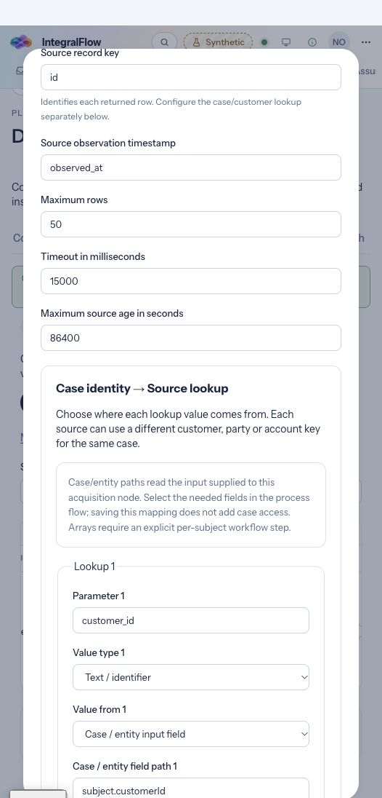
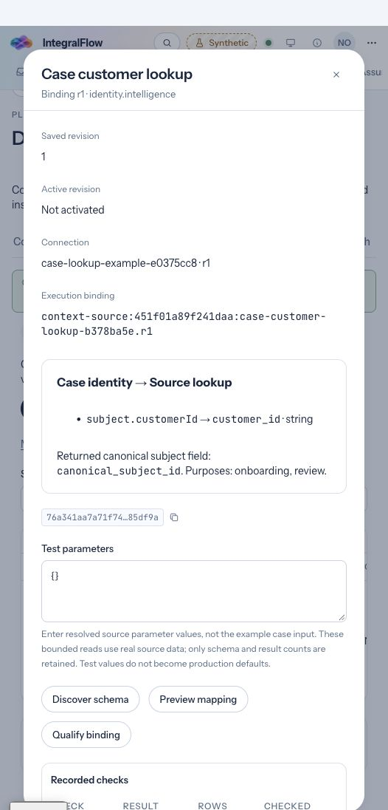

# Case identity to source lookup

Implemented on `codex/context-case-lookup`, separately from PR #80. A case reference, source customer key and returned record key have separate roles. This delivery makes their configuration visible and connects saved parameter mappings to gateway execution.

## Configure a product-source lookup

In **Platform → Data sources → Product bindings**, add or revise a binding. The **Case identity → Source lookup** panel supports:

| Value source | Runtime behavior |
| --- | --- |
| Named workflow parameter | Use the existing named input, such as `customer_id`. Existing bindings retain this behavior. |
| Case / entity input field | Read an explicit field path from the input supplied to this acquisition node, such as `subject.customerId`. It can come from selected case context or an authorized predecessor. |
| Signed case ID | Read the verified execution envelope's case ID. An input object's `caseId` cannot override it. Select this only if the source stores the platform's case reference. |

For a SQL source, choose a source lookup column and a declared parameter, then select **Apply lookup filter**. This preserves the projection and other supported equality filters. Unsupported or ambiguous queries remain unchanged and report an error; the existing restricted SQL compiler still governs execution. Source columns can be entered before discovery and selected from discovered names afterward. For REST, use declared path/query parameter names in the operation configuration. Gateway-based sources receive the resolved parameter object.

Example saved parameter:

```json
{
  "name": "customer_id",
  "type": "string",
  "required": true,
  "valueFrom": { "source": "input", "path": "subject.customerId" }
}
```

Example acquisition input:

```json
{ "subject": { "customerId": "CIF-123" } }
```

The gateway resolves this to `{"customer_id":"CIF-123"}` before the existing connector executes `WHERE customer_key = :customer_id`. This is a projection over the invocation's available input; it does not read additional case fields or grant new access. The released process flow must supply the declared input shape through its existing case selectors or predecessor projection. Arrays, wildcard paths, expressions and automatic selection of a first subject are unavailable. Use an explicit per-subject acquisition step when a case has several subjects.

Missing required values, wrong scalar types, blank/overlong identifiers, non-finite numbers and unsafe/inherited paths fail before a source read. A mapped input parameter cannot be overridden by adding a same-named root input field. Missing field mappings never fall back to unrelated values or a service identity. Existing parameter definitions without `valueFrom` continue using the original strict named-parameter input contract.

## Associate returned records

**Source record key** identifies returned rows. **Returned canonical subject field** names the source column containing the canonical case subject ID used by subject-scoped consumers. Configure an approved source view/crosswalk when the source stores a different vendor identity; the adapter does not infer identity equivalence. **Permitted record purposes** supplies the existing purpose labels used during context admission. These fields are persisted in the existing `subjectField` and `purposes` contracts and shown in the saved binding review.

The panel warns when no returned subject field is configured. Purpose labels, selected input paths and a successful test do not themselves authorize case access or source use.

**Try lookup values** resolves editable examples locally without contacting a source. Its values are transient component state, not saved production defaults. The binding review's **Test parameters** remains a separate technical discovery/preview/qualification input and takes already-resolved source parameter values.

Saving lookup changes creates a draft binding revision while preserving the active revision. Qualify and activate the new revision, update the process-flow connector pin, and complete normal source-policy/release approvals. Existing authorization, transport allowlists, canonical validation, observation freshness and immutable lineage remain in force.

## Review case-specific keys for Salesforce/Fenergo

In the enabled API record mapping, **Bind this source to a case** now has editable **Approved subject lookup keys** rows instead of a JSON textarea:

1. Enter the case, acquisition node and case source-context digest.
2. Add each canonical subject and that source's customer/party/account key. Blank or duplicate keys/subjects block saving; the existing 20-subject limit applies.
3. Enter the approval reason and save with existing `release.activate` authority.

To modify a binding, enter the case, select **Load saved case bindings**, and choose the existing binding. This loads its revision, canonical subjects, acquisition metadata and enabled/paused state. Editing keys preserves a paused binding's state. General case metadata intentionally omits source keys, so each source key must be re-entered and reviewed before approval. The editor submits the revision loaded for review; it no longer reads the newest revision immediately before saving and silently overwrites concurrent changes. The normal revision conflict requires a reload. Changing the case clears the previous case's keys and acquisition metadata.

These approved crosswalks continue through the existing case-pull path: users request canonical subjects; the server derives source keys from the pinned case binding. No arbitrary source key is accepted in the pull request.

## Verification and limits

Tests exercise safe lookup resolution and backward compatibility, signed case identity, missing/type/array/prototype rejection, query-filter preservation/refusal, gateway parameter use and returned subject/purpose lineage, and mock API roundtrips without activation. Existing connector and case-pull tests verify transport/record boundaries and reviewed-key scope/redaction. UI journey definitions cover save/reopen, local resolution and failure behavior; they are typechecked, without running the Playwright CLI suite.

Local validation passed: 10 contract tests, 34 connector tests, 3 gateway lookup tests, 5 existing case-pull tests, 10 web lookup/catalog tests and 3 mock API tests (65 total). Contracts, gateway, control API, connectors, mock service, web and UI journeys typecheck. Contract compilation/synchronization and the production web build/no-mock bundle check pass. Gitleaks 8.30.1 found no leaks in the changed-file snapshot.

Browser verification uses synthetic configuration at `localhost:5311`. It covered creating the lookup, applying the source filter, saving/reopening the draft, local missing-value and signed-case previews, and the saved review's field path, source parameter, subject column and purposes. A development hot reload caused the known stale mock-inventory response; the UI retained the saved review and blocked mutations. A fresh page restored the mock service and the final save/reopen journey passed with no browser error-level diagnostics. The role available during this check could inspect API source setup but could not author a qualified Salesforce/Fenergo mapping, so the crosswalk approval UI was not exercised end to end. Case-key scope/redaction are covered by the existing control API tests. No customer credentials, live source reads, activation or release were used in these checks.

The input field path remains explicit because a binding can be used by different released flows. This delivery does not automatically discover a flow's case selectors, create cross-system identity matches, coordinate multiple source pulls or implement field-level value resolution.




