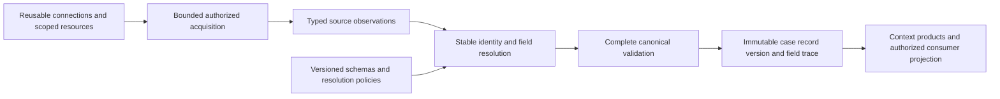
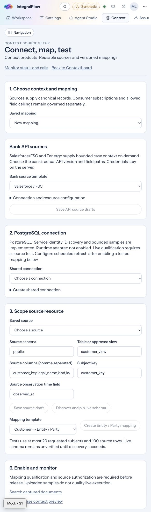
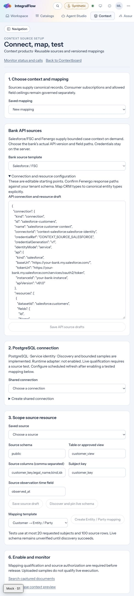
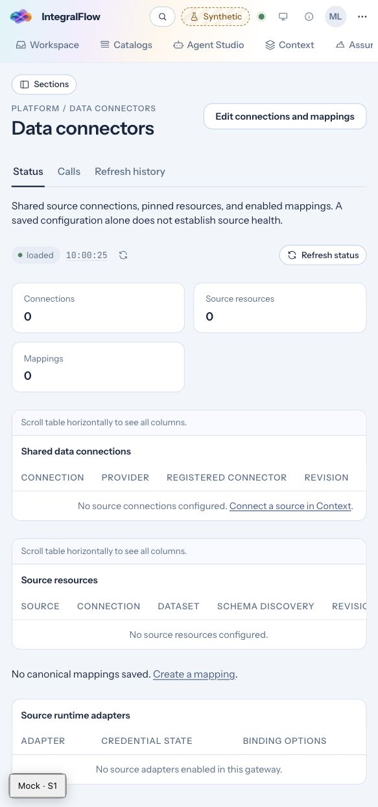
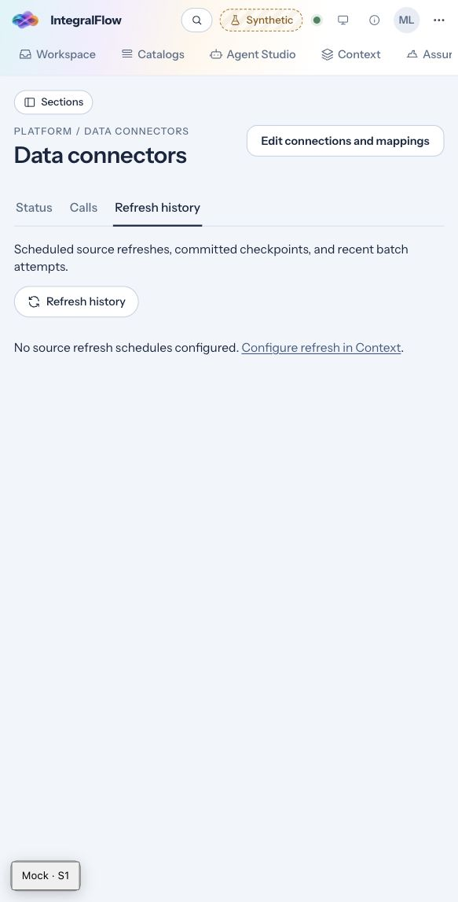
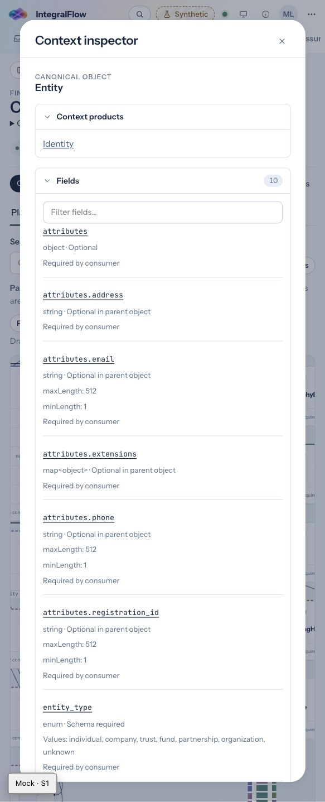
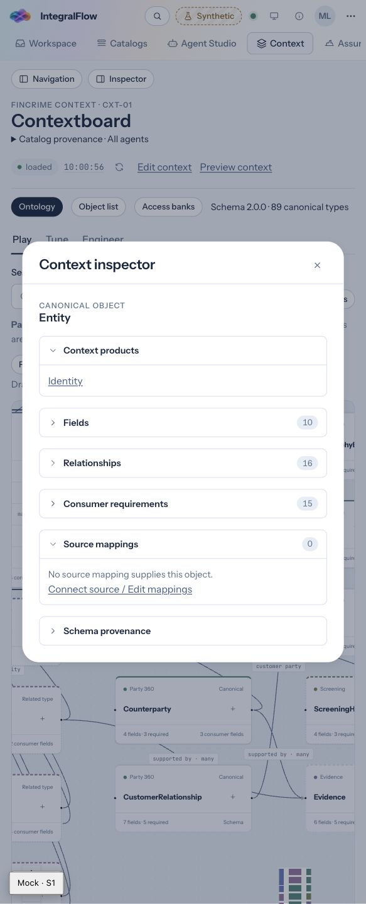
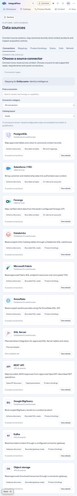
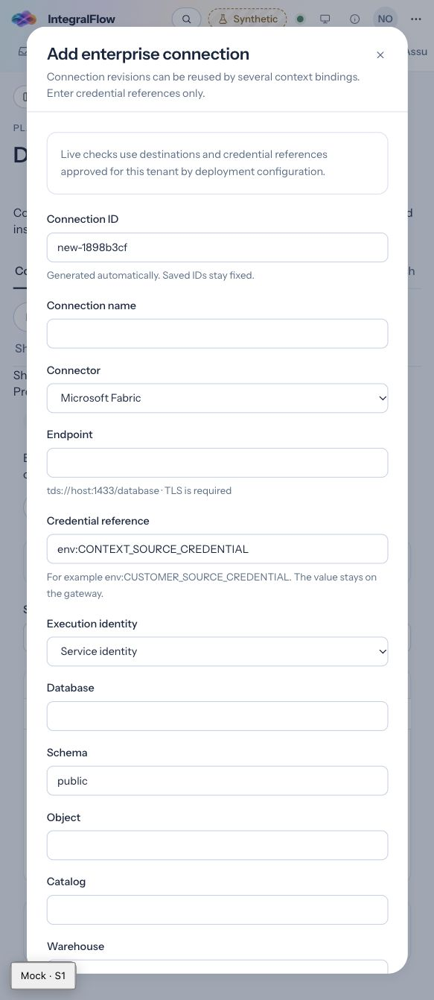
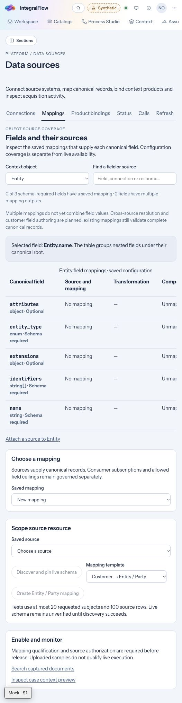

# Context: connect, combine, evolve

Status: design with initial implementation, 2026-11-11. The gallery, saved-mapping coverage and SQL Server adapter are implemented on the isolated branch. Later composition/schema-extension phases remain proposed. No live customer source has been qualified.

### Implementation update — first delivery slice

Implementation started on **`codex/context-connect-evolve`**, isolated in a separate worktree from `origin/main` at `7c568ae97`. The review captures below came from the original working tree. That newer main already consolidated authoring under `/platform/data-sources` and added the product-source path; this branch builds on that navigation instead of reverting the parallel work.

This slice implements the searchable connector card/list gallery, provider details, saved connection/resource inventory, existing setup routing, and an object-level field source coverage table. Ontology links preserve object, field, product, agent and draft context. Catalog metadata distinguishes record mappings from product bindings and does not establish runtime health, source qualification or execution authority.

The separate new-mapping vendor dropdown has been removed. New source selection uses the same gallery; the Mappings tab focuses on canonical fields and saved resources. Existing connection forms, Visual/Graph/Code editors, and qualification remain in place.

A separate [case lookup follow-up](context-case-lookup.md) adds visual input-field/parameter/source-filter mapping, returned subject/purpose fields, runtime parameter resolution and editable reviewed case-source key rows.

The requested catalog includes **Databricks, Microsoft Fabric, Snowflake, SQL Server, and REST API**, alongside PostgreSQL, Salesforce/FSC, Fenergo, BigQuery, Kafka and object storage. Databricks/Fabric/Snowflake/REST open existing product-binding integration flows. The subsequent adapter slice adds a dedicated **SQL Server** provider, SQL login/Entra authentication, scoped discovery, bounded reads and setup routing. Fabric and SQL Server share the TDS transport while retaining separate provider and authentication contracts. See the [SQL Server connector guide](context-sqlserver-connector.md).

The coverage table reports the latest saved mappings, complementary/overlapping field supply, source expressions and changed dependency pins. **It does not merge values or establish freshness.** Cross-source observation/resolution contracts, the customer field registry, automatic object refresh, typed API setup replacing the existing JSON form, and a full resumable wizard remain subsequent work. The original core design below remains the target, rather than a claim that every phase has shipped.

## 1. Recommendation

Make **the context object and its fields the center of the experience**. Give users a visual connector gallery, reusable connections, and one workspace where they can answer:

1. Which sources supply this object?
2. Which source supplies each field, and what happens when sources disagree?
3. How current is each value, and what happens when a refresh fails?
4. How can I add a customer-specific field and make it available to an approved consumer?

The gallery is the front door. The larger change is an explicit model for **many sources contributing to one resolved object**, with field-level provenance, deterministic resolution, and governed schema extensions.

Keep the existing ontology, mapping expressions, source authorization, qualification, case acquisition, and immutable records. Add the missing composition layer above individual source mappings. Consolidate authoring into Context; retain Platform's operational view over those same objects.

### The user promise

> Select an object, attach existing or new sources, map its fields, test the combined result, and publish. Context then keeps eligible values current according to the approved refresh policy, shows where every value came from, and explains any gaps.

“Publish” means completing the existing review/release gates. Saving a connection or passing an access check does not activate it for consumers.

### Terms used here

| Term | Meaning |
| --- | --- |
| Object type | A model definition such as `Entity`, `Party`, `Account`, or `OwnershipInterest`. This is what an administrator configures. |
| Entity instance | A particular identified person or organization, represented by stable canonical IDs and related records. This is what a user previews for an authorized case. |
| Connector | A supported transport/provider implementation, such as PostgreSQL or Salesforce. |
| Connection | A reusable tenant/environment-specific endpoint and execution identity. Several connections may use the same vendor. |
| Source resource | A scoped table, view, API dataset, or approved collection within a connection. |
| Field mapping | How one source value becomes a typed target value. |
| Resolution policy | How eligible values from different sources are combined or selected for a target field. |
| Context product | A governed projection over records for consumers; it is not another copy of a connection or entity. |

Configure mappings and policies once for an object type and applicable scope. Do not require a separate setup wizard for every customer instance. Runtime identity bindings determine which records supply a particular case subject.

## 2. What the review found

### Review scope and evidence

Reviewed the local web app at `http://localhost:5173`, using the synthetic **Context Architect** persona, and the current source contracts and implementation. The browser retained its normal narrow viewport; captures are 583 pixels wide. They establish the visible setup/navigation experience, not a desktop breakpoint or full accessibility assessment.

The source inventory was empty and live mutation actions were disabled in this mock environment. Populated mapping, live qualification, successful pulls, refresh failures, and real source performance were reviewed in code rather than exercised against a customer system. Existing uncommitted work is included in this assessment; this is not a certification of the default branch or a deployed release.

The numbered review flow is:

1. **Open Context source setup.** A long form combines saved mappings, a separate API source section, PostgreSQL connection setup, resource scoping, and enablement. The empty path visibly goes from step 3 to step 6. See [evidence 1](#evidence-1--source-setup).
2. **Expand API configuration.** Salesforce/Fenergo setup exposes connection and resource JSON instead of a guided, vendor-specific form. See [evidence 2](#evidence-2--api-configuration).
3. **Follow “Monitor status and calls.”** The user moves to Platform / Data connectors, which displays the shared connection/resource/mapping inventory and links back to Context for editing. See [evidence 3](#evidence-3--platform-operations).
4. **Open Refresh history.** A separate operational tab reports schedules and links back to Context for configuration. See [evidence 4](#evidence-4--refresh-history).
5. **Inspect Entity in Contextboard.** The ontology already exposes fields, relationships, consumer requirements, and source mappings. Its connect/edit link returns to the general setup page with product scope. See [evidence 5](#evidence-5--entity-inspector).

### Findings and priorities

Priority indicates proposed delivery order and user impact, not a security severity rating.

| ID | Priority | Finding and evidence | Recommended change |
| --- | --- | --- | --- |
| F1 | High | **The starting point is an implementation artifact.** The first setup choice is a saved mapping, followed by provider-specific sections. Users must already understand connections, resources, and mappings before describing their object. Visual evidence: steps 1–2. | Start from an object's Fields or Sources tab, with a source-first gallery as an equivalent entry point. Preserve the selected object and field throughout setup. |
| F2 | High | **Authoring and monitoring feel like separate features.** Context and Platform use different page structures and names for the same definitions; each links to the other. Visual evidence: steps 1, 3–4. Code confirms a shared inventory, not two configuration databases. | One authoring owner and shared object inspectors; contextual health in Context, fleet operations in Platform. |
| F3 | High | **Multi-source composition is implicit.** A mapping pins one resource. Several mappings may target the same type, but there is no explicit per-field cross-source resolution plan. Code evidence: `canonicalMappingSchema` and the mapping evaluator. | Add source bindings, typed field observations, and a versioned resolution plan. |
| F4 | High | **A new source can become a competing whole record.** Current records are versioned at object level. That alone does not merge complementary fields from independently authored mappings. Code evidence: case-store head/version selection. | Assemble one validated canonical object from approved observations before committing a new object version. Do not use arrival order as field authority. |
| F5 | High | **Refresh is mapping-oriented and provider-dependent.** PostgreSQL scheduling asks operators for case, plan, node, and subject details; API mappings use case bindings and explicit pulls. Visual evidence: step 4 for discoverability; detailed behavior established in code. | Present an object-level refresh policy and per-source capabilities, while deriving and enforcing the existing execution scope on the server. |
| F6 | Medium | **“Add field” is not customer schema authoring.** The mapper can add an admitted canonical field. Closed schemas reject unknown fields. A namespaced extension helper exists, but there is no complete customer field registry and lifecycle in this flow. Code evidence: mapper, compiler, library contracts. | Offer distinct actions for mapping an existing field, defining a customer field, and proposing a core model change. |
| F7 | Medium | **The existing ontology inspector is a strong starting point.** It already groups fields, relationships, requirements, and source mappings. Visual evidence: step 5. The connect link carries product scope but not a selected target field. | Expand this inspector into an object workspace; avoid building another unrelated ontology browser. |
| F8 | Medium | **The form asks users to carry too much state.** Manual column lists, editable JSON, scattered actions, and conditionally absent numbered steps obscure progress. Visual evidence: steps 1–2. | Use a persistent stepper, discovery selectors, typed forms, clear prerequisites, and resumable drafts. Keep advanced JSON as an optional representation. |

Accessibility risks visible in this scope: dense tables need horizontal navigation in the narrow view; the setup relies on lengthy scrolling; the ontology canvas needs the existing Object list alternative to remain a full route to all actions. New mappings must be operable without dragging, and all state badges need text rather than color alone. Keyboard completion, focus recovery, screen-reader announcements, and contrast require implementation-stage verification; screenshots do not establish compliance.

### Existing capabilities to reuse

The product already has more than a basic text mapper. It includes **Visual / Relationship graph / Code** editors over the same mapping representation, deterministic transforms, row-local `coalesce`, reviewed identity crosswalks, bounded collection mapping, schema discovery, sample lineage, exact-revision qualification, case preview, and operational receipts.

`coalesce` currently chooses between expressions within one source row. It is not a policy for choosing between separately refreshed Salesforce and Fenergo observations. Sample lineage is a useful foundation, but it is not yet a durable explanation of a resolved field across sources and time.

## 3. Borrow the interaction patterns, preserve Context semantics

| Reference | Useful pattern | Application here |
| --- | --- | --- |
| [Azure Data Factory connector overview](https://learn.microsoft.com/en-us/azure/data-factory/connector-overview) | Explicit capability differences across connectors and activities. | Every gallery card and details panel declares its supported discovery, sampling, execution, authentication, and refresh capabilities. A vendor logo never implies complete support. |
| [Lakeflow Connect concepts](https://docs.databricks.com/aws/en/ingestion/lakeflow-connect/) | Reusable connections, explicit ingestion configuration, and source-type-specific execution components. | Separate “connect once” from “use this resource for these fields.” Show the refresh model that applies to this adapter. |
| [Lakeflow custom connector interface](https://docs.databricks.com/aws/en/ingestion/custom-connectors) | Discovery, schema, metadata, and read methods form an explicit connector interface. | Drive the gallery and setup from a capability manifest; connect discovered resources and fields to the mapper. |
| [ADF schema drift](https://learn.microsoft.com/en-us/azure/data-factory/concepts-data-flow-schema-drift) | Schema changes can be detected and handled explicitly. | Detect new source fields and offer a review action. Do not automatically add them to the governed context model or consumer projections. |

These are design references, checked on 2026-11-11. EHF's current acquisition is bounded by authorized case subjects and released plans. A visual connector experience should not silently turn it into bank-wide replication, a general ETL engine, or a promise of CDC support.

## 4. One workspace, two useful entry points

### Navigation and ownership

Keep **Context** as the primary workspace. Preserve Ontology, Object list, Access banks, and the Play/Tune/Engineer perspectives; use them as views of the same model and consumer relationships.

Selecting an object opens an expanded workspace with **Overview · Fields · Sources · Refresh & health · History**. A source-first **Connections** view offers **My connections** and **Add connection**. Selecting a field opens its mapping and lineage inspector directly.

| Surface | Responsibility |
| --- | --- |
| Context / object workspace | Define fields, attach sources, map, resolve, test, publish, and inspect contextual freshness. |
| Context / Connections | Discover supported connector types and manage reusable tenant connections and resources. |
| Platform / Connection operations | Fleet-wide access failures, adapter availability, rate limits, job backlog, credential state, and run history. |
| Shared connection/resource inspector | The same identity, revision, health, ownership, and impact information opened from either location. |
| Agent Studio / Access banks | Consumer subscriptions and allowed field ceilings. Link to supply gaps without duplicating source setup or granting access by mapping a field. |

Rename Platform's page to **Connection operations** to communicate its purpose. Keep operational actions there, but route editing to the same Context editor and definitions. Avoid separate Create connection or Map fields implementations in Platform.

Retain existing `/context/connections`, `/context/sources/$sourceId`, and `/context/mappings/$mappingId` deep links. Resolve them to the new workspace with the relevant selection. Preserve product, object type, field path, agent, draft, and return location. Proposed object URLs are an implementation decision; do not break existing bookmarks or query scopes.

### Object workspace sketch

The following is a proposed layout with illustrative counts, not a screenshot or measured customer inventory:

```text
Context / Entity                                      Draft · 2 unpublished changes
Organization profile                                  [Test combined result] [Publish]

Overview | Fields | Sources | Refresh & health | History

Sources: 3 attached     Required fields: 3/3 mapped     Customer fields: 2
Sample: 18/20 valid     Freshness: 1 source needs attention

FIELD                    SUPPLIED BY                     RESOLUTION          STATUS
name                     Fenergo; Customer master        Prefer verified     Conflict · inspect
entity_type              Customer master                  Approved lookup     Mapped
identifiers              Registry; Customer master        Typed set union     Mapped
attributes.email         Salesforce                       Direct              Fresh
extensions.bank...tier   Salesforce; Customer master       Prefer master       Not tested

[Map existing field] [Add customer field] [Attach source]
```

Keep **Mapped**, **Qualified**, **Fresh**, and **Available to consumer** separate. Counts must identify their population: all configured fields, selected required fields, or 20 sampled subjects. Object-type configuration has no single universal freshness timestamp; instance/field freshness comes from actual observations in the selected case and consumer scope.

## 5. The visual connector gallery

### Card anatomy

Each card contains the approved vendor icon, connector name and category, one sentence describing its scope, supported execution modes, release/support state, and existing connection count. Selecting it opens a details panel before configuration.

```text
[Vendor icon] Salesforce / FSC                  CRM · Implemented adapter
Customer and relationship context for approved case subjects
Discovery · Bounded samples · On-demand pulls
2 existing connections                         [Use existing] [New connection]
```

Filters: **All / My connections / CRM & CLM / Databases / Documents / Other**, plus search by vendor, technology, and use case. Offer a list view equivalent to cards. Recommend connectors only from deployed capabilities and relevant object requirements, with a stated reason.

Separate these facts in the card/details view:

- Adapter implemented and deployed.
- Connection configured and access checked, with check time.
- Resources discovered and schema pinned.
- Mapping tested against an exact revision.
- Source authorized and released for a stated use.
- Runtime health and freshness for a stated scope.

Never collapse them into one “Connected” green check. Show **Unavailable in this deployment** when an adapter exists in code but is not enabled. Show **Planned** cards in a separate, optional section without an active Connect button.

### Initial catalog and capability honesty

| Connector | Current implementation baseline | Initial gallery behavior |
| --- | --- | --- |
| PostgreSQL | Shared connections, resource discovery/schema pins, bounded samples, mapping qualification, case acquisition, scheduled snapshot refresh. | Typed database/identity form and resource browser. Display scheduled snapshot support only when the deployment has the adapter and refresh worker configured. |
| Salesforce / FSC | API driver, resource/schema configuration, bounded case pulls and case bindings. | Typed instance/version/resource form. Show on-demand execution; scheduled API refresh requires additional implementation and qualification. Distinguish actual discovered FSC profiles. |
| Fenergo | API driver and bounded case pulls against an explicitly configured API/profile. | Typed tenant/API resource form. Show supported profile and on-demand execution; do not imply all Fenergo deployments share a schema. |
| Databricks | Existing product-source adapter uses Unity Catalog metadata and the SQL Statements API for bounded reads. | Catalog card opens the existing typed product connection form; require workspace, warehouse and catalog/schema/table scope. No CDC claim. |
| Microsoft Fabric | Existing product-source adapter uses encrypted TDS and an Entra access-token reference. | Catalog card opens the Fabric product connection form; require database and scoped resource. This is not generic SQL Server support. |
| Snowflake | Existing product-source adapter uses the SQL API with bounded reads. | Catalog card opens the existing product connection form with account, warehouse and database/schema/table scope. |
| SQL Server | Dedicated provider with SQL login/Entra references, verified TDS, scoped discovery and bounded execution; live qualification remains customer-specific. | Opens the SQL Server product connection form. Saving configuration does not qualify or activate a source. |
| REST API | Existing `openapi` product-source adapter supports declared GET operations, typed parameters and bounded JSON collections. | Display REST API in the catalog and retain OpenAPI / REST in the existing typed connection form. Do not imply arbitrary HTTP execution, webhook or pagination support. |
| BigQuery, Kafka, object storage | Existing product-source integrations; Kafka/object storage use a connector gateway. | Preserve these existing options in the gallery, with their gateway and deployment prerequisites. |
| Additional vendors | Portfolio ideas exist in earlier plans; implementation must be verified individually. | Backlog/request state until adapter, contracts, setup, and qualification exist. No simulated success path. |

Use locally packaged, approved vendor SVG assets with a text fallback and accessible name. Icons identify vendors; status remains text. Do not load remote logos into a sensitive configuration page. A catalog icon and a runtime credential are unrelated objects.

### Manifest-driven setup

Introduce a versioned connector experience manifest referencing the real adapter contract: ID, label, icon asset, category, support state, auth methods, typed non-secret configuration, resource discovery, schema discovery, sample bounds, execution modes, deletion semantics, network requirements, and documentation.

The server remains authoritative about enabled adapters and access. UI metadata must not enable unsupported behavior. Reuse common forms and provider-specific sections rather than adding another top-level vendor branch to the setup page. Keep JSON editing for engineers with the same validation and revision handling as the forms.

## 6. Connect and map without losing the user's goal

Use a resumable workflow with a persistent summary: **target object → sources → identity → fields → test → publish**. Show unmet prerequisites beside the next action; do not skip numbered steps silently.

1. **Choose the object and goal.** Starting from `Entity.name` retains that field. Starting from a connector asks which object(s) it should supply. Show the relevant product and consumer requirements, including missing dependencies.
2. **Reuse or create a connection.** Show existing connections with environment, owner, last access check, and permitted resource scope. New setup uses typed endpoint/profile inputs and a managed credential reference. Test access without exposing secret values.
3. **Select resources visually.** Browse discovered tables/views or API resources, search columns, inspect types and masked examples, and select the minimum resource scope. Pin the schema fingerprint. Unsupported discovery has an explicit manual schema path labeled unverified until live qualification succeeds.
4. **Resolve identity.** Specify the stable source key and canonical identity, then reuse or review a crosswalk. Show unmatched and ambiguous identities. Never join two organizations using name similarity alone. Vendor IDs remain namespaced by connection/resource; a Salesforce account ID is not a Fenergo entity ID.
5. **Map fields and resolve overlap.** Suggest mappings with reasons, but require acceptance. Show every target field's sources, transformation, null behavior, priority, freshness requirement, and consumers. Different source resources may supply complementary fields or competing observations of the same field.
6. **Test the combined result.** Run an authorized bounded sample. Show source access, schema, identity, transformation, resolution, final contract validation, and consumer availability as distinct stages. Include cases where one source is missing, stale, denied, or disagrees. Uploaded fixtures remain synthetic and cannot qualify live access.
7. **Review impact and publish.** Show changed field bindings, sources, custom schema, consumers, refresh behavior, and unresolved requirements. Reuse exact-revision source and release approvals. Publish the composed plan only when every required dependency is qualified for that use.

The primary field editor should be a searchable table with a details panel. Offer a visual source-to-target graph as a second view, using the same contract. Keyboard users can choose **Map from source** and **Add fallback** without dragging. Large nested models need grouped paths, required/task-required filters, and bulk operations with an explicit review diff.

Drafts need autosave or an explicit Save state, optimistic concurrency, recovery after navigation, and a clear indication of unpublished changes. An interrupted wizard must resume at the same object, field, and revision.

## 7. Multi-source objects: make resolution explicit

### Example: one organization, several systems

Illustrative source aliases and customer fields below are proposed mappings, not guaranteed vendor DTO paths. The target canonical paths shown for `Entity` exist today; customer fields require the registry in section 9.

| Target | Candidate sources | Proposed rule |
| --- | --- | --- |
| `Entity.name` | Verified CLM legal name; customer-master legal name | Prefer an eligible verified CLM observation; use the approved master fallback only under its declared missing/stale conditions. Show conflicting eligible values. |
| `Entity.entity_type` | Customer master classification | Reviewed enum map to the pinned canonical values. Unknown source values require attention rather than an invented type. |
| `Entity.identifiers` | Master and registry identifiers | Union normalized, typed/namespaced identifiers with stable deduplication. Keep per-member lineage. |
| `Entity.attributes.email` | Salesforce contact field | Direct typed mapping; classification, subject, and purpose restrictions still apply. |
| `Entity.extensions.bank.value.customer_tier` | Master; CRM | Customer-defined enum with an explicit authority order. |
| `Entity.extensions.bank.value.annual_revenue` | Approved ERP view | Customer-defined amount/currency object with observation/effective time; no unit or currency guessing. |

Ownership, accounts, applications, and risk assessments remain their own typed objects and relationships where the ontology defines them. Do not flatten everything onto `Entity`, fabricate ownership joins, or convert a vendor risk label into an EHF decision. The same multi-source mechanism can apply to those object types with their own identity and completeness rules.

### Field policy semantics

For each field, define eligible sources and a deterministic policy. Start with **one source**, **ordered authority with explicit fallback**, **most recent eligible observation**, and **typed set union**. Add reconciliation workflows only where a customer has a concrete requirement.

| Situation | Required behavior |
| --- | --- |
| Complementary fields | Compose the object from both sources; updating CRM email must not remove the CLM legal name. |
| Different values for one scalar | Apply declared authority, not job completion order. Keep the alternatives and reason visible to authorized reviewers. |
| Latest-value policy | Compare meaningful source observation/effective times among eligible candidates. Define ties deterministically. Fetch time is not business recency. |
| Missing versus empty | Distinguish absent field, explicit null, empty collection, and authoritative clear/delete. A snapshot omission alone must not erase another source's value. |
| Invalid value | Report a conversion/schema issue. Use a fallback only if the policy explicitly allows this condition; do not mask a broken mapping. |
| Failed or denied source | Show degraded/unavailable state. A denial must not be disguised as missing data or bypassed with a broader identity. Previously acquired data also needs current-use authorization. |
| Stale primary | Retain or replace it only according to the field and consumer freshness policy. Explain “Using master fallback because CLM observation exceeded 24 hours.” |
| Arrays and relationships | Define item identity, deduplication, authority per item, removal, and bounds. Do not blindly concatenate arrays or merge unrelated relationships. |
| Manual override | If introduced, require a reason, actor, approval policy, expiry, and audit trail. Represent it as a governed observation; do not overwrite source evidence. |

Resolve identity before merging fields. A reviewed identity crosswalk is a separately versioned dependency: changes can move observations between entities and therefore require impact review and retesting. Ambiguous matches go to repair, not automatic publication.

### Explain every resolved value

Selecting a field on a sample or live case shows: selected value, source/resource/record reference, source field path, transform version, source observation time, fetched time, validity interval when available, mapping revision, resolution policy revision, and reason selected. Show alternatives and conflict state only where the viewer is authorized to see them.

Lineage must remain available after refresh and policy changes. A summary such as “3 sources” is not enough. A whole object must also show when fields were observed at different times; do not imply a single coherent source snapshot when none exists.

### Required contract and storage additions



The following names are proposed contracts, not existing APIs:

| Contract | Responsibility and important pins |
| --- | --- |
| `ObjectSourceBinding` | Attach multiple existing resource/mapping revisions to an object type and applicable scope. Reference connection/resource/mapping digests and the approved identity crosswalk. Avoid confusing this with the existing source-policy authorization binding. |
| `FieldBinding` | Target field path, typed candidate expression, source binding, classification and purpose constraints, observation-time semantics, and null/delete behavior. |
| `ObjectResolutionPlan` | Pinned canonical schema, extension schema digests, field bindings, identity rules, source eligibility/authority, fallback and freshness policies, dependency graph, and compiler version. |
| `FieldObservation` | Immutable typed candidate with tenant/case/subject/object identity, source reference, source revision/event identity when available, observed/fetched/effective times, trust labels, and acquisition receipt. |
| `ResolvedFieldTrace` | Selected observation(s), alternatives/conflict outcome, policy digest, freshness decision, and canonical version reference. |
| `ObjectRefreshPolicy` | Desired field freshness and per-source execution strategy, bound to approved acquisition plans and explicit subject scope. |

**Partial candidates need a new explicit contract.** Today's compiler requires each output's required canonical fields and validates each mapped record. A source supplying only `Entity.attributes.email` cannot simply pass through that compiler as an incomplete Entity. Add typed observation output and staging validation, then validate the assembled whole object before canonical commit. Keep legacy complete-record mappings compatible; do not weaken the canonical validator to permit partial records.

Use governed, bounded observation storage in the existing tenant/case evidence path, with retention and access controls. Avoid a second unrestricted raw-data lake. Persist only the allowed evidence needed for resolution, replay, and diagnosis.

Persist the resolved field trace with a verifiable digest/reference from the committed version. Reuse canonical source references and provenance, extending their contracts deliberately where needed. Field eligibility must not broaden because observations share a resolved record: preserve restrictive labels and enforce field-aware projection, or conservatively restrict the whole record until field-aware enforcement exists.

Recompute affected objects when an eligible observation or approved policy changes. Use an input-set digest, idempotent resolution key, and optimistic concurrency against the expected canonical head so parallel source jobs cannot lose fields. Validate references in the atomic write boundary. Invalid required fields or unresolved relationships prevent a new complete version; diagnostics explain the gap.

Historical replay pins the observation set, schema, crosswalk, mappings, and resolution policy. Retrying a live snapshot fetch may return newer source data; that is a new acquisition, not reconstruction of an old source state. The current case-store whole-record head semantics remain intact: the resolver supplies an assembled version rather than changing the store into an implicit merge engine.

## 8. Transparent refresh

“Transparent” should mean users can understand and trust automatic refresh without operating individual jobs. It must not mean that the system hides failures or acquires data whenever a screen opens.

### What users configure

At object level, offer a freshness goal, an approved default schedule where supported, source-specific overrides, and failure behavior. Show the effective policy for each field. Explain that a five-minute schedule cannot satisfy a one-minute freshness requirement and that a source without a trustworthy observation time has unknown freshness.

In case context, derive the selected case, subjects, released acquisition plan, node, and version pins from the approved binding wherever possible. Offer a reviewed subject-key mapping action instead of exposing plan/context digests as the main form. Engineers can inspect those values in an advanced panel; server enforcement remains unchanged.

| Mode | Current status | Experience |
| --- | --- | --- |
| Explicit pull | Existing for supported sources, including Salesforce/Fenergo case bindings. | **Pull context** with stated subject/resource scope, bounds, and last result. |
| Scheduled snapshot | Implemented for PostgreSQL mappings, with a deployed refresh worker. | Set cadence for the approved case-scoped acquisition; display next due time and committed result. |
| Scheduled API polling | Proposed additional work. | Offer only after adapter-specific scheduling, quotas, authorization, and qualification exist. |
| Incremental/CDC/webhook | Future capability, qualified per adapter and deployment. | Declare cursor/deletion/replay semantics and recovery bounds before exposing an active option. |

This proposal improves automatic case-scoped refresh. Bank-wide continuous ingestion would need a separately designed scope, storage, authorization, and cost model.

### What users see

Show source-level status alongside field-level data currency:

- Last attempt, last successful fetch, **last committed result**, next due time, and retry state.
- Source observation/as-of time, effective time where relevant, fetch time, and field freshness against the selected requirement.
- Coverage with a denominator, for example “18 of 20 authorized subjects returned”; a small sample is not fleet coverage.
- Partial results, rate limits, paused bindings, schema changes, and unavailable required fields.
- What the current consumer can use, including values withheld for purpose, access, or freshness requirements.

Example copy: **“CRM refreshed 2 minutes ago. Its email observation is 3 days old and exceeds this task's 24-hour requirement. CLM name is current. Two subjects need identity mapping.”** A successful poll does not reset the age of unchanged business observations.

**Refresh now** acquires data and requires the existing execution authority. **Reload status** only reloads operational information. Do not use the same refresh icon and ambiguous copy for both actions.

### Runtime behavior

1. Evaluate the approved refresh policy and acquire only authorized, bounded subjects/resources. Reuse existing gateway and released acquisition paths.
2. Coordinate source work for the affected object and respect shared connection quotas. Expose the slowest required dependency instead of claiming the object is fully refreshed after one source finishes.
3. Persist valid observations, resolve the pinned field policies, validate the assembled result, and commit atomically. If partial progress is permitted, publish only a complete valid object and mark source coverage explicitly.
4. Advance a checkpoint only after the relevant committed records and resolution trace exist. Existing `completedThrough` represents scheduled slots, not a source CDC cursor.
5. Retry bounded transient failures with stable idempotency and a visible attempt limit. Keep prior eligible values where policy allows, mark them stale/degraded, and prevent consumers with stricter requirements from receiving them.
6. Require requalification for incompatible source schema, mapping, credential-generation, identity, or resolution changes. Pause affected bindings rather than silently changing meaning.

Cancellation, pause, and credential revocation must preserve existing in-flight reconciliation rules. Revoked data cannot remain eligible merely because its last fetch succeeded. Recovery shows which subjects/fields were repaired; it does not turn an incomplete acquisition into a successful batch.

## 9. Let customers add fields safely and usefully

### Three distinct actions

| User intent | Action | Result |
| --- | --- | --- |
| “We already have a canonical field; it needs a source.” | **Map existing field** | Select an admitted field and attach a binding. |
| “Our organization needs an extra data attribute.” | **Add customer field** | Define a typed, namespaced extension for this object type in the tenant field registry. |
| “This should be part of the shared domain model.” | **Propose model change** | Separate ontology/platform-contract review and consumer compatibility work. |

Display-name customization is an alias, not a new schema field. Distinguish a directly sourced customer field from a calculated field; deterministic calculations require declared inputs and a supported expression contract, not arbitrary scripts.

### Customer field definition

The form asks for a label, description, stable machine key, object type, namespace, type, cardinality, allowed values/constraints, units where relevant, sensitivity/classification, purposes, owner, and intended consumers. Default new fields to optional. Show existing similar fields before creating another one.

Store values in the existing versioned extension shape, for example:

```json
{
  "extensions": {
    "bank": {
      "schema_version": "1.0.0",
      "value": {
        "customer_tier": "strategic",
        "annual_revenue": { "amount": "12500000.00", "currency": "USD" }
      }
    }
  }
}
```

This is an illustrative fragment of `Entity.data`, not a complete canonical record. The existing `extensionBlock()` helper already supports namespaced versioned blocks; it does not supply the proposed tenant field registry, its UI, or consumer integration. Its empty-value filtering also means explicit clearing needs a deliberate observation/delete representation, not an assumption that helper omission records a clear.

The **registry is tenant-scoped** and versions the extension schema and digest, field metadata, validation, policy, and lifecycle. Namespace ownership and stable keys prevent collisions. Bind mappings and resolution plans to those schema versions. Validate both the pinned canonical contract and registered extension values before commit. Do not enable arbitrary top-level properties in the core schemas.

### Lifecycle and consumer availability

1. **Draft:** define the field and see its physical path, example values, access classification, and owner.
2. **Map and test:** attach one or more sources; preview missingness, invalid values, resolution, and impact on the selected sample.
3. **Review and publish:** version the extension schema and bindings together. Requiredness is a new requirement for an explicitly released consumer scope, not a retroactive failure of every historical record.
4. **Adopt:** expose the field in the model browser, mapping grid, case inspector, authorized preview, and lineage view. Offer explicit, reviewed consumer projection and typed search/index support where implemented.
5. **Evolve:** show downstream usage before renaming, type changes, or removal. Keep machine keys stable; breaking type/cardinality changes require a new version/key and migration plan. Deprecate before removal and retain historical interpretation.

Adding a field must not automatically send it to agents/models, subscribe existing skills, widen allowed field ceilings, or index it for all users. Existing library skills do not automatically consume extension values. Consumer contracts, selectors, requirements, and release approvals need explicit extension support. Mapping a new field and making it available to a specific consumer are separate visible steps.

If a new customer field refers to another object, require typed reference validation and scope rules; do not let a string field create an unvalidated cross-tenant relationship. Search/index entries must carry the same tenant, subject, classification, purpose, and current authorization restrictions as the resolved value.

## 10. States, errors, and collaboration

| State | User sees | Useful next action |
| --- | --- | --- |
| No sources | Object fields and requirements, with a concise explanation of missing supply. | Attach source or choose a reusable connection. |
| Adapter unavailable | Connector details and deployment prerequisite. | Ask the designated operator to enable the supported adapter. |
| Access check failed | Safe error, affected connection, check time, and permission/network category. | Repair the credential reference or approved resource scope; retry access check. |
| Identity ambiguity | Conflicting keys and affected sample count, subject to access. | Review crosswalk; rerun the sample. |
| Field conflict | Selected value, alternatives, policy, and downstream impact. | Review the source facts or draft a policy change. |
| Schema drift | Added/removed/type-changed source fields and affected mappings. | Ignore unmapped additions, map approved additions, or repair and requalify. |
| Partial refresh | Which sources/subjects committed, which failed, and effective field freshness. | Inspect failed dependency or run an authorized bounded retry. |
| Concurrent edit | Saved revision and conflicting changes. | Compare and rebase the draft instead of overwriting another editor. |
| Deprecated customer field | Consumers still using it and planned replacement. | Migrate affected bindings and consumers. |

Map these tasks onto existing permissions: connection operators manage endpoint/identity scope; context architects author mappings and fields; designated reviewers authorize source use and releases; consumers see only their permitted projections. These are responsibility groupings, not a proposal to silently add broad roles. Display missing prerequisites beside actions while the API enforces them.

Keep secrets outside source definitions, examples, audit events, exports, and browser state. Show managed references, generation, owner, and configured/missing state. Redact samples according to access; prevent a lineage panel from becoming a back door to an otherwise denied source field.

## 11. Delivery sequence and acceptance

### Phase 1 — Unify the experience around existing capabilities

Build the vendor gallery and shared connection inspector across existing record and product-source adapters, including Databricks, Fabric, Snowflake, SQL Server and REST. Require qualification of each configured source before activation. Expand the current object inspector into Fields/Sources/Health views, preserve object/field context in deep links, replace API JSON-first setup with typed forms, and provide a persistent, resumable setup flow. Keep existing Visual/Graph/Code mapping and qualification behavior.

Exit criteria: a user can start from an object or a vendor card, reuse one connection for two mappings, return to the same object, and distinguish configuration, qualification, release, runtime health, and freshness. Platform operates on those same objects. No unsupported refresh mode is offered.

### Phase 2 — Deliver actual multi-source field composition

Add typed observation output, stable cross-source identity bindings, versioned resolution plans, complete-object validation, durable field trace, and concurrency-safe commits. Build the field mapping/resolution grid and combined sample preview together with these contracts. A UI-only “add another source” button is not sufficient.

Exit criteria: two sources can provide complementary and competing fields for the same identified Entity; refresh of either source produces a deterministic valid combined version without removing unrelated fields. Required-field and relationship failures remain visible and block an invalid version.

### Phase 3 — Publish customer fields and transparent refresh

Add the tenant extension registry, versioned validation and lifecycle, explicit consumer opt-in, and object-level refresh orchestration/status. Reuse existing PostgreSQL scheduling first. Extend API scheduling only after adapter-specific execution, quotas, worker behavior, and authorization are qualified. Field-level freshness and failure explanations are part of this phase, not a later monitoring add-on.

Exit criteria: a tenant adds a typed customer field, maps it from two sources, publishes it, and explicitly makes it available to one approved consumer; other consumers and tenants remain unchanged. Automatic supported refresh preserves provenance and correctly withholds values that fail that consumer's access/freshness requirements.

### Later — Expand from verified customer demand

Add selected vendor adapters, incremental/CDC modes, more resolution operators, and broader ingestion scopes only with explicit contracts and qualification. Do not block the first three phases on a universal connector framework or a bank-wide data platform.

### End-to-end acceptance scenarios

| Scenario | Observable pass condition |
| --- | --- |
| Discover a connector | Cards have vendor names/icons and truthful support/mode states; searching and selecting work by keyboard and list view. |
| Reuse a connection | A second object/resource uses the same connection without another credential or conflicting configuration copy. |
| Preserve navigation | Entity/field/product/agent/draft selections survive setup, operations inspection, and return. |
| Combine complementary sources | CLM name survives a CRM-only email update; the canonical version references both eligible observations. |
| Resolve disagreement | Reverse source completion order yields the same selected scalar and an inspectable conflict explanation. |
| Match identity | Exact reviewed crosswalks merge the intended records; ambiguous or cross-tenant keys never auto-merge. |
| Handle missing/null/delete | The declared semantics apply independently; omission or partial pagination does not erase an authoritative value. |
| Handle stale/denied data | Poll success does not freshen an old observation; current access denial prevents use even when historical data exists. |
| Protect complete records | Partial candidates cannot enter the canonical store until final required fields and references validate. |
| Recover refresh | A failed dependency has bounded retries, truthful partial status, no false checkpoint advance, and idempotent recovery. |
| Add a customer field | Typed validation rejects bad values; field/schema versions remain interpretable; tenant isolation holds. |
| Adopt a field | Only the explicitly updated and approved consumer receives it; preview and runtime use the same projection checks. |
| Evolve schemas | Drift and breaking extension changes show impacted bindings/consumers and require the applicable requalification. |
| Replay and concurrency | A pinned observation set reproduces the same result; concurrent refreshes do not lose fields or mix revisions. |
| Use without a mouse | Complete connection, mapping, conflict inspection, and publication without dragging; focus and async status remain understandable. |

Measure completion and repair time in usability sessions, connection reuse, abandoned setup stages, conflicts awaiting review, and stale required fields per authorized scope. Establish a baseline before promising a percentage improvement. Keep secrets and source values out of UX telemetry.

## 12. Implementation map and relationship to existing plans

This proposal consolidates the user experience direction in [Context experience](context-experience.md) and the connector plans. It adds explicit multi-source field resolution and customer field lifecycle requirements. Existing implementation guides remain authoritative for what runs today; this document does not replace their executable contracts.

| Current source | Relevant finding or proposed extension |
| --- | --- |
| [Contextboard](../../apps/web/src/domains/fincrime/surfaces/context/contextboard.tsx), [ontology inspector](../../apps/web/src/domains/fincrime/context/ontology/OntologyInspector.tsx), [Engineer view](../../apps/web/src/domains/fincrime/context/Engineer.tsx) | Extend the existing model/requirements/source relationships and preserve consumer perspective. |
| [Context setup](../../apps/web/src/domains/fincrime/surfaces/context/context-setup.tsx), [API setup](../../apps/web/src/domains/fincrime/context/ApiSourceSetup.tsx) | Replace the long provider-split form with shared guided setup, retaining editor representations and revision checks. |
| [Platform Data connectors](../../apps/web/src/platform/surfaces/data-connectors.tsx) | Keep shared-definition fleet operations; reuse object inspectors and route authoring to Context. |
| [Record setup contracts](../../packages/contracts/src/context-setup.ts), [product source contracts](../../packages/contracts/src/context-sources.ts) | Record mappings pin one resource; product bindings have a separate versioned connection/execution path. Add explicitly versioned composition contracts without confusing either with source-use authorization. |
| [Mapping compiler/evaluator](../../packages/context-mapping/src/index.ts) | Reuse deterministic expressions and sample lineage; introduce typed observation output before cross-source resolution. |
| [Library contracts and extension helper](../../packages/library-contracts/src/index.ts) | Preserve closed canonical validation and add registered extension validation/metadata/consumer support. |
| [Canonical record store](../../packages/case-store/src/canonical-records.ts) | Preserve immutable versions and head semantics; commit assembled objects with durable field-trace references. |
| [Refresh panel](../../apps/web/src/domains/fincrime/context/ContextRefreshPanel.tsx), [refresh contracts](../../packages/contracts/src/context-refresh.ts), [worker](../../apps/control-api/src/context-refresh-worker.ts) | Present object-level policy while preserving released-plan scope, bounded retries, and commit-gated checkpoints. |
| [Source setup guide](context-source-setup.md), [API connector guide](context-api-connectors.md), [operations guide](context-operations.md), [connector v2 plan](context-connectors-v2-plan.md) | Current implementation and qualification boundaries, especially PostgreSQL snapshots versus explicit SaaS pulls. |

Recommended first implementation slice: **one Entity workspace, a vendor gallery spanning the supported integrations, shared connection reuse, and a field-to-source grid backed by the existing mapper**. Mark cross-source resolution as unavailable until Phase 2 contracts ship; do not simulate the combined behavior. Follow with the resolver and customer field registry before describing the experience as complete.

## 13. Current-screen evidence

These are current-run synthetic screenshots of the existing experience, saved and inspected on 2026-11-11. They are evidence for the review, not mockups of the proposed design.

### Evidence 1 — Source setup

The existing flow begins with a mapping selector, separates API sources from PostgreSQL setup, asks for manual resource fields, and conditionally skips numbered stages in the empty state.



### Evidence 2 — API configuration

The expanded provider configuration exposes JSON containing connection and resource definitions. The example uses credential references; the issue is configuration usability rather than a need to expose credentials.



### Evidence 3 — Platform operations

Platform shows the same connection/resource/mapping concepts and routes authoring back to Context. Its fleet operations purpose is useful; its current placement contributes to navigation ambiguity.



### Evidence 4 — Refresh history

The empty operational history links back to Context for refresh configuration. This screenshot does not establish successful scheduled execution.



### Evidence 5 — Entity inspector

The existing inspector exposes canonical fields and consumer requirements. Collapsing Fields and Relationships reveals Source mappings and the connect/edit link. This is the right foundation for the expanded object workspace.





## 14. First implementation slice: verification and screenshots

The implementation remains isolated on `codex/context-connect-evolve`. No live bank credentials or source reads were used for verification. This section records the first gallery commit; its planned SQL Server state is historical. The adapter delivery and current setup evidence are described in the [SQL Server guide](context-sqlserver-connector.md).

| Boundary | Evidence |
| --- | --- |
| Static types | Web and UI journey TypeScript checks pass. |
| Coverage and routing logic | 10 tests across the new catalog/coverage tests and existing ontology/mapping graph tests pass. They cover route scope, supported provider IDs, planned SQL Server, latest revisions, source pins, complementary/overlapping fields, expression paths and canonical type references. |
| Production build | HTTP-mode web build passes; bundle check reports no mock code. |
| Catalog → existing setup | Browser verified Databricks, Fabric, Snowflake and REST open the correct existing connection forms and retain selected object, field and product scope. |
| Permission handling | A read-only Context Architect can inspect setup; product connection mutation controls remain disabled. Operator form access was checked with the synthetic Platform Administrator. SQL Server has no setup action. |
| Filtering and navigation | Browser verified search, list layout, empty-state recovery, returning to the catalog, Salesforce record setup, and the simplified Entity field source view. |
| Runtime diagnostics | Browser diagnostics contained development/HMR messages and no error-level entries during these checks. |
| Journey regression definitions | Added catalog/warehouse/scope journeys and updated existing connection entry points. These browser test definitions were typechecked; the automated Playwright suite was not executed in this session. |
| Live qualification and populated records | Not verified here. Synthetic inventories are empty; multi-source coverage/pin behavior uses unit fixtures. No production adapter, customer configuration or runtime release was qualified. |

The following screenshots are from the isolated implementation preview, captured and inspected in the browser's normal narrow viewport. They show the new gallery, its connection to an existing typed Fabric form, and the object field coverage view. The original review evidence in section 13 remains unchanged for comparison.






