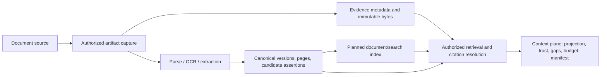

# Context experience: connect, map, test, enable

Status: implementation baseline, 2026-11-09. [Enterprise context sources](context-source-connectors.md) provides provider connections, bindings, qualification and governed refresh. The [Contextboard setup workflow](context-source-setup.md) adds shared source revisions, bounded sample reports, consumer preview and enablement. [Context operations](context-operations.md) covers snapshot refresh/checkpoints, mapping expressions and crosswalks, captured-document lexical search and platform Application contracts. Broader CDC, semantic search, source-backed document delegation and Application library consumers remain proposed. The two source workflows retain separate APIs and revision histories.

## 1. The experience we want

A user should be able to open **Party 360**, connect a customer source, map its fields to the canonical model, test a few customers, and see exactly which agents and tasks can use the result. The same workflow should work for transactions, documents, risk scores, product holdings, and application data.

The primary workflow is visual: select resources, connect fields, configure transformations, resolve relationships, and inspect sample results. Users can also type queries and mapping expressions in an optional code editor. Both modes produce the same versioned mapping definition and run the same validators. Ordinary setup should be possible without writing code; engineers should have a useful code path when they need one.

The experience answers four questions throughout:

1. **What have I connected?** The source, permitted resources, execution identity, and actual connector support.
2. **What does it mean?** The canonical objects, fields, identifiers, relationships, and transformation rules.
3. **Does it work?** Evidence from a bounded sample, including rejected records, unresolved references, missingness, and freshness.
4. **Who can use it?** The context products, agents, tasks, and purposes enabled by this binding, with remaining gaps.

“Connection succeeded” is the start of setup. The useful outcome is **context available for a specific subject, purpose, and task**.

## 2. Fit with the repository today

Use the repository's current contracts as the destination. The mapping UI must read the pinned schema and catalog rather than maintain a separate hand-written canonical model.

| Existing foundation | Implication for this proposal |
| --- | --- |
| [Context product catalog](../../apps/fincrime-host/catalog/context-products.json) | Preserve the twelve existing product IDs and their object/field projections. A product is a governed view over records; connecting a source does not create a new ontology. |
| [Contextboard model](../../apps/web/src/domains/fincrime/context/model.ts) and [Engineer view](../../apps/web/src/domains/fincrime/context/Engineer.tsx) | Extend the existing Subject, Sources, and Governance layout. Engineer currently exposes requirements and providers as a read-only workbench. |
| [Canonical data validator](../../packages/library-contracts/src/index.ts) and [vendored ontology](../../packages/library-contracts/src/vendor/ontology.schema.json) | Validate mapped `data` with the existing closed schemas. Resolve the context schema version from the lock file; keep product versions, source schema versions, and mapping versions separate. |
| [Canonical record ingestion](canonical-records.md) | Reuse immutable record versions, stable object identity, source references, observation/valid times, provenance, and the authorized case commit path. A mapping emits candidate records; the service supplies authoritative envelope values. |
| [Connector registry](../../packages/persistence/src/connectors.ts) | Reuse connector identity and operational status. A tenant connection and a canonical mapping are separate artifacts, not extra copies of a catalog connector. |
| [Source policy contracts](../../packages/contracts/src/source-policy.ts) | Bind mapping and connector versions to source authorization, permitted datasets/fields, jurisdiction, access basis, processing/storage scope, and purposes. Existing `source-binding` is an authorization artifact, not a complete visual extraction mapping. |
| [Context plane](context-plane.md) | Keep selectors, field projection, trust labels, freshness checks, quarantine, budgets, and manifests in the existing assembly path. |
| [Current preview screen](../../apps/web/src/domains/fincrime/surfaces/context/context-preview.tsx) | A non-dispatching Bridge preview hook is still required. Until it exists, report preview unavailable instead of fabricating a packet. |
| [Document intelligence](document-intelligence.md) and [document mapping gaps](../../apps/fincrime-host/docs/document-context-mapping.md) | Reuse document contracts, extraction validation, and exact provenance. Successful extraction does not establish a verified fact. |
| [Deployment onboarding design](deployment-onboarding-design.md#connections) | Reuse shared connections, bounded tests, identity selection, and the distinction between cataloged, configured, executable, tested, and active. Its Lattice coverage assessment is a design input; actual imported capabilities must be measured in this repo. |

The current Contextboard `ready` calculation checks required fields against an agent's allowed field ceiling. Preserve that meaning and label it **Access coverage**. Add independent source, sample, freshness, and task checks before making any broader readiness claim.

### The objects users configure

| Concept | User-facing meaning | Cardinality |
| --- | --- | --- |
| Connector type | How the platform talks to a technology or provider | One type supports many connections |
| Connection | Where to connect and which identity to use; credentials remain server-side references | One connection supports many resource bindings |
| Resource binding | A table, view, endpoint, topic, or collection plus bounded retrieval parameters | One resource can feed several mappings |
| Canonical mapping | How source rows or artifacts become identified, versioned canonical records | One mapping may emit several related object types |
| Context product | An allowed projection of those canonical records | One product can draw from several sources |
| Consumer requirement | The fields, record counts, freshness, and scope needed by an agent/task | One consumer can require several products |

Use **Context resource binding** as the implementation name for the proposed retrieval artifact to avoid confusing it with the existing source-policy `SourceBinding`. Product copy can simply say “Source”.

## 3. Navigation and screens

Keep **Contextboard** as the entry point. Each product bank gains **Connect source**, **View mappings**, and **Test context** actions appropriate to the user's access.

- **Play:** which products support the selected consumer; source availability, last actual observation, and remaining task gaps.
- **Tune:** subscriptions and allowed field ceilings, linked to the bindings that can supply them. Mapping a field never grants permission to consume it.
- **Engineer:** connections, source resources, mapping versions, sample runs, schema changes, and operational health.
- **Preview:** what a selected agent/task would actually receive for a case, using the same server assembly logic as runtime.

A shared **Connections** list supports source-first setup. A user can start from “Connect Snowflake” or “Enable Party 360”; both arrive at the same binding editor. Returning from the editor preserves the product, agent, and draft selection.

Suggested new deep links are proposals: `/context/connections`, `/context/sources/:id`, and `/context/mappings/:id`. Preserve existing `/context?product=&agent=&mode=` and `/context/preview` entry points.

### Contextboard product inspector

```text
Party 360                              Consumer: Customer review
Access coverage                        Required fields within ceiling
Sources                                CRM connected; holdings not configured
Sample                                 18/20 parties valid · 2 need attention
Freshness                              CRM observed 4 min ago
Task context                           Missing Product.channel for 2 subjects

Sources                  Canonical objects             Consumers
CRM / customer_view  --> Party, CustomerRelationship --> Profile completeness
Core / accounts      --> Account                    --> Product profile
Product / holdings   --> Product                    --> Product profile

[Connect source]  [View mappings]  [Test context]
```

Counts have named denominators and scope. Show “18 of 20 sampled parties”; avoid a general “90% ready” badge. Show **Not tested** when no evidence exists and **Not subscribed** when the consumer does not use the product.

## 4. Guided setup: six steps

### Step 1 — Choose the context to enable

Choose a product and optionally an agent/task. Show existing canonical objects, required fields, freshness constraints, and currently missing sources. A template preselects a sensible mapping bundle, such as **Customer master → Party 360** or **Payments feed → Transactions**.

Selecting Party 360 can propose related Identity mappings because `Party.entity_id` needs an Entity. It should explain that dependency and let the user bind an existing Entity source instead of creating duplicate identities.

### Step 2 — Connect and discover

Select an existing shared connection or create one. Show supported authentication methods, service versus delegated identity where implemented, environment, permitted resource scope, and a **Test access** action. Delegated execution must fail if delegation is unavailable; no fallback to a broader service identity.

Resource selection is technology-specific:

| Source family | Guided resource selection | Additional setup |
| --- | --- | --- |
| PostgreSQL, Snowflake, BigQuery, Databricks, Fabric | Database/catalog → schema/dataset → table/view → columns | Subject key, time field, watermark, optional read-only query |
| OpenAPI/API | Approved operation → typed request parameters → response collection | Subject parameter, pagination, rate limits, observation time |
| Kafka/events | Topic → event schema/version → partition/key | Event time, deduplication key, offset/checkpoint and replay bounds |
| Object storage/document repository | Container/bucket → prefix/collection → metadata schema | Document identity/version, artifact access, subject links, content restrictions |
| Planned document/search DB | Approved index/collection → metadata filters → retrieval profile | Exact document access, subject/tenant filters, index generation and citation resolution |

Show discovery, sampling, execution, and refresh support separately for each imported adapter. A catalog card must not imply that a discovery API or runner exists. When discovery is unavailable, allow schema import or a sample upload, then clearly retain **Live schema unverified** until a real source test succeeds.

Discovery captures a schema fingerprint and shows types, nullable fields, nested structures, candidate keys, and masked examples. Treat inferred keys/types as suggestions. A small sample does not prove uniqueness or establish a source contract.

### Step 3 — Scope and retrieve

Use a visual filter builder for subject identifiers, date windows, resource selections, and row limits. Populate parameter types from the source contract. Show a human-readable request summary and the estimated request size when available.

For transactions, require an explicit time window and page/row budget. For an event stream, bound tests by offsets and duration. For a document source, bound document count, bytes, and parser work. No sample action starts an unbounded scan or advances the production checkpoint.

Advanced users can edit a read-only SQL statement or a typed API request. Values are bound parameters; tenant and allowed-resource constraints remain enforced by the execution service. Store a query digest and parameter schema with the binding. Read-only source credentials, operation allowlists, timeouts, and server limits enforce the boundary beyond editor validation.

### Step 4 — Map to canonical objects

Present source fields, mapping rules, and the canonical schema side by side. Allow drag connections, keyboard-based “Map to…” selection, and a searchable mapping table.

```text
CRM customer_view           Mapping                       Canonical model
customer_key       ------> Stable ID: CRM customer key --> Record.object_id
customer_key       ------> Resolve Entity ID          --> Party.entity_id
legal_name         ------> Trim; preserve original    --> Entity.name
kind               ------> Lookup person/company      --> Entity.entity_type
relationship_role  ------> Approved value map         --> Party.role
customer_segment   ------> Approved value map         --> Party.customer_type
business_purpose   ------> Direct                     --> Party.profile.business_purpose

Required: 7 of 8 mapped     Unresolved: Entity.identifiers
Selected field: Entity.identifiers
Expected: array of identifiers · Source: not selected
[Choose source field] [Add lookup] [Inspect requirement]

[Visual] [Code]       [Validate mapping] [Run sample]
```

The example shows a partial mapping. It must not validate as a complete Entity/Party bundle until every required field in the pinned schemas is supplied. Labels like “7 of 8” are illustrative and computed from the actual selected bundle.

Field details expose canonical path, type, requiredness, vocabulary, description, source path, transformation, null behavior, and consumers that require it. Distinguish **Schema required**, **Task required**, and **Optional**. A nullable source cannot silently satisfy a required canonical field.

Offer typed transformations: rename, trim, case normalization, decimal parsing, date/time parsing with timezone, array/object construction, enum lookup, identifier resolution, bounded joins, and explicit unit conversion. Show input and output examples immediately. An unmapped enum remains an issue; it does not acquire a guessed default.

For one row emitting several records, provide an object group with parent/child keys and explicit cardinality. For joins, show the actual key pairs, expected relationship, duplicate-key behavior, and unmatched records. A many-to-many expansion needs an explicit choice and output bound.

Suggestions may propose mappings with a reason and confidence indicator. Users accept them before they become mapping rules. All accepted rules remain deterministic. New source fields remain unmapped until reviewed; sensitive columns are not automatically added to previews or mappings.

### Step 5 — Test on a sample

Choose **Uploaded sample**, **Saved fixture**, or **Live bounded sample**. Identify fixture/synthetic data visibly; it cannot qualify a live connection. Configure subjects, time range, row/document cap, and optionally a consumer task. Default to a small sample, with the proposed starting limit of 20 subjects or 100 source rows, adjusted to the connector and enforced server-side.

Run the stages separately and preserve their results:

1. **Fetch:** access, parameters, pagination, schema fingerprint, and source limits.
2. **Transform:** field conversions, joins, identity resolution, and emitted candidate records.
3. **Validate:** canonical data schemas and record envelopes, then relationship and temporal rules.
4. **Assess context:** apply consumer requirements, source authorization, field projection, freshness, and completeness.
5. **Preview packet:** assemble the structured/model views when the non-dispatching backend hook exists. Otherwise show **Packet preview unavailable**, even if mapping tests passed.

```text
Sample: CRM / customer_view · live · 20 rows · mapping v3
Fetch         Passed     20 fetched · source returned all 20 requested rows
Transform     Attention  18 valid candidate records · 2 rejected
Relationships Attention  1 unresolved entity reference
Task check    Gaps       Product.channel unavailable for 2 subjects
Packet        Not built  Required context missing

Row  Source value         Destination             Issue                Action
07   customer_segment=X   Party.customer_type     Unmapped value       Edit value map
12   entity_key=null      Party.entity_id         Required reference   Inspect identity rule

[Source rows] [Canonical records] [Relationships] [Task gaps] [Lineage]
[Fix selected mapping] [Run again] [Save sample report]
```

Each issue links to the source row/document and canonical field. Use stable issue codes with a plain-language explanation and a concrete repair action. Rejected rows retain a protected reference and reason. Never silently drop them and display an all-green result.

Tests stage data in an isolated tenant-scoped preview area. They do not commit case records, send messages, invoke business effects, start schedules, or alter production ingestion offsets. A test may use an authorized source read and, for an explicitly selected document extraction test, bounded parser/model calls. Show that work before running it and retain the receipt.

Save the mapping revision/digest, source schema fingerprint, schema/catalog versions, sample digest, input parameters, identity/access scope, source watermark, observation time, stage outcomes, counts, and issue details. Store sensitive sample content under its access and expiry policy; ordinary logs contain identifiers/digests rather than raw data.

The report says **Sample validated**, not “all source data validated”. Show selection method and limitations, including missing rare enum values, incomplete pagination, and sample-only relationship checks. Support adding boundary examples and saving expected results as regression fixtures.

### Step 6 — Enable and monitor

Review the source resources, mapped fields, access scope, sample report, refresh behavior, and consumers affected. **Save draft** persists incomplete work. **Enable binding** pins an eligible tested revision through the existing authorized release/activation path. Any required approval follows the actual tenant policy.

Enabling requires the executable connector, credentials/access, mapping, schema compatibility, and required tests to be valid for the intended scope. A partial mapping may supply an explicitly limited set of canonical types/fields; it must not claim to enable consumers whose mandatory requirements remain unmet.

An enabled binding appears on its product with last successful fetch, source observation/watermark, latest validation, checkpoint/index state where relevant, and unresolved gaps. A green access probe cannot substitute for fresh data. **Pause**, **Retry bounded fetch**, **Inspect failures**, **Re-test**, and **Create new mapping version** provide the operational actions.

## 5. Canonical alignment by context area

| User goal | Current product and canonical targets | Required mapping and testing decisions |
| --- | --- | --- |
| Party 360 | `party360`: Party, CustomerRelationship, Account, Counterparty, ExpectedActivity, GeographyExposure, Product; related `identity.intelligence`: Entity, IdentityIdentifier, Address | Distinguish entity identity, institution-specific party role, account identity, and source keys. Test cross-source resolution and unmatched customer/account links. Profile legal name does not eliminate Entity identity requirements. |
| Transactions | `transaction.intelligence`: Transaction, Payment, DatasetScope, PaymentRail; trade-related objects where applicable | Map source/target endpoint identities, decimal amount, currency, timestamp, event ID, status, and optional transaction type. Validate reversals, duplicate events, late arrivals, and window completeness. |
| Documents | `document.intelligence`: Document, DocumentVersion, DocumentPage, ExtractedAssertion; related `evidence.intelligence`: Evidence, SourceRecord, Assertion | Bind artifact hash/version, media type, pages, subject, extraction contract, exact spans, and review state. Preserve unknown dates and partial text coverage. Search results must resolve to these versions and evidence. |
| Risk scores | `risk.intelligence`: RiskAssessment, RiskFactor, RiskModel, SourceOfFunds, SourceOfWealth | Preserve assessment subject via the record envelope, score scale, model/version, effective time, tier vocabulary, contributions, source, and limitations. Imported score and platform-derived assessment retain distinct provenance. |
| Products and holdings | `party360`: Product, Account, CustomerRelationship; `network.intelligence`: Relationship only where semantics fit | Product currently contains `product_type`, `channel`, and `active`. Resolve how the party owns/uses an account or product. Rich offering catalogs, holding terms, and application-product links need explicit versioned semantics. |
| Applications | No current `Application` object or application context product in the inspected ontology/product catalog | Preserve the source payload as authorized SourceRecord/evidence. Map only fields that independently fit existing records. Introduce an approved Application contract before claiming canonical application context. |
| Other context | Existing identity, ownership, registry, screening, network, case, policy, and evidence products | Reuse the same studio, product projections, and consumer requirements. Context ingestion of historical decisions or policies does not confer runtime decision or approval authority. |

### Party identity and relationships

Present **Identity rules** as a first-class panel: source namespace, source primary key, canonical ID strategy, institution scope, crosswalk/lookup, and unresolved/conflicted behavior. Keep source keys beside canonical identifiers in lineage.

A customer record can emit Entity, Party, and CustomerRelationship records with different stable IDs. Account records resolve to the correct entity; a declared product holding must not be inferred merely because the same product type occurs in two sources. Relationship records and their role vocabularies must match the admitted schema.

Use a small relationship preview: selected party → accounts → counterparties → documents → assessments. Every edge exposes its source and resolution rule. Ambiguous matches go to a review queue; do not merge parties on name alone.

### Transaction semantics

The current `Transaction.amount` is a decimal string, and `status` is `settled`, `pending`, `reversed`, or `cancelled`. Display examples such as `amount_minor=129900` with currency USD becoming `"1299.00"` only under an explicit minor-unit rule. Reject unknown currency/unit combinations instead of universally dividing by 100.

`source` and `target` need an approved endpoint identity convention and resolvable namespace. The current string shape alone cannot establish whether a source ID refers to an account, entity, or provider alias. Treat that semantic contract as a binding requirement.

Track received, accepted, rejected, and duplicate counts separately. A row-limited sample cannot emit `DatasetScope.complete=true` for a larger transaction window. The current DatasetScope requires an expected count and watermark: if the source cannot establish these, retain explicit coverage limitations in the test/source metadata and surface a contract gap rather than inventing them.

### Risk score semantics

Show source score, source scale, model version, mapped score, tier rule, and effective time together. Never assume `82/100`, `0.82`, and `HIGH` are interchangeable. A transformation that rescales a score needs an explicit reversible rule and retained original values.

`RiskAssessment` requires `tier`, `score`, `contributions`, and `model_version`. If the source lacks a required semantic value, show the gap. An empty contributions list means no supplied breakdown and cannot satisfy a consumer that needs explainability. Risk model configuration follows the existing control-plane authority path; ingesting a provider model descriptor does not activate that model.

### Application and product extensions

Propose Application as a separately versioned addition, with stable application ID, applicant references/roles, requested products, submission/channel, lifecycle status, effective times, evidence references, and attributed historical decisions. Define joint applicants, resubmission, withdrawal, and application-to-account linkage before admitting it.

Do not rename Application to Case or Product just to make validation pass. A case can reference an application source record while the canonical contract is being designed. Product/account/application relationships need an explicit contract before the UI can advertise them as consumable canonical context. Extension metadata may preserve source details, but existing skills do not gain access to or understand those details automatically.

## 6. Documents and the planned document/search database

Make **Documents** a complete source journey with two views: **Ingest and map** and **Search and retrieve**. Reuse connection and mapping setup for document metadata; add document-specific extraction and retrieval tests.



The planned document/search DB owns a rebuildable retrieval index: chunks, indexed metadata, lexical/vector representations, and index-generation state. Durable artifact bytes and evidence identity stay with their existing owners. A search index is not the system of record for canonical facts, case state, or approvals. Physical engine selection is a separate implementation decision; align it with the [data stores plan](data-stores-plan.md) and existing context-store capabilities before adding another store.

### Ingest and map

Select collection scope, artifact/version keys, subject/application/account metadata, document type classification, extraction profile, parser/OCR, supported languages, refresh rules, and source access constraints. An application source key can remain an attributed external reference until its canonical contract exists.

Test a small set of documents and show the original page beside extracted values. Each value reveals document version/hash, page and span, raw/normalized representation, extraction contract/provider version, missingness, and review state. Missing, illegible, ambiguous, redacted, and not-applicable observations stay distinct.

The current Document schema requires issue and expiry timestamps. A document with no known issue date or no stated expiry must expose the known lifecycle contract gap. Keep its artifact/pages and observations in the authorized evidence path; never invent dates to create a passing Document record.

Only text actually extracted is searchable. Cited-quote-only DocumentPages must not be labeled full document text. Extraction candidates remain unverified; promotion to a fact goes through the existing authorized verification path.

### Search and retrieve

Offer a search-profile editor: selected collection, subject and business filters, permitted purposes, lexical/semantic/hybrid mode where supported, maximum results, snippet size, and context budget. Default to the selected case's authorized subjects, with an explicit policy-controlled expansion mechanism.

Each indexed chunk needs document ID/version/hash, page/span offsets, chunk digest, subject links, access/purpose labels, parser/chunker versions, and index generation; vector entries also need embedding model/version. Embedding or relevance similarity is separate from extraction confidence and verification status.

Enforce tenant, access, subject, purpose, and applicable residency restrictions before returning candidates or snippets; recheck access on citation/artifact resolution. Overfetch plus post-filtering alone is insufficient. A connector must declare whether the retrieval backend can enforce these filters.

The sample test accepts a query, test identity/purpose, selected subjects, and optional expected documents. It displays matched chunks, exact citations, excluded/inaccessible results without leaking their contents, missing expected results, stale/deleted versions, index lag, and the proposed context excerpt. If a vector-only index lacks a score-independent exclusion reason, report the available explanation honestly rather than inventing one.

Test known-answer retrieval and known-denied documents, alongside “no result” and incomplete-index cases. An empty search result establishes only the tested query/index scope. It does not prove a document, risk, or obligation is absent.

Only authorized, version-resolved results can enter context, marked `UNTRUSTED_EXTERNAL` with per-chunk provenance and injection/quarantine handling. This retrieval integration remains implementation work under the current context-plane notes. The model sees selected excerpts and citations; it does not gain unrestricted database access.

Deletion, access revocation, legal hold, source removal, and re-indexing need explicit lifecycle behavior: withdraw stale index entries, enforce current permissions, retain evidence under its own policy, and preserve historical run manifests. Show separate **Captured**, **Parsed**, **Mapped**, **Indexed**, and **Retrievable** states per document.

## 7. Visual and code editing share one mapping

Store a typed declarative mapping representation. Visual controls edit it directly. Code mode provides source/canonical autocomplete, inline schema diagnostics, typed helper functions, formatting, and a sample output panel. SQL/API retrieval definitions remain separate from canonical transformations, with links between both editors.

Illustrative proposed mapping syntax below; it is not an existing EHF contract or executable configuration. The enabled artifact must also pin the full canonical schema/catalog, connector/resource binding, authorization, and provenance configuration.

```yaml
mapping: payments-to-transaction
revision: 3
target: Transaction
identity:
  object_id: stable_id("payments", row.payment_id)
  version_id: content_version(row.payment_id, row.source_revision)
fields:
  source: resolve_id("account", row.debit_account)
  target: resolve_id("account", row.credit_account)
  amount: minor_units_to_decimal(row.amount_minor, row.currency)
  currency: enum_lookup("approved-currencies", row.currency)
  timestamp: parse_instant(row.booked_at, source_timezone)
  event_id: stable_id("payments-event", row.event_id)
  status: enum_lookup("payment-status", row.state)
on_invalid: quarantine
```

The server compiles expressions to a bounded deterministic plan. Preview and production execute the same plan and validators. No arbitrary JavaScript/Python, network calls, credentials, or nondeterministic clock/random values inside mapping expressions. Advanced custom transformations, if later supported, need a separately versioned and qualified capability.

Visual → code → visual round-tripping must preserve meaning. Unsupported advanced constructs are shown as a labeled read-only block in visual mode until edited in code; the UI must not drop them. Conflicting edits use revision checks and a diff. Changing a mapping invalidates qualification for the changed revision.

Envelope construction is service-owned: tenant, authorized case/subject scope, classification/purposes, source references, connector invocation provenance, store-recorded time, and digest cannot be overridden by source data. Stable object IDs survive re-fetches; version identity and supersession follow the existing canonical record rules. Preview IDs and staging references cannot masquerade as committed case records.

## 8. Validation, status, and recovery

| Check | Example failure | What the user sees |
| --- | --- | --- |
| Connection | Credentials expired; runner unavailable | Source unavailable, affected bindings, reconnect/re-test action |
| Source schema | Column removed; numeric field became text | Schema diff, impacted mapping fields, blocked revision |
| Canonical structure | Decimal invalid; required field absent | Row/field issue with expected type and repair link |
| Semantics | Unknown score scale; timezone missing | Explicit decision required before conversion |
| Identity and joins | Missing entity; duplicate crosswalk; fan-out | Unmatched/conflicting key pairs and relationship preview |
| Time and coverage | Stale observation; incomplete transaction window | Actual source times, completeness limits, affected task |
| Policy and access | Purpose denied; field outside ceiling | Excluded field/source, policy reason, authorized repair path |
| Consumer requirements | Too few usable records; required field missing | Exact agent/task requirement and missing evidence |
| Document integrity/retrieval | Hash mismatch; missing citation; stale index | Excluded chunk/document, lineage error, rebuild/re-capture action |

Separate these dimensions in the data model and UI:

- **Connector operational state:** preserve current `available`, `live_ready`, `quarantined`, and `retired` semantics.
- **Binding lifecycle, proposed:** Draft → Tested → Enabled → Paused → Retired. Failed/expired qualification prevents enablement. A failed attempt is a retained test result, not a destructive lifecycle transition.
- **Connection health:** reachable, authentication failed, unavailable, or not checked, with last probe time.
- **Data condition:** last successful observation, freshness, validation failures, rejected counts, and known coverage.
- **Consumer result:** access coverage plus actual per-subject/task gaps, exclusions, and packet outcome.

Schema drift monitoring compares the pinned fingerprint with fresh discovery where supported. Added fields prompt review without widening scope. Removed fields, incompatible type changes, required enum changes, and key/relationship changes invalidate affected mappings. Retain the prior enabled revision for unaffected work where policy allows; never silently rewrite it to match the new schema.

Changing credentials, identity scope, source contract, mapping, canonical schema, or authorization requires the relevant checks again. The enable operation checks the exact revision/digests and evidence validity atomically so a successful test cannot qualify a different artifact.

For ongoing ingestion, use bounded retries, idempotent record keys, durable checkpoints, quarantine for invalid inputs, and explicit replay bounds. Advance a checkpoint only after its batch's accepted/rejected outcomes are durably accounted for. Preserve source conflicts and supersession history. A refreshed source does not mutate an already recorded context pack; later runs assemble new manifests.

Keyboard users must be able to choose mappings and repair issues without dragging. Status uses text and icons as well as color. Large schemas support search and filters for required, unmapped, invalid, or consumer-used fields. Autosave drafts, show dirty state, and retain work across failed tests and expired sessions.

## 9. Implementation seams and delivery order

Keep platform connection/mapping services generic; FinCrime supplies canonical contracts, context product projections, and consumer requirements. Reuse the existing web UI kit, BFF contract generation, service authorization, gateway receipts, canonical validator, and case/context stores.

New logical artifacts are Connection, ContextResourceBinding, CanonicalMappingRevision, SampleRunReport, and ContextEnablementRevision. Names and service routes are proposed, not implemented. Each artifact needs tenant/owner scope, revision/digest, environment, and server-controlled audit metadata; secrets remain external references. Reuse existing source-policy artifacts for authorization rather than creating a second policy engine.

Required service operations are discovery/capability reporting, bounded sample fetch, mapping validation/compilation, isolated sample execution, issue/lineage reads, consumer assessment, non-dispatching packet preview, version-pinned enablement, and health/drift inspection. Browser code never executes source queries directly or constructs a substitute context pack.

Connectors supply transport/discovery and authentic source metadata. Mapping services supply typed candidates and transformation lineage. Authorized ingestion supplies canonical record envelopes and case commits. Context assembly supplies consumer projection, trust, budgets, and manifests. A planned search service supplies filtered candidates and exact citations.

| Delivery slice | Concrete user outcome | Completion condition |
| --- | --- | --- |
| 1. Connect and map | Configure one executable Lattice-based structured connector, reuse its connection, map Party/Entity or Transaction data visually and in code | Server-bounded live sample, canonical errors, revisioned mappings, equivalent visual/code execution |
| 2. Enable context | Link mappings to product banks and selected consumers; test subjects and enable an eligible binding | Per-task gap assessment, authorized canonical commit path, and real non-dispatching packet preview; preview stays unavailable until its hook exists |
| 3. Operate and extend | Refresh, inspect drift, quarantine/replay failures; add risk/product templates | Credentials/access changes and schema changes trigger relevant checks; checkpoint/replay and version history work |
| 4. Document retrieval | Capture/parse/map documents, build the planned index, test filtered retrieval and context citations | Exact version/span resolution, permission enforcement, index lifecycle, and context-plane retrieval integration |
| 5. Application semantics | Admit Application and richer holding/link contracts, then expose their mapping templates | Versioned schema/catalog update, consumer contracts, migrations/compatibility, and fixtures; no shortcut through unrelated object types |

### Acceptance scenarios

1. A user connects a supported customer view, maps Entity/Party fields visually, tests 20 subjects, repairs an unknown customer type, and saves/enables the tested revision without typing code.
2. An engineer edits the same mapping in code, sees canonical path/type diagnostics, and gets identical sample output after returning to visual mode.
3. A transaction sample with duplicate events, ambiguous endpoint IDs, and incomplete pagination reports each issue and never claims full-window completeness.
4. A provider risk score without model/scale information produces a specific semantic gap; the user cannot hide it through a guessed default.
5. A removed source column shows an impact diff and blocks incompatible qualification without silently changing the enabled mapping.
6. A well-formed mapped record outside the selected purpose/access scope is excluded from consumer context despite passing schema validation.
7. An application feed can be captured as source evidence, while the UI clearly marks canonical Application support as pending its contract.
8. A document without a known expiry preserves that missingness, retains page/span lineage, and never becomes verified through extraction or search indexing.
9. An unauthorized document cannot appear in search snippets or citation resolution. A re-indexed/deleted document cannot silently replace a historical citation.
10. A sample run creates no production case mutation or checkpoint advancement. Editing its mapping requires a new test before enablement.
11. Connection health, access coverage, and source freshness can show different outcomes; the Contextboard explains which condition blocks the chosen task.
12. A real packet preview uses runtime assembly and exact versions. An unavailable preview hook returns its blocker and no invented packet.

The first complete experience is a user moving from **“I have a customer or transaction source”** to **“I can see valid canonical records, understand remaining task gaps, and enable the exact tested binding”** within the existing Contextboard.
