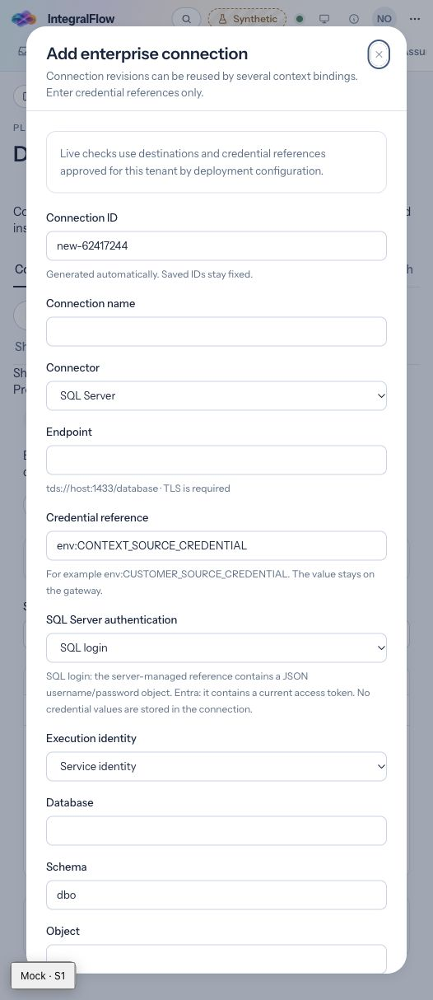

# SQL Server context connector

Implemented on `codex/context-connect-evolve`, 2026-11-11. SQL Server was the missing direct adapter among the five requested providers. Databricks, Fabric, Snowflake and REST/OpenAPI already have execution paths. All remain subject to per-connection qualification and source authorization; implementing an adapter does not certify a customer system.

| Catalog source | Execution path |
| --- | --- |
| SQL Server | New `sqlserver` product provider using Tedious/TDS, SQL login or Entra access-token references. |
| Microsoft Fabric | Existing `fabric` product provider using Entra/TDS; shares the native transport without adopting SQL login authentication. |
| Databricks | Existing SQL Statements API and Unity Catalog discovery. |
| Snowflake | Existing SQL API with separate parameter bindings. |
| REST API | Existing OpenAPI-described GET operations with typed response validation. |
| Kafka / object storage | Existing bounded external connector gateway contract; native broker subscriptions and storage SDK adapters are not provided. |

## Configure a connection

Select **Platform → Data sources → SQL Server → Configure SQL Server**. Enter a connection name, endpoint, credential reference, database, schema and table/view. `dbo` is the initial schema. The connection can be reused by versioned product bindings.

Example connection definition (all values below are configuration, without credentials):

```json
{
  "id": "sql-customers",
  "name": "Customer master",
  "provider": "sqlserver",
  "endpoint": "tds://sql.example.test:1433/governed",
  "credentialRef": "env:SQL_CUSTOMERS",
  "identityMode": "service",
  "sqlServerAuth": "sql_password",
  "openapiPath": "/openapi.json",
  "resource": {
    "database": "governed",
    "schema": "dbo",
    "object": "customers",
    "catalog": "",
    "warehouse": "",
    "project": ""
  }
}
```

`openapiPath` is a required shared-contract field and is unused by TDS. SQL Server deployment setup proposals can also be imported; imported definitions still require review, binding and qualification.

For `sql_password`, a deployment secret manager must supply `SQL_CUSTOMERS` to the capability gateway as a JSON object containing nonempty `username` and `password` strings. For `entra_token`, that reference must hold a current raw access token for the configured SQL endpoint. Token acquisition and renewal belong to deployment identity management; this adapter does not obtain or refresh tokens. Entra authentication requires a server configured to support it. SQL login requires server-side SQL authentication support. See [Tedious authentication and connection options](https://tediousjs.github.io/tedious/api-connection.html) and [Microsoft's Node.js connection guidance](https://learn.microsoft.com/en-us/sql/connect/node-js/step-3-proof-of-concept-connecting-to-sql-using-node-js?view=sql-server-ver16).

The UI and saved connection contain the `env:` reference only. Do not put the secret JSON, passwords or tokens in repository files, URLs or binding parameters. `sql_password` is the default when a service connection omits `sqlServerAuth`.

Delegated SQL Server execution requires `entra_token` and an explicitly supplied runtime token-exchange callback. The current gateway qualification path does not supply one; use a service identity for that baseline. Missing delegation fails without falling back to service credentials.

## Allow the exact destination

Deployment configuration must include the tenant's exact provider/endpoint/credential-reference tuple in `CONTEXT_SOURCE_TARGETS_JSON`:

```json
{
  "tenant_example": [
    {
      "provider": "sqlserver",
      "endpoint": "tds://sql.example.test:1433/governed",
      "credentialRef": "env:SQL_CUSTOMERS"
    }
  ]
}
```

The gateway must have network access to the configured TCP port. Specify an explicit port for named instances; SQL Browser instance discovery is not implemented. The endpoint path must exactly match the configured database. Inline credentials, query strings, fragments and encoded paths are rejected. Workload reads still pass through the existing acquire/transport/use source policies and active binding/qualification pins.

TLS encryption and certificate validation are mandatory (`encrypt: true`, `trustServerCertificate: false`, minimum TLS 1.2). The server certificate must match the endpoint hostname and chain to a trusted CA. For a private CA, supply the PEM bundle through gateway deployment configuration as `CONTEXT_SOURCE_CA_PEM`; the form has no certificate-validation bypass. This CA setting is shared by native context sources in that gateway process.

Use a database principal with SELECT permission limited to approved tables/views and sufficient metadata visibility to discover those resources. `readOnlyIntent` is a routing hint, not a substitute for database permissions. These connection options follow the [Tedious API](https://tediousjs.github.io/tedious/api-connection.html).

## Bind, discover and qualify

Create a product binding pinned to the saved connection revision. Use the existing mapping editor to supply the key, observation timestamp, canonical mappings, optional subject/purpose scope and typed parameters.

The [case lookup editor](context-case-lookup.md) now provides visual input-field/parameter/source-filter configuration, returned canonical subject and purpose fields, local example resolution and a saved lookup review. Runtime field paths are evaluated against the acquisition node's supplied input; they do not add case selectors or source access.

A supported query is:

```sql
SELECT id, name, entity_type, identifiers, observed_at
FROM customers WHERE id = :customer_id
```

The compiler accepts a deliberately small SELECT grammar: explicit columns or `*`, one scoped relation and optional equality predicates joined by `AND`. It rejects expressions, functions, comments, CTEs, joins and multiple statements. Parameter values are bound separately. Resource and field identifiers must satisfy the existing identifier contract. SQL Server projection and predicate columns must use the exact spelling returned by discovery; unknown or differently cased names fail before a row query, ensuring exact numeric conversion cannot be bypassed through case-insensitive lookup.

Discovery reads `INFORMATION_SCHEMA.COLUMNS` for only the pinned database/schema/object. It returns names, SQL types, nullability and a schema fingerprint without reading customer rows. Discovery still requires a syntactically valid binding and declared test parameters.

Reads use `TOP (maximumRows + 1)` to detect truncation. The contract permits at most 200 rows and a timeout of at most 60 seconds. The native transport enforces the overall timeout, closes on cancellation, limits metadata to 500 fields, and checks a 2 MiB serialized response budget while collecting streamed rows. That budget bounds accepted result data; the driver can allocate an individual cell before its row event.

SQL Server `decimal`, `numeric`, `money`, `smallmoney` and `bigint` columns are projected as text before driver coercion, retaining exact values for canonical decimal/string mappings. Money uses conversion style 2 to retain four fractional digits. See [Microsoft CAST/CONVERT documentation](https://learn.microsoft.com/en-us/sql/t-sql/functions/cast-and-convert-transact-sql?view=sql-server-ver17). SQL JSON text can use the existing `json` transform; array/object canonical fields are validated after transformation. Source observation timestamps must represent UTC (or use `datetimeoffset`); `datetime`/`datetime2` values are decoded with `useUTC: true`. No observation time is fabricated.

Run **Discover → Preview → Qualify** for the pinned binding. Preview/qualification validate canonical data, required fields, freshness and subject scope. Qualification rejects empty or truncated results. Existing activation/release approvals and runtime source policies remain required. Refresh uses the approved product-binding snapshot path; CDC, Windows integrated authentication and automatic field-level multi-source resolution are outside this adapter.

## Verification evidence

Driver-boundary tests exercise the real allowlist, credential resolution, query compiler, TDS adapter and canonical normalizer with a mocked Tedious connection. They cover SQL login and Entra, Fabric authentication compatibility, TLS options, discovery scope, bound parameters, exact numeric projection, JSON/date normalization and lineage, truncation, streamed-result limits, provider failure sanitization, transport denial, cancellation and cleanup. HTTP-boundary tests also exercise the existing Databricks and Snowflake paths; REST has existing contract/response tests.

Validation passed: 34 connector tests, 10 contract/deployment tests, 10 targeted web catalog/coverage/ontology tests, and 3 gateway transport-policy tests. Five database-dependent gateway tests were skipped because their test database was not configured. Connector/contracts/gateway/web/UI-journey TypeScript checks, connector compilation, generated contract synchronization and the production web build passed; the bundle check found no mock code. Gitleaks 8.30.1 scanned the changed-file snapshot with the repository policy and found no leaks (this was not a new full-history scan).

Browser verification used the synthetic Platform Administrator, confirmed SQL Server setup routing, `dbo`, and switching SQL login to Entra. An initial stale mock inventory after hot reload blocked editing as intended; a page reload restored the synthetic inventory and setup form. Browser diagnostics contained no error-level entries after reload. Browser journey definitions were typechecked; the Playwright CLI suite was not run.

**No live SQL Server, Fabric, Databricks, Snowflake or customer REST endpoint was qualified in this session.** A deployment with network access, trusted certificates, managed credentials and approved source/binding configuration must complete the qualification flow above before production use.


