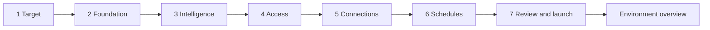

# IntegralFlow deployment and onboarding design

Proposed experience, 8 November 2026. Design scope only; provisioning and application changes are not implemented by this proposal.

IntegralFlow should open directly into a resumable setup experience when no environment has been configured. An administrator chooses a deployment target, accepts a small foundation, selects intelligence from curated catalogs, maps user access, connects enterprise systems, and activates schedules. The same experience remains available under **Administration → Environments** for later changes and additional environments.

The product speaks in capabilities: container hosting, PostgreSQL, object storage, identity, reasoning, document processing, enterprise context, and delivery. Cloud products appear as implementations of those capabilities. The application configuration remains independent of the cloud hosting it.

## Current baseline

Design against remote main at `2444142087ce1dcd37133b158e071d38498e6d98`, including merged [PR 33](https://github.com/hganesha/ehfconcept/pull/33). The local checkout predates that merge and contains unrelated work in progress.

| Foundation | Current behavior | Design consequence |
| --- | --- | --- |
| Human identity | OIDC issuer, audience, discovered or configured JWKS, configurable roles claim | Offer standards based SSO; no default cloud directory |
| Workload identity | One projected token per service; issuer, audience and subject map to logical service names; callees assign roles | Preserve each service identity regardless of hosting provider |
| Signing and secrets | Mounted RSA signing keys; environment or file secret references | Integrate any secret manager through a mounting or resolution adapter |
| Storage and telemetry | PostgreSQL, S3-compatible storage with object lock for protected artifacts, OTLP | Test required protocols and behavior before declaring a service compatible |
| Runtime and intelligence | Hosted HTTP, Databricks, named adapter bindings, OpenAI-compatible model endpoints and generic HTTP operations | Provider names belong in connection recipes, not platform modes |
| Packaging | Dockerfile builds one selected Node service using `SERVICE_NAME`; Compose has multiple service builds and separate Python hosts | A universal application image is additional packaging work |
| Deployment | Cloud infrastructure and delivery pipelines live outside the application; the old Azure deployment wizard has been removed upstream | Add a neutral environment control surface and runner contract; do not restore the old Azure backend |

Sources: [current README](https://github.com/hganesha/ehfconcept/blob/2444142087ce1dcd37133b158e071d38498e6d98/README.md), [Dockerfile](https://github.com/hganesha/ehfconcept/blob/2444142087ce1dcd37133b158e071d38498e6d98/Dockerfile), [Compose](https://github.com/hganesha/ehfconcept/blob/2444142087ce1dcd37133b158e071d38498e6d98/compose.yaml).

## Product decisions

1. **One distributable application image**, pinned by digest, with entrypoints for the console, APIs, workers and included runtime modules. The deployment recipe assigns entrypoints to execution units with distinct identities. Database servers, enterprise systems and provider hosted intelligence remain external resources.
2. **One setup journey**, available on first launch and from Administration. Users never need a separate cloud-specific administration application.
3. **One connection registry** shared with Intelligence, External Capabilities, Context and Integrations. Setup edits their canonical drafts rather than creating copies of settings.
4. **Use existing or create** for each resource. Reuse verified resources by default. Provision only dependencies required by enabled capabilities.
5. **One provider-neutral deployment profile** resolves through versioned provider recipes. Profile fields describe requirements and bindings; provider resource identifiers live in adapter-specific references.
6. **Curated dropdowns for every model selection**, including frontier and open-weight models across providers. Provider hosting, model identity and intended use remain separate selections.
7. **Review before external changes.** Discovery is read-only. Resource creation and configuration activation have concrete review screens and explicit actions inside the product.

One distributable image can run in multiple containers. A production deployment that runs every service in one container is a separate architecture decision: the current service isolation, projected credentials and hosted runtime requirements must first be redesigned and verified. Do not quietly collapse the new per-service identities to satisfy a packaging label. The image manifest must also account for the web bundle, OPA and any required Python modules; a single Dockerfile for the Node services does not yet package the whole application.

## Screen structure

Use the existing IntegralFlow shell and UI kit. The environment name and current target stay in the header. A compact left rail shows the seven steps. The center contains the current task. A narrow right summary shows the footprint and changes, with technical details available on demand. Avoid a cloud-service catalog as the first screen.

Each step has one primary action, **Continue**, with **Back** and **Save and exit** as secondary actions. Resource rows use a consistent pattern: capability, selected service, use existing/create, verification state, and Configure. Show only settings needed for the chosen recipe. Advanced settings stay collapsed.

The summary separates application image and service instances, database instances and logical databases, reused resources and newly created resources, and optional services. It labels estimates with their source and timestamp; unavailable pricing is shown as unavailable.

## Target

Opening copy: **Set up your environment**. Ask for an environment name and deployment target: AWS, Azure, Google Cloud, Kubernetes, or another supported container platform. A Databricks workspace can provide data or intelligence independently of the application hosting target; it is not a synonym for the deployment cloud.

Connect using the target's supported short-lived authorization flow. Show the signed-in administrator, account or project, available scopes and actual permissions. Use **Deployment scope** as the common concept, then display the selected provider's real account, project, namespace or resource-group labels. An AWS scope can include an account, region and tagged resource boundary; do not imply every cloud has a resource-group equivalent.

Offer **Use existing scope** and **Create scope** where the adapter supports creation. Explain any parent-scope permission needed to create the scope or establish trust. A user who can deploy into an existing scope may lack permission to create it. Bootstrap authority is short lived and separate from application runtime identity.

Discovery lists reusable resources and permission gaps. It does not create anything. An infrastructure administrator can export the concrete bootstrap request and complete it externally, then let the same setup resume.

## Foundation

Default to **Minimal**. A **Resilient** option adds verified redundancy, backups and availability settings for the chosen target. Security requirements and identity boundaries apply to both. Avoid preset provider SKUs or invented cost promises.

| Capability | Minimal selection | Required validation |
| --- | --- | --- |
| Application hosting | Smallest supported container recipe; same application image for service entrypoints | Architecture, health checks, HTTPS reachability, separate service identities, token renewal, supported worker lifecycle |
| PostgreSQL | Reuse one compatible server where possible; separate control, case and context databases and least-privilege logins | Version, required extensions, transactions, notifications and fallback polling, migrations, authentication renewal, connection limits |
| Protected artifact storage | Reuse a compatible object store and required retention boundaries | S3 protocol, TLS, object lock, retention and read/write behavior using a bounded test artifact |
| Workload identity | Existing issuer or supported recipe that provisions trust | Unique subjects, audience validation, key rotation, service mapping and denied cross-service impersonation |
| Keys and secrets | Existing secret provider that can supply references or mounted files | Per-signer keys, file permissions, rotation and renewal; no secrets in profile exports |
| Telemetry | Existing OTLP collector or selected compatible destination | Reachable authenticated endpoint and a bounded test trace |
| Networking and ingress | Existing compatible network and HTTPS ingress | Private dependencies, required egress, callback paths and target-specific security rules |

An external API gateway is optional when the chosen ingress already meets policy. PostgreSQL signaling remains the work queue mechanism; a separate broker, cache, search cluster or cloud scheduler is not a default dependency. Add resources only when an enabled feature requires them. Network security groups or firewall rules are infrastructure settings here; directory groups and user roles belong in Access.

The PostgreSQL selector can offer generic PostgreSQL, Flexible Server, RDS/Aurora PostgreSQL and Lakebase through recipes. It must verify compatibility for each database purpose. The current context store uses pgvector and Apache AGE; a service offering PostgreSQL does not establish support for both. Permit a separate compatible context store when necessary, and show the increased footprint. SQL Server, MySQL and arbitrary “Amazon SQL” products are not interchangeable with the application's PostgreSQL persistence layer; they can still be enterprise context sources through a compatible connector.

Supported extensions vary by managed engine and version: see [RDS extension versions](https://docs.aws.amazon.com/AmazonRDS/latest/PostgreSQLReleaseNotes/postgresql-extensions.html) and [Lakebase extensions](https://docs.databricks.com/aws/en/oltp/projects/extensions). Query the actual target's available extensions and run application compatibility probes rather than relying on catalog labels.

Foundation selections remain a draft until Review and launch. Existing resources can be tested immediately. New resources show **Verify after creation**, which is distinct from Verified. If a later step requires live discovery on a new resource, offer an explicit **Review and create foundation** action, then resume the same journey. Mark these resources as already applied on the final review.

## Intelligence

Lead with **What should this environment be able to run?** Reuse the Intelligence switchboard's canonical connections and binding drafts.

| Selection | Interaction |
| --- | --- |
| Reasoning | Searchable curated dropdown by use or tier; select approved model, hosting connection and deployment |
| Runtime | Existing hosted HTTP, Databricks or another conformant runtime binding; show invoke, callback and lifecycle test results |
| Document processing | Optional typed OCR, extraction or classification bindings |
| Predictive inference | Optional typed online inference bindings for existing model endpoints |
| Fast decisions | Optional qualified System 1 decision bindings |
| Embeddings and reranking | Show only when enabled context features require them |

Model dropdown rows show model name, publisher, frontier/open-weight classification, hosting provider, pinned version, supported features, deployment region and eligibility. Distinguish publisher license metadata from the product's curated “OSS” grouping. Filter on tenant policy, data residency, credentials, capacity, runtime support and model qualification. Keep ineligible entries visible with a reason when that helps selection.

Use the existing reasoning tiers where configured: Low, Med, High and XHigh, with judge/evaluation as a separate use. Require only the tiers used by selected process flows. A simple deployment may start with one approved default model. All other model pickers resolve the same catalog IDs. Do not require users to type model IDs or construct endpoint paths.

The curated catalog is a versioned administrative dataset, not a hardcoded browser list or an unfiltered provider model feed. Provider discovery reconciles the catalog with resources actually available to the connected account. Selections pin catalog revision, model version, binding revision and qualification evidence. Fallbacks are explicit approved selections and never cross a residency boundary silently. A custom endpoint binds to a curated model or enters the separate catalog qualification workflow.

Foundry, SageMaker, Azure ML, Mosaic/Databricks serving and document-intelligence products can appear as optional service recipes. Each needs a verified adapter translating its authentication, request, response and lifecycle protocols to the neutral contracts. PR 33 removed the native Foundry and Azure document adapters, so these names must not appear as working choices merely because an older screen or Stratum catalog contains them. Runtime execution, model inference and document processing have separate capability tests.

## Access

Show **Who can use this environment?** Connect an existing OIDC identity provider, select directory groups where discovery is available, and map them to existing application roles. Support explicit claim/group mapping when the directory exposes no group browsing API.

| User-facing role | Existing authorization mapping |
| --- | --- |
| Platform administrator | `Platform.Admin` |
| Process author | `Harness.Author` |
| Release approver | `Harness.Approver` |
| Operator | `Harness.Operator` |
| Analyst | `Case.Analyst` |
| Reviewer | `Case.Reviewer` |
| Auditor | `Platform.Auditor` |

Keep internal compatibility role identifiers out of ordinary setup copy. A deployment permission is a new explicit authority; `Platform.Admin` must not silently grant infrastructure ownership. Maintain author/approver separation and tenant scope. A **Test access** action previews effective permissions for a selected test identity and verifies a real sign-in before completing owner handoff.

The initial administrator claim uses a single-use, time-limited bootstrap session supplied through the initial launch channel. Bootstrap endpoints remain inaccessible to unauthenticated public traffic. Complete OIDC owner verification before retiring that session, and provide a controlled recovery procedure. Application runtime credentials never inherit bootstrap cloud administration permissions.

Workload identities were resolved in Foundation. Access shows their generated service-to-service relationships in an expandable view, alongside separate signer ownership. Human directory groups do not replace workload subjects.

## Connections

Show **Connect your enterprise systems**, with three task groups: **Context sources**, **Capabilities and tools**, and **Inputs and outputs**. Intelligence connections configured earlier appear as linked existing connections. Optional groups can be deferred without implying their features are operational.

All connections use the same sequence: choose catalog entry, select an existing connection or authenticate, select resource scope, discover supported operations/schema, map a typed contract, test, and stage the binding. Credentials remain server-side references.

Context sources reuse Lattice patterns for Databricks, Snowflake, BigQuery, Fabric, PostgreSQL, Kafka, object storage and OpenAPI. Provide resource dropdowns where live discovery exists, typed parameters, source-key mapping, read-only query constraints, bounded sample previews, schema fingerprints, freshness policy and health checks. Shared enterprise connections can support multiple bindings without copying credentials.

Show **Run as service** and **Run as signed-in user** only where supported. Delegated mode requires token exchange and must fail when delegation is unavailable; it must never fall back to a broader service identity. Scheduled execution needs its own explicitly authorized service identity or a provider-supported durable delegation mechanism. A user's interactive session is not a schedule credential.

Capabilities and tools reuse External Capabilities and the MCP switchboard. Select a provider, then exact permitted operations or tools and their typed bindings. A healthy MCP server does not authorize every advertised tool. Keep jurisdiction, purpose, entitlement and qualification requirements attached to each binding.

Inputs support existing ingress contracts, authenticated webhooks and supported event or batch sources. Outputs support configured HTTP/webhook, event, or other implemented delivery adapters. Select direction explicitly. Configure event filters, data contract version, allowed destination, delivery identity, retries, deduplication and failure handling. Show a real bounded test result before activation.

Lattice's catalog and runtime have different coverage: built-in HTTP execution covers OpenAPI, Databricks, Snowflake and BigQuery; native execution covers PostgreSQL and Fabric. Kafka and object-storage execution require an external connector gateway in that implementation. Live schema discovery is narrower again. Preserve the distinction between **cataloged**, **configured**, **executable**, **tested** and **active** when adapting this work into IntegralFlow; these are not already imported connectors.

Sources: [Lattice connector catalog](https://github.com/hganesha/lattice/blob/cbf6282d29ae7e16b46e94c2e361080ab3c8935e/packages/contracts/src/connectors.ts), [execution and discovery](https://github.com/hganesha/lattice/blob/cbf6282d29ae7e16b46e94c2e361080ab3c8935e/apps/api/src/connectors.ts), [source binding studio](https://github.com/hganesha/lattice/blob/cbf6282d29ae7e16b46e94c2e361080ab3c8935e/apps/studio/src/SourceBindingStudio.tsx), [health store](https://github.com/hganesha/lattice/blob/cbf6282d29ae7e16b46e94c2e361080ab3c8935e/apps/api/src/connectorHealthStore.ts).

## Schedules

Offer **On demand**, **On event**, or **Scheduled** for eligible bindings and process flows. Select an interval or human-readable calendar rule, timezone and start date; advanced cron is optional. Preview the next three actual execution times, including daylight-saving behavior, before saving.

Configure overlap behavior, missed-run handling, maximum runtime, retries, backfill bounds and the execution identity. Keep source freshness targets separate from refresh schedules. A health probe is not proof that source data is fresh; display the last successful fetch and source watermark when available.

Schedules save disabled. Activation follows binding tests and final review. Prefer a PostgreSQL-backed due-work table, leases and idempotent dispatch through the existing worker framework to keep the footprint small. This durable scheduling facility is proposed work; PostgreSQL notifications alone do not implement it. Use a cloud scheduler only through an optional adapter where the deployment policy calls for it.

## Review and launch

Present a readable change list grouped into **Create**, **Reuse**, **Configure**, and **Activate**. Include the image digest, service execution units, resource inventory, logical databases, identity grants, network changes, secret references, selected models, connection tests and enabled schedules. Reused resources stay marked as externally owned. Open the architecture preview for placement and data-flow details.

The primary action is **Deploy environment** when resources must be created or updated, and **Activate configuration** when only existing, verified resources are being bound. Apply the exact reviewed profile and recipe versions. Edits invalidate affected test evidence and any dependent deployment plan; stale async results never validate a later draft.

The runner creates resources in dependency order, writes service configuration, applies database migrations once under a lease, starts services, performs readiness and identity checks, tests required bindings, and activates approved configuration. Schedules enable last. An optional failed connector leaves its feature unavailable; it must not produce a green “fully configured” state. A required failure prevents readiness for the affected workload.

Show a resumable task list with human-readable stages and expandable redacted logs. A partial failure resumes from recorded effects; it does not recreate or delete resources blindly. Cancel requests stop future work and reconcile operations already in flight. Configuration can return to its last healthy revision; database and infrastructure rollback depend on explicit compatibility and recovery plans. An object-lock retention setting may be irreversible and needs its consequence shown before application.

Completion opens **Environment overview** with the application URL, foundation health, effective models, access, connections and schedules. Each section's **Edit** action returns to the corresponding setup step with an impact diff. Later deployment changes preserve existing work and expose pending versus effective configuration separately.

## Stratum integration

Reuse Stratum's capability catalog, provider mapping IDs, provider artwork, infrastructure graph, boundary representation and static validation concepts. Render the architecture from the resolved deployment plan so the diagram and the runner refer to the same resource identities. Show account, network, region and trust boundaries without making a canvas mandatory for setup.

The inspected [Stratum revision](https://github.com/hganesha/stratum/tree/f716694f5716dac4bf313fc8162a661606350d9a) is a parser and visualizer. Its composer does not generate deployable infrastructure, and scripts are never executed. Its provider catalog is a Q3 2026 reference snapshot, with explicit mapping gaps; it cannot establish current provisioning or pricing support.

Its bundled Harness Factory archive contains an older Azure Terraform example, including agent/tool identity classes, App Configuration, API gateway and messaging modules. Treat these as reference material. Do not import that topology or its identity counts into the minimized platform. A deployable recipe must be rebuilt around the current neutral contracts and verified independently of its visual mapping.

Sources: [Stratum README](https://github.com/hganesha/stratum/blob/f716694f5716dac4bf313fc8162a661606350d9a/README.md), [infrastructure graph types](https://github.com/hganesha/stratum/blob/f716694f5716dac4bf313fc8162a661606350d9a/src/lib/types.ts), [provider catalog](https://github.com/hganesha/stratum/blob/f716694f5716dac4bf313fc8162a661606350d9a/src/lib/service-catalog.json), [reference archive](https://github.com/hganesha/stratum/blob/f716694f5716dac4bf313fc8162a661606350d9a/public/examples/harness-factory-azure.zip).

## Deployment contracts and authority

Use three separate records. A **Deployment profile** contains desired capabilities, placement policy, hosting target, image digest and references to connection, model, access and schedule revisions. A **Resolved plan** contains concrete resource changes, recipe versions, scope, required grants, dependency graph and verification requirements. A **Deployment run** records durable actions, resource ownership, receipts, failures and effective revisions.

The profile supports per-resource placement; choosing an application host does not force its models or enterprise data onto that cloud. Region, trust, residency and latency policy determine whether a cross-provider connection is eligible. Provider-specific details stay under typed adapter namespaces rather than leaking into the common profile schema.

A provider adapter exposes authorization, discovery, compatibility validation, plan, apply, status and reconciliation. It declares which capabilities it can create, bind, or only inspect. Execute a pinned, reviewed recipe in a scoped runner. The application APIs do not gain unrestricted infrastructure administration. The runner can be an ephemeral job using the distributable image; it does not require an always-on additional deployment service.

Before a platform database exists, keep the bootstrap draft and run journal in an authenticated durable bootstrap volume or external state store. Move canonical setup records to PostgreSQL once it is available, with explicit reconciliation. Browser storage can retain navigation preferences, but it is not the authority for applied infrastructure or credentials. Handoff from a local launcher to the deployed console uses a short-lived claim bound to the environment and verified owner.

## Delivery order

| Stage | Concrete result | Completion check |
| --- | --- | --- |
| Experience | Seven-step interaction specification and prototype in the existing product shell | New and existing scope, reuse/create, optional feature, access failure and partial deployment journeys reviewed |
| Packaging and contracts | Single image manifest and entrypoints; neutral profile, plan and run schemas | All required application modules are included; distinct credentials and least-privilege database logins survive packaging |
| Portable foundation | Existing container platform/Kubernetes recipe plus bind-existing PostgreSQL, OIDC, object store and OTLP | Real launch, token renewal, migrations, restart/resume and required feature probes pass |
| Provider creation | Independently qualified provisioning recipes for selected clouds | Same profile semantics work across at least two targets without adding cloud modes to application code |
| Intelligence and access | Shared curated catalog pickers, canonical binding drafts, OIDC group/role handoff | No free-text model IDs, no false adapter availability, owner sign-in verified, author/approver boundaries enforced |
| Enterprise connections | Lattice patterns adapted into existing registries; capability and MCP selections; typed ingress/egress | Declared identity honored, supported discovery works, bounded live tests and qualification distinguish ready from configured |
| Scheduling and operations | Durable schedule execution and environment overview with revisions | Timezone previews, duplicate dispatch, overlap, missed runs, partial failures and configuration recovery verified |

The Azure bootstrap and reviewed runtime deployment path are implemented: one application image, durable onboarding and deployment journal, generic OIDC owner handoff, rotating OAuth workload tokens, scoped service logins, database migrations, selected curated model publication, and verified application/runtime connectivity. See [the deployment guide](../../deploy/README.md) for operator inputs, commands and recovery. Docker integration checks cover the production recipe; live cloud deployment still requires the target environment's private inputs.

The table describes the broader delivery target. Additional cloud creation recipes, broader durable business scheduling remain implementation work. Context-source execution, discovery, qualification, activation and case-bound refresh are implemented in [Enterprise context sources](context-source-connectors.md), with provider-specific release limits documented there. Connection and schedule definitions are saved as proposals and cannot activate enterprise work through onboarding.
