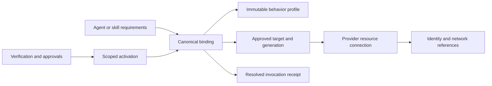
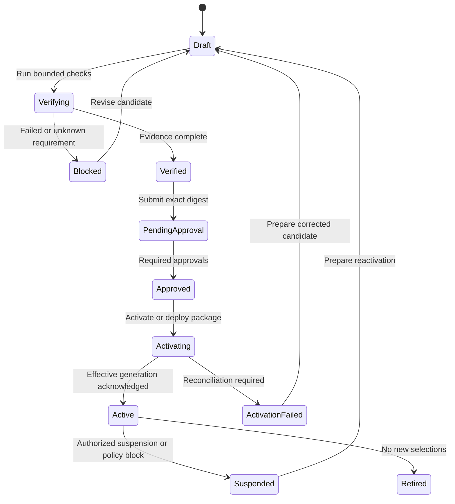

# Intelligence control plane experience design

Status: Proposed design. 8 November 2026. Implementation sequence: [delivery plan](intelligence-control-plane-plan.md).

The Intelligence switchboard is the enterprise configuration surface for reasoning models, agent execution runtimes, predictive ML services, Document Intelligence, System 1 Decisions and MCP server/tool registrations. Platform operators establish trusted connectivity and activate canonical bindings here. Agent and skill authors later select those bindings by purpose, without handling cloud endpoints or credentials.

The central design decision is to lead with **what a workload needs**: a reasoning tier, an execution runtime, a typed inference capability, document analysis or a fast typed decision. Provider connections, workload identities, network placement, and activation evidence explain how each binding works. One experience coordinates these objects while their existing authorities remain separate.

## 1. Product boundary and existing foundations

The primary user is a platform integration operator. Security administrators establish trust, model owners qualify behavior, release approvers authorize activation, and agent/skill authors consume eligible bindings. Operators need to answer: What can run here? Through which identity? Where will data go? Is this configuration in force? What would a change affect?

Build on the current [provider switchboard](external-provider-switchboard.md), [administered configuration](administered-configuration.md), and [runtime adapter contract](runtime-adapters.md). Reuse EHF navigation, tables, filters, badges, drawers, revision history, reason fields, and freshness indicators from `@ehf/ui-kit` and the administration/catalog screens.

| Existing foundation | Design consequence |
| --- | --- |
| Provider switchboard drafts are proposals and never route execution | Saving a connection remains distinct from activating it |
| Model profiles are immutable documents pinned by digest in plans | Tier changes create new revisions; old plan digests remain resolvable |
| Provider endpoints and runtime bindings are administered connectivity | Show their effective generation and execution receipt independently of profile digests |
| Runtime targets use `<adapter>:<binding>` and resolve per node | Preserve this representation and explicit node targets |
| PostgreSQL owns durable execution; gateway owns governed capability calls | Cloud runtimes do not become workflow or business-state authorities |
| Production deployment bindings are protected by reviewed packages/pipelines | A console editor does not acquire deployment authority |

This work configures and qualifies existing resources. Provisioning cloud infrastructure, training models, authoring prompts, editing business decision policy, and building agents remain in their respective experiences. Deployment Studio receives concrete reviewed configuration packages when infrastructure or deployment-managed values must change.

## 2. Information architecture

Proposed location: **Platform → Intelligence**, route `/platform/intelligence`. Keep the External Capabilities provider catalog for broad business integrations. Link intelligence-related connections into this surface rather than maintaining a second connection registry. Keep non-intelligence platform settings under Administration.

The header contains tenant, environment, policy boundary/region filter, refresh timestamp, and **Add connection**. Tenant/environment scope is always visible and participates in every server-side lookup. The first release can inherit the existing tenant/environment selector instead of introducing a new one.

| Section | Main question | Main content and action |
| --- | --- | --- |
| **Bindings** — default | What can agents and skills use? | Four reasoning tiers, runtime inventory, inference inventory; configure/open binding |
| Connections | What resources are connected? | Provider/account/project/workspace instances, identity and network status; add or revise connection |
| Access and trust | Who authenticates to what? | Inbound/outbound identities, trust relationships, permissions, credential references; inspect or propose trust changes |
| Activation | What is ready to become effective? | Candidate revisions, blockers, verification evidence, impact diff, approvals, rollout status |
| Operations | Is effective configuration working? | Health, capacity, latency, errors, consumption, drift and expiry; diagnose or suspend |
| Activity | Who changed or used configuration? | Configuration, verification, approval, activation, suspension and rollback events |

Use a list and detail layout. Selecting a row opens a deep-linkable detail drawer; detailed configuration and activation review use full-width detail pages when needed. A tab change preserves search/filter context. The bindings section has subviews **Reasoning**, **Runtimes**, **ML inference**, **Document Intelligence**, **System 1 Decisions** and **MCP servers & tools**, each with its own relevant columns.

## 3. Default screen and detail design

The Bindings screen starts with a compact status line: active bindings, blocked candidates, degraded targets, and pending approvals. Counts are computed for the selected scope; they are not substitutes for per-binding evidence. Below it, show the selected subview and search/filter controls. Avoid a cloud-logo dashboard that forces operators to reverse-map providers into workload purposes.

The following is a content layout, using illustrative configuration rather than live deployment claims:

| Reasoning tier | Canonical binding | Active target | Effective effort | Eligibility | Candidate |
| --- | --- | --- | --- | --- | --- |
| Low | `reasoning.low` | Approved model profile revision | Adapter-qualified low setting | Active · verified timestamp | — |
| Med | `reasoning.med` | Approved model profile revision | Native medium, if supported | Active · verified timestamp | Revision awaiting review |
| High | `reasoning.high` | Approved model profile revision | Adapter-qualified high setting | Active · degraded capacity | — |
| XHigh | `reasoning.xhigh` | Unassigned | Unassigned | Needs setup | Configure |

Additional columns available through table preferences: cloud, serving region/routing scope, data classification, p95 latency, budget, owner, used by, and last verification. A tier row exposes **Open**, **Propose revision**, and **View consumers**. Activation actions live on the reviewed candidate.

Runtime rows show canonical ID, adapter, resource/revision, deployment region, identity, lifecycle support, eligibility and consumers. Inference rows show capability ID, model version, input/output contract versions, prediction semantics, region, owner and eligibility.

### Shared detail anatomy

1. **Overview:** stable ID, purpose, owner, effective generation, lifecycle state, live health, source of truth and recent verification.
2. **Configuration:** resource coordinates, behavior, parameters, policy and fallback; compare candidate with effective values.
3. **Authentication and network:** caller identity, target audience, secret reference or federation, trust direction, private route and test vantage point.
4. **Readiness:** individually evidenced checks with passed/failed/unknown/not applicable, checked-at, expires-at and remediation owner.
5. **Consumers:** agents, skills, packages, released plans and in-flight invocations; distinguish direct references from transitive dependency counts.
6. **Activity:** revision diff, actor, reason, verification job, approval, deployment attestation and activation generation.

Keep lifecycle, health and eligibility visually separate. For example: **Active r4 · Health unknown · New use blocked: verification expired**. A previously active configuration must remain inspectable during a provider outage. Status labels always include text; color is supplementary.

### Empty, degraded and constrained states

An unassigned tier offers **Configure binding**. An unsupported adapter shows **Adapter implementation required** and allows a draft only. Insufficient permissions produce a useful read-only screen with the required action named. Deployment-managed fields show their source and **Prepare deployment change**. Registry errors show unavailable data explicitly; stale cached values retain their timestamp and cannot satisfy activation gates. A revision conflict preserves the operator's draft and offers a diff against the current revision.

On narrow screens, expose tier/ID, status and target first, with other fields in detail. Support keyboard row navigation, labelled controls, focus return from drawers, an error summary linked to fields, and an accessible announcement for verification completion.

## 4. Object and authority model

| Object | Purpose and ownership |
| --- | --- |
| Provider type and adapter descriptor | Platform-maintained transport, auth modes, parameter schema, capability matrix and conformance version |
| Connection | Tenant/environment resource instance: subscription/account/project/workspace, endpoint, identity and network references; reuse/link existing provider records |
| Behavior profile revision | Immutable reasoning configuration, runtime execution contract, or ML contract; authored and qualified by its owner |
| Canonical binding | Stable workload-facing ID pointing to a qualified profile and approved connection/target in a scope |
| Activation candidate and generation | Reviewed, immutable bundle of exact revisions/digests, scope, evidence, approval and rollout intent |
| Verification evidence | Time-bounded result tied to candidate digest, adapter version, execution identity, runner location and fixture digest |
| Consumer dependency | Derived linkage from published artifacts and run ledger; never a manually maintained count |
| Resolution receipt | Effective target, profile digest, binding generation, adapter version, principal reference, region and provider request ID for one invocation |

Canonical binding IDs are separate from vendor names. Proposed namespaces: `reasoning.low`, `reasoning.med`, `reasoning.high`, `reasoning.xhigh`, `runtime.investigation`, and `ml.customer_risk`. These are binding aliases, not executable capability IDs. Existing profiles and targets keep their IDs; aliases provide the new presentation. A runtime alias resolves to a valid existing target such as `hosted_http:investigation`. Do not put the new alias string directly into the current `runtimeTarget` field. Executable capabilities retain the versioned naming rules in the [capability naming ADR](capability-naming.md).

A hosted runtime executes EHF's per-node contract. A vendor agent endpoint that cannot execute that contract remains a gateway capability. A skill implemented entirely as deterministic code or a remote provider call need not acquire an LLM or hosted runtime dependency. The existing skill execution mode determines which bindings it needs.

## 5. Reasoning tiers and parameter design

**Tier is workload intent; native effort is a model-specific parameter.** The same model can serve several tiers with different qualified configurations, or separate models can serve them. `med` is the canonical tier spelling; adapters may translate it to a provider's `medium`. Do not impose native `xhigh` on every provider or silently translate it down to `high`.

| Tier | Intended workload | Qualification emphasis |
| --- | --- | --- |
| Low | Routing, bounded extraction and straightforward classification | Latency, cost, format compliance and minimum task quality |
| Med | Routine synthesis and ordinary agent steps | Balanced task quality, tool use, latency and budget |
| High | Multi-step investigations and difficult evidence synthesis | Reasoning quality, grounded outputs and longer task budget |
| XHigh | Exceptional ambiguity or complexity with explicit use permission | Demonstrated incremental quality against cost/latency, stricter admission budget |

Every tier binds to measured workload evaluations and a declared capability set. A model without a native effort control can still qualify for a tier through evidence; the detail must show **No native effort parameter** and its qualification basis. An explicit requested native setting that the adapter does not support is a validation error. [OpenAI's reasoning documentation](https://developers.openai.com/api/docs/guides/reasoning) confirms that supported effort values are model-dependent; use adapter-specific capability descriptors rather than a universal dropdown.

| Parameter group | Configuration |
| --- | --- |
| Target | Provider connection, model/deployment ID, immutable version where exposed, API family/version, permitted serving regions; record a mutable-provider-version limitation explicitly |
| Behavior | Native effort mapping, supported sampling settings, input modalities, output modality/schema, tool calling, streaming, context/cache features |
| Limits | Context/input ceiling, maximum generated tokens including provider-specific reasoning accounting, timeout, tool-round ceiling where applicable, request/concurrency limits |
| Economics | Per-request/run/tenant budget, token rate limits, approved price-sheet reference/currency/effective date, reservations/capacity allocation |
| Data policy | Allowed classifications, processing locations, retention/training-use contract reference, content policy and logging/redaction policy |
| Resilience | Ordered qualified fallback targets, retryable errors, attempt/deadline limits, circuit breaker and residency constraints |
| Qualification | Evaluation suite/version, quality thresholds, latency/cost evidence, capability snapshot, owner and validity period |

Show default, candidate and effective values and their source. Disable unsupported parameter controls with a reason. Sampling controls are conditional on model/effort compatibility. Do not expose raw arbitrary request JSON as the primary configuration path. Advanced provider fields require adapter-owned validation and become part of the immutable behavior revision if they change behavior.

Effective request selection: the signed node's requirements and explicit profile/runtime target govern selection; an approved scoped default is used only where the plan permits it. Effective limits are the strictest intersection of plan authority, tenant policy, active profile, provider capability and remaining budget. A per-call override is allowed only inside explicitly compiled bounds. Policy conflict fails closed.

The current `model.fast.v1`, `model.standard.v1`, and `model.deep.v1` are migration candidates for Low, Med, and High, subject to owner qualification. `model.judge.v1` is a specialized evaluation role and remains separate. XHigh begins unassigned until qualified. No existing model identifier in checked-in configuration is evidence of present provider availability.

## 6. Runtime configuration

Runtime details distinguish **dispatch into the runtime** from **runtime callbacks and capability egress**. Authentication success on the first path does not establish the second path.

| Parameter group | Configuration |
| --- | --- |
| Identity and resource | Canonical ID, adapter, cloud/account/project/workspace, deployment region, environment, execution principal |
| Artifact | Image digest, deployed resource ID and immutable revision, EHF execution-profile digest, protocol/conformance version |
| Lifecycle | Invoke target, declared status/cancel transport or companion endpoint, readiness, correlation, idempotency, callback endpoints |
| Capacity | Concurrency, queue/admission policy, min/max replicas where managed externally, CPU/memory/GPU requirements, cold-start and execution deadlines |
| Connectivity | Ingress auth, permitted callback audiences, gateway/control/case API reachability, private connectivity and allowed egress |
| Isolation | Tenant boundary, session/workspace isolation, checkpoint policy, ephemeral storage, residency and logging |
| Recovery | Lost-response handling, reconciliation support, cancellation semantics and effect-aware retry policy |

Display scale/resource values as observed or deployment-managed unless an adapter and protected deployment workflow can change them. Do not present a working autoscale control merely because a resource has autoscale settings.

For a hosted runtime, surface the exact endpoint, runtime revision, invocation protocol, execution-profile digest, the dispatcher's workload identity and audience, and the separately configured lifecycle endpoint. Preserve the repository's strict production workload-identity policy. EHF status/cancel conformance is required of every runtime, as documented in [runtime conformance](runtime-conformance.md).

Do not mark a runtime eligible until it can authenticate dispatch, exchange an invocation grant, reach required EHF callbacks, execute a synthetic node, preserve revision/correlation, report lifecycle state accurately, and demonstrate safe reconciliation. An adapter that cannot cancel must report that limitation; workloads requiring cancellation cannot bind to it.

## 7. ML inference configuration

Predictive ML bindings resolve to typed gateway capabilities, independent of reasoning tiers. A binding such as `ml.customer_risk` references a versioned capability expressing business meaning, such as `risk.customer.assess.v1`, while the adapter handles SageMaker, Vertex prediction, Databricks serving or an internal HTTP/gRPC service.

| Parameter group | Configuration |
| --- | --- |
| Model | Registry/model ID, immutable version or artifact digest, deployment/endpoint, provider routing revision, owner and validation approval |
| Input | Feature schema/version/digest, types, units, required fields, missing-value policy, event/as-of timestamp, maximum feature age, preprocessing version |
| Output | Output schema/version, target definition, score range and direction, prediction horizon, calibration version, reason-code/explanation schema, uncertainty/abstention |
| Invocation | Online/synchronous or asynchronous mode, content type, payload/row limits, timeout, batching, result retrieval/cancel semantics |
| Governance | Intended use, approved populations/jurisdictions, model validation and expiry, lineage, monitoring/drift limits, retention |
| Reliability | Idempotency, response validation, out-of-distribution/missing-feature behavior, circuit breaker, qualified fallback and shadow policy |

For a risk score, the detail should make the semantics readable: “0–1; higher means higher risk; predicts [defined event] within [defined horizon]; calibration [version].” A score is not automatically a probability. Business thresholds and case decisions remain versioned domain policy; the connection screen links to that policy rather than changing it.

The verification preview pairs a synthetic feature row with a validated response containing score, model/version, feature timestamp, calibration metadata and reason codes where supported. Missing/stale features, invalid output or expired model validation yields a typed unavailable/abstain result, never a fabricated zero-risk score. Fallback requires equivalent, validated score semantics; do not average or substitute unrelated model scores.

## 8. Cloud and deployment scenarios

These are adapter targets and design requirements, not assertions that EHF already supports each integration. Availability, network topology and exact permission scopes are verified in the target account before activation. A connection can combine services across clouds only when every trust and data-routing edge is approved.

| Scenario | Resources to represent | Authentication design | Required distinction |
| --- | --- | --- | --- |
| AWS | Bedrock inference; AgentCore runtime or EHF container on ECS/EKS; SageMaker endpoint | IAM role/STS and SigV4 where required; JWT authorizer only for transports that support it | Runtime execution role, invoking principal, region/account, model entitlement and outbound identity are separate |
| Google Cloud | Vertex model/prediction resources; Agent Engine or EHF container on Cloud Run/GKE, subject to runtime conformance | Attached service account or workload identity federation; explicit token type/audience per transport | Project/location, runtime service account and model invocation permission are separate |
| Databricks across clouds | Model Serving and an EHF runtime hosted as a Databricks App | Workspace-scoped service principal OAuth M2M; supported federation as a separate qualified auth mode | App execution is a runtime; serving a model or native agent is a capability |
| Direct model SaaS | Provider API project/account and model resources | Provider-supported machine credential referenced from an approved secret store or identity broker | Do not imply enterprise browser SSO grants model API access |
| Enterprise gateway | APIM, internal model gateway or another governed proxy | OAuth client credentials, workload identity or mTLS as supported | Inventory the actual upstream model, processing location and contract; proxy location alone does not prove residency |
| Private/on premises | EHF runtime on Kubernetes/VM; local model serving; internal inference endpoint | Enterprise OIDC federation, mTLS/SPIFFE where supported, or brokered service credentials | Discovery, private DNS, CA trust, GPU capacity and callback routes must be evidenced |
| Hybrid or isolated deployment | Runtime in one cloud, models/ML in another; sovereign/air-gapped environment | Federated trust or approved broker with two explicit trust edges | Cross-border transfer, egress cost, latency, disconnected verification and unavailable public services must be addressed |

Vendor documentation supports provider-specific identity choices: [AWS AgentCore inbound and outbound authentication](https://docs.aws.amazon.com/bedrock-agentcore/latest/devguide/runtime-oauth.html), [Google Cloud authentication](https://docs.cloud.google.com/gemini-enterprise-agent-platform/machine-learning/authentication), and [Databricks OAuth M2M](https://docs.databricks.com/aws/en/dev-tools/auth/oauth-m2m). These inform adapter design; they do not establish EHF conformance. In particular, AgentCore's documented inbound auth selection is IAM SigV4 or JWT, rather than a single interchangeable token configuration.

## 9. Enterprise authentication and trust experience

Separate four layers in the UI:

1. **Human console access:** enterprise SSO/session, tenant/group mapping, existing RBAC, step-up authentication for sensitive activation where policy requires it. SCIM/group provisioning belongs to enterprise identity administration; this surface shows effective access and links there.
2. **Control plane to resource:** dispatcher's/gateway's workload identity and exact target permissions. Prefer short-lived federated credentials; retain current environment-variable credential references during migration.
3. **Runtime outbound access:** distinct identities/audiences for gateway, envelope broker, case API and approved resources. EHF grants remain scoped per node; a cloud role does not confer case-write authority.
4. **Delegated user access:** optional, explicitly supported OBO/OAuth consent with subject, audience, scopes, expiry and revocation. Background work cannot silently use the configuring administrator's browser session.

The trust form captures issuer/authority, tenant or account, principal/role/service account, federation subject and conditions, audience/scopes, resource permissions, credential-store reference, certificate/CA reference where needed, rotation owner and expiry. Auth forms are discriminated by transport: OIDC workload identity federation, AWS SigV4/STS, GCP token flow, OAuth M2M, mTLS, or provider key. Do not offer irrelevant fields.

A credential reference contains no secret value. Secret issuance, role assignment, trust provisioning and rotation execute through an approved vault/identity/deployment system. A verification worker in the real execution boundary resolves the reference; neither the browser nor BFF receives it. Presence of a variable in the control API is not successful gateway authentication.

Private connectivity records endpoint/resource IDs, DNS zone/route, network zone, CA trust and verification runner. Tests must originate from the actual dispatch/gateway/runtime network boundary, or explicitly report **Not tested from execution network**. Validate endpoint hosts, allowed ports, DNS/IP resolution and redirects against approved egress policy to prevent arbitrary internal-address probes; private endpoints need an authorized resource route, not a blanket private-IP ban. Provider query/API-version fields are adapter-controlled, separate from arbitrary user URL parameters.

Proposed fine-grained actions are `intelligence.read`, `intelligence.configure`, `intelligence.verify`, `intelligence.approve`, `intelligence.activate`, and `intelligence.suspend`. These require implementation and explicit role mapping. Existing `admin.write` supports current draft/configuration authority only; it must not implicitly grant new deployment or production activation privileges. Production approval requires independent actors where separation of duties applies. Emergency suspension has a reason, audit event and impact view.

## 10. Connection and activation journey

### Configure a new resource

**Add connection → Choose service class → Select provider/adapter → Locate resource → Configure trust/network → Validate → Save candidate.**

Service class is Reasoning model, Agent runtime, or ML inference. A resource connection can expose several classes, but each advertised capability needs its own qualification. Select an existing connection before creating another. Resource discovery is an optional scoped operation with separate read permissions; manual entry remains available. Show **Not supported by installed adapter** instead of manufacturing discovery results.

The review step summarizes coordinates, credential references, data destinations, requested permissions, intended bindings and deployment-managed changes. Draft saves perform schema/policy validation only. A saved candidate has no execution effect.

### Verify, approve and activate

Lifecycle belongs to a candidate/activation, not a provider logo. Active revision A can continue serving while candidate B is blocked or awaiting approval. Editing B invalidates B's verification and approvals; it never changes A. A failed activation keeps the last effective generation and exposes expected versus observed state.

| Gate | Evidence and blocker examples |
| --- | --- |
| Configuration | Supported adapter, complete coordinates, compatible parameter schema, unique ID and scope |
| Identity | Token acquisition, correct principal/audience, minimum resource permissions; secret reference resolves at executor |
| Network | DNS/TLS/private route and required callbacks from the relevant execution networks |
| Resource and entitlement | Exact deployment/revision exists; required APIs, model access, commercial entitlement and quota confirmed |
| Contract and behavior | Synthetic model response/tool/schema checks; runtime lifecycle/conformance; ML feature/score contract |
| Policy and qualification | Residency/classification, retention agreement, model/runtime approval, test suite thresholds and expiry |
| Change authority | Exact diff and impact, independent approvals, protected deployment attestation where required |

Running verification is an explicit bounded operation with a fixture preview, estimated spend ceiling and allowed network targets. It sends synthetic or approved evaluation data only. It must not invoke business side effects or retrieve production case data. Evidence records each stage independently, including partial results and unknowns.

The activation review shows **current → candidate**, exact digest/generation, consumer impact, any required recompile/release, rollout scope, rollback target and effective-time semantics. The action label is **Activate binding** for governed operational changes and **Prepare deployment change** for protected changes. After dispatch, show **Activating** until execution consumers acknowledge the generation; a saved pointer alone is insufficient.

Production can require a staged tenant/workload rollout and an explicit observation window. Optional shadow calls have separate budget and data-transfer approval and cannot emit business writes. Promotion never copies credentials or assumes source-environment evidence proves target-environment readiness.

## 11. Resolution, fallback and change effects

| Change | Required behavior |
| --- | --- |
| Display metadata | Audited update; no behavioral change |
| Credential rotation | Reference/generation change with identity check; reconnect through executor, never expose secret |
| Endpoint/region/auth target | Candidate, policy/network verification, approval/deployment as required; active generation changes only after acknowledgment |
| Model/effort/token behavior | New immutable profile revision and qualification; existing signed plans retain pinned digests |
| Runtime image/agent revision | New qualified runtime activation; verify protocol, profile digest and lifecycle |
| ML features, preprocessing, calibration or output semantics | New versioned ML contract and consumer compatibility review |
| Emergency disable/revocation | Block new dispatch even for pinned references; reconcile affected in-flight work according to effect/cancel semantics |

For compatibility, the initial release retains per-node runtime resolution. Record the generation at dispatch and pin it for that invocation's status, cancellation and reconciliation; those calls must not switch to a newly edited endpoint. Never reroute an in-flight invocation. A future per-run binding snapshot is an explicit contract change, not a silent switch in this UI rollout.

Fallback remains inside the signed plan's allowed target set and policy intersection. Model substitutions that change a pinned profile require a separately compiled/approved profile or an explicitly versioned fallback contract. No live production failure becomes a recorded/mock model answer. Runtime retries after unknown effects require reconciliation. ML fallback requires compatible feature and output semantics and its own qualification.

Binding activation is permission to offer a target to eligible consumers. It does not grant an agent new tool access, elevate a skill's execution permissions, or bypass package/plan release approval. The consumer picker shows only active, scoped, compatible bindings and explains excluded targets. Authoring can reference an unavailable binding as an explicit unresolved draft dependency; publication/dispatch fail closed.

## 12. Operations and acceptance walkthroughs

Operations correlates target health, authentication failures/expiry, policy eligibility, quota/concurrency, queue delay, p50/p95 latency, error rates, circuit state, token usage/cost and version drift. ML adds feature freshness, output validation, score distribution and configured drift signals. Preserve unknown cost when a current price/usage source is unavailable. Runtime telemetry links to run/work-item/invocation traces.

Record decisions and provenance, not hidden chain-of-thought. Log credential/principal references and redacted request metadata, with payload capture off by default. Attach data handling and retention controls to any diagnostic payload capture.

The design is acceptable when these walkthroughs can be demonstrated:

1. An operator connects a hosted runtime, verifies real dispatcher and callback identities, sees a missing lifecycle route as a blocker, fixes it, and activates an exact runtime revision through the required authority path.
2. A model owner configures Med using a supported native mapping, sees invalid parameter combinations before save, qualifies it, and learns precisely which new releases can adopt it. Existing digested plans do not silently change.
3. An AWS or Google connection can be recorded with accurate auth/resource fields; missing adapter support prevents verification/activation and never appears live-ready.
4. An ML owner registers a risk endpoint with feature freshness and calibrated score semantics; a stale-feature fixture abstains and a schema mismatch blocks activation.
5. An agent author selects active reasoning/runtime bindings without seeing credentials; a deterministic skill can use an inference capability without adding an LLM.
6. A reader can distinguish active/degraded from candidate/blocked, inspect unknown health during a registry outage, and view effective versus desired generations.
7. Concurrent edits return a conflict, cross-tenant access is denied, draft writes cannot activate routes, stale evidence cannot be approved, and emergency suspension blocks new work without rerouting running invocations.

## 13. Recommended first release

Deliver the unified read experience, four canonical reasoning slots, named runtime bindings, typed ML configuration drafts, dependency visibility and evidence-backed activation review. Execute existing adapters only; catalog planned adapters explicitly. Ship production activation only after the authority, verification runner and generation reconciliation work is complete.

Then add one cloud path end to end, chosen by the target environment's actual demand. AWS and Google remain first-class schema/design targets from the beginning; supporting their configuration forms is not sufficient to claim their runtimes are supported.

## Document and System 1 extension

The six-category binding picker uses wrapping category cards. Document and System 1 inventory, proposal editor, history, access controls and exact-revision checks share the existing control-plane flow. **Common adapters** exposes the canonical contract family, lifecycle and provider implementation status independently of connection health.

Document analysis is a provenance-bearing job contract, with processor/API/schema versions, supported operations/features, bounded input/job budgets, result retention boundary and confidence review. System 1 is an atomic typed judgment contract: choice, rubric score, truth probability or image box. State/question/rubric/output versions and decision-use policy are pinned separately from model identity. Structured-output LLMs must independently demonstrate confidence semantics; no adapter may synthesize confidence or silently escalate to reasoning.

The [implementation reference](intelligence-control-plane.md#document-intelligence-and-system-1-decisions) records the exact fields, common contract schemas, researched provider semantics and current configuration-only boundary.

## MCP registration extension

Model MCP servers as versioned connection bindings with an explicit tool allowlist. Keep connection/authentication, catalog discovery evidence, individual tool contracts and invocation authority separate. The editor registers server/protocol/transport metadata, reviewed catalog pins and exact tool-to-capability/schema/effect/approval mappings. Details expose a tool table; the common-adapter view includes `mcp.tools.v1`. Saving and offline checks cannot discover, execute or activate tools. See the [MCP implementation boundary](intelligence-control-plane.md#mcp-server-and-tool-registration).
