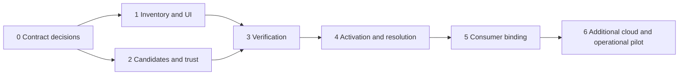

# Intelligence control plane implementation plan

Status: Proposed delivery plan. 8 November 2026. Depends on the preceding [experience design](intelligence-control-plane-design.md).

Implementation update: the [switchboard foundation](intelligence-control-plane.md) now implements the contract decision, unified inventory, multicloud proposal editor, scoped immutable persistence and offline configuration reports. Production execution verification, activation and consumer binding remain unfinished. The [ADR](intelligence-control-plane-adr.md) records the current boundary; no production approval is implied.

Build the Intelligence switchboard in increments that preserve current execution authority. Start by projecting existing model/provider/runtime configuration into one experience, then add governed candidates, verification and activation. Expand cloud execution through independently qualified adapters. This plan does not authorize provisioning or activation of external resources.

## 1. Scope and sequencing

The first useful increment is a unified, truthful inventory with canonical slots and drill-downs. The first production-capable increment additionally requires immutable candidates, workload-based verification, scoped approval, activation reconciliation and safe invocation receipts. Do not place a working-looking Activate button over the existing draft-only provider onboarding API.

Effort should be estimated after Phase 0 resolves schema and deployment boundaries. Workstreams below identify dependencies and acceptance evidence rather than speculative calendar commitments.

## 2. Baseline and integration points

These are inspected implementation foundations, not features supplied by this proposal:

| Area | Current code | Planned use |
| --- | --- | --- |
| Admin surface | `apps/web/src/platform/surfaces/admin.tsx`, `admin/models-tab.tsx`, `admin/providers-tab.tsx`, `admin/settings-tab.tsx` | Reuse profile revision/history and protected configuration behavior; link old entry points to new details |
| Provider switchboard | `apps/web/src/catalogs/external-providers.tsx`, `provider-model.ts`; `apps/experience-bff/src/external-providers.ts` | Reuse inventory/detail patterns and connection draft projection without adding execution effects |
| Contracts | `packages/contracts/src/index.ts` | Existing strict profile, provider, runtime-binding and runtime-target schemas remain backward compatible |
| Persistence/control | `packages/persistence/src/admin.ts`, `external-providers.ts`; `apps/control-api/src/admin-config.ts`, `external-provider-routes.ts` | Reuse tenant isolation, revision conflict checks and transactional audit patterns |
| Runtime adapters | `packages/runtime-provider/src/registry.ts`, `index.ts`, `databricks.ts` | Existing `local_http`, `hosted_http`, `databricks` adapters; no AWS/Google runtime implementation implied |
| Dispatch | `apps/runtime-worker/src/v2-execution.ts` | Preserve per-node selection and add generation snapshot/receipt handling |
| Model/capability execution | `apps/capability-gateway/src/adapters/openrouter.ts`; `packages/adapters/src/databricks.ts`, `model-io.ts` | Govern model and inference calls; remove assumptions that transport identity equals workload purpose |
| Compilation/authoring | `packages/compiler/src/agent-profiles.ts`, `compiler.ts`; `apps/control-api/src/authoring.ts`; `apps/web/src/platform/surfaces/authoring/AgentsTab.tsx` | Preserve digested profile resolution; replace hard-coded consumer options with eligible binding inventory |
| API generation/mock | `apps/fincrime-host/docs/ui/contracts/gen/openapi_v2.py`, `packages/ui-contracts`, `packages/ui-mock`, `packages/ui-client` | Keep API specification, generated clients, operations, mocks and real projection aligned |

The current profile document has only ID, provider, model, token ceiling, timeout and concurrency. Native reasoning effort and the richer behavior schema require a versioned contract change. Existing runtime binding auth fields also cover a narrower set than the proposed multicloud trust model. New forms must not submit fields existing strict schemas will discard or reject.

## 3. Phase 0 — Set contract and authority decisions

**Owner:** platform architecture, runtime/compiler and security owners.

Produce a short ADR addressing:

- Canonical IDs and scoped alias storage; explicit conversion between `runtime.investigation` and `<adapter>:<binding>`.
- A versioned behavior-profile format supporting effort/capability settings; preserve the exact legacy digest algorithm and legacy resolver. Choose a new profile schema version rather than extending legacy digested JSON in place.
- The split between behavioral profile fields, connection coordinates and operational limits. Behavioral changes require new immutable revisions; operational bounds can only narrow plan authority.
- A discriminated auth reference schema and backward-compatible interpretation of environment-variable references. Secret-store support requires an executor-side resolver; do not advertise it before that resolver exists.
- Current deployment-managed field restrictions and which authority can approve/activate each change type. Keep the production workload-identity restrictions for hosted runtimes.
- Binding generation selection per node and persistent invocation snapshots for lifecycle/reconciliation. Any later per-run pinning is separately designed.
- The typed ML inference envelope, schema/version pinning, score semantics and existing capability naming/permission integration.
- Proposed fine-grained actions and role/step-up/separation-of-duties mapping through existing identity/authorization code.

**Exit evidence:** approved ADR; representative legacy and new contract fixtures; examples for all four tiers, a hosted runtime, a second-cloud draft, and a risk endpoint. Unknown adapters/auth modes fail validation for activation while remaining representable as unsupported drafts.

## 4. Phase 1 — Unified inventory and design implementation

**Owner:** web and BFF. Depends on Phase 0 identifiers; can use existing read APIs initially.

Add the proposed `/platform/intelligence` route through `apps/web/src/platform/routes.ts` and the existing router/navigation structure. Create a dedicated surface using existing EHF components and tokens. Implement Bindings, Connections and a shared detail structure first; expose other sections only when backed by useful data.

Build a BFF projection that joins existing providers, profile revisions, runtime settings/bindings, connector inventory and known consumer references. Every field includes provenance/freshness where it influences readiness. Distinguish unsupported, not configured, not checked, unavailable and verified; keep active and candidate views separate.

Create four empty or qualified canonical reasoning slots. Offer explicit mapping proposals for fast/standard/deep; retain judge as a separate role. Never auto-map judge to XHigh. List known runtime bindings with adapter metadata; do not infer provider support from a cloud name alone. ML inventory can begin with typed drafts and existing compatible capability implementations.

Keep Administration and external-provider links working. Route intelligence configuration through the current authoritative services rather than copying it into a new database. Confirm whether the existing production surface has concurrent changes before moving UI; this repository already contains substantial unrelated working-tree changes.

**Exit evidence:** all subviews and deep links render from real BFF projections and matching mock data; reader/write permissions work; no false ready state on outages; keyboard/drawer behavior and narrow screens are reviewed. Existing profile/admin URLs continue to work. This phase has no execution-routing change.

## 5. Phase 2 — Candidates, trust metadata and dependency records

**Owner:** contracts, persistence, control API, identity and BFF. Depends on Phase 0.

Add proposed focused modules such as `packages/contracts/src/intelligence.ts` and `packages/persistence/src/intelligence.ts`; export through established package entry points. Allocate migration numbers from the actual current migration head at implementation time.

Proposed records under the established admin namespace:

| Record | Required integrity |
| --- | --- |
| Binding identity and scoped link | Unique tenant/environment/binding ID; references existing providers/profiles/runtime targets where applicable |
| Candidate revision | Immutable definition/digest, expected base generation, author/reason, adapter and profile contract version |
| Identity/network reference | Tenant/environment ownership; no secrets; validated auth discriminator, resource and network constraints |
| ML contract revision | Immutable feature/output/preprocessing/score semantics and validation references |
| Dependency projection | Artifact IDs/digests and reference paths; derived freshness and completeness |
| Activity event | Actor, scope, reason, before/after digest and correlation; transactional with authoritative mutation |

Use tenant RLS plus explicit scoped predicates, optimistic concurrency, foreign-key ownership checks and audit writes in the same transaction. Environment scope cannot be a client-supplied label that bypasses the deployment's environment boundary. Cross-tenant references are rejected, including nested connection/profile/trust IDs. Define immutable history retention and tombstones so referenced generations cannot disappear.

Mutations accept `expectedRevision` or `expectedGeneration`, idempotency keys where necessary, and a reason. BFF enforces interactive session and CSRF; control API independently authorizes. Candidate writes cannot modify gateway routing, runtime settings or deployed credentials. Validate resource coordinates and adapter-owned endpoint shapes without performing network probes on draft save.

**Exit evidence:** round-trip persistence, stale-edit 409, duplicate create, tenant/environment isolation, malicious nested reference, credential rejection and transactional activity checks pass against disposable PostgreSQL. Saving candidates leaves effective execution configuration unchanged.

## 6. Phase 3 — Verification service and readiness evidence

**Owner:** integration/runtime platform, gateway, security and model validation. Depends on Phases 1–2.

Implement durable verification jobs with workers/agents in the relevant network and identity boundaries. Reuse existing job/outbox patterns where suitable; a BFF request must not hold cloud credentials or run unrestricted URL probes.

An adapter descriptor declares configuration/auth schemas, supported behavior parameters, discovery support, verification stages, lifecycle features, qualified service classes and conformance version. First descriptors describe the actual existing adapters. Planned AWS/Google adapters remain visibly unsupported until implemented and qualified.

Verification stages: schema/policy; identity acquisition; target authorization; DNS/TLS/reachability; resource/revision/entitlement/quota; class-specific synthetic invocation; callbacks/lifecycle; qualification evidence. Validate endpoint resolution and redirects inside the worker immediately before requests. Restrict probes to approved resource targets and redact logs. Discovering cloud resources requires separately scoped read permission and bounded pagination.

Persist each stage result with candidate digest, principal reference, runner zone, adapter version, target fingerprint, fixture digest, timestamp/expiry, latency, bounded usage/cost and stable diagnostic code. Editing configuration invalidates dependent evidence. Identity, target revision, policy or adapter drift invalidates the relevant evidence; activation rechecks freshness atomically. Manual attestations are labelled and cannot stand in for mandatory executable checks.

Hosted runtime verification must cover the configured lifecycle endpoint and broker/gateway/case callbacks. ML fixtures cover stale/missing features, out-of-range scores, schema mismatches and abstention. Model verification covers parameter support and required output/tool behavior. Known test doubles are sufficient for contract development; live production readiness requires target-environment evidence.

**Exit evidence:** bounded synthetic verification succeeds for an existing model path and a hosted runtime in an authorized non-production environment; failed/unknown stages block readiness; network/identity evidence comes from actual execution boundaries. No business writes or production case payloads occur. Where that environment is unavailable, the feature remains verification-capable with an explicit unverified state.

## 7. Phase 4 — Governed activation and execution resolution

**Owner:** control API, persistence, runtime worker, gateway and deployment/release owners. Depends on Phase 3 and approved authority rules.

Add immutable approval records, activation requests, observed/effective generations and revocation/suspension records. Bind approvals to the exact candidate digest, scope, evidence set and expected effective generation. Changes to any of these require reapproval. Enforce independent approvers where policy requires it, expiry and server-side authorization at activation time.

Activation evaluates profile compatibility, evidence freshness, consumer impact, deployment-managed restrictions and revocation before a compare-and-swap of desired generation. Commit a durable outbox event with the request. Consumers apply only authorized complete generations and acknowledge observed state. Retries are idempotent; partial failures expose desired versus effective generations. Do not implement this as an unrelated second release/signing system: attach existing protected package/release attestations where required.

Snapshot selected generation, target/lifecycle coordinates, execution-profile digest and identity reference into the invocation record before remote dispatch. Status/cancel/reconciliation use that snapshot after connection changes. Each invocation receipt records exact behavior and connectivity selection. Preserve existing per-node runtime selection and explicit plan targets. Check revocation/suspension before every new dispatch; define the acknowledgment/freshness bound and fail closed if policy state is too stale.

Classify fallback and retries by effect and compiled authority. No cross-region fallback without residency permission; no alternate behavior outside pinned profiles; no recorded production fallback; no automatic repeat of an unknown-effect invocation. Add provider/tenant budgets and bounded test/shadow spend without double-counting retries.

Implement rollback as a new activation referencing an existing immutable generation after current policy/evidence checks. Credential revocation or stale verification can make an old generation ineligible for rollback. Emergency suspension blocks new calls immediately within the declared enforcement bound and reports in-flight work for cancel/reconciliation; it does not rewrite running targets.

**Exit evidence:** activation race, duplicate request, stale approval, expired evidence, partial consumer acknowledgment, rollback, revoked pin, outage, identity rotation and endpoint edit during an in-flight invocation behave correctly. Existing plan/profile digests resolve unchanged. Protected deployment fields remain protected. End-to-end receipts identify the effective target generation.

## 8. Phase 5 — Agent and skill binding

**Owner:** authoring/compiler, skill catalog, UI and runtime. Depends on Phase 4's eligible inventory.

Expose a consumer eligibility query based on scope, service class, classification, residency, protocol/capability requirements and required execution mode. In agent authoring replace the current two-option runtime selector and cloud-specific label logic with approved named targets. Reasoning selection resolves to immutable profile revisions at compile/release time; runtime aliases compile to valid adapter/binding targets with declared requirements.

Allow explicit unresolved references in authoring drafts, show their blockers, and refuse publish/compile/dispatch where requirements cannot be met. The compiler remains authoritative for production hosted-runtime rules and package-declared profiles. Existing plan nodes and profiles retain precedence over defaults.

Skill authoring binds typed ML capabilities through the existing provider/capability path. Code-only or provider-only skills do not inherit unnecessary reasoning/runtime requirements. ML contract changes force compatibility review or a new skill/package release as appropriate. Consumer impact links include the artifact revision and reference path rather than just a count.

**Exit evidence:** an agent runs using a selected active runtime and pinned reasoning profile; a risk skill invokes a versioned inference capability; a deterministic skill adds no LLM dependency; an incompatible/disabled binding cannot be released or newly dispatched. Existing authors and signed packages retain compatible behavior.

## 9. Phase 6 — Second cloud and operational pilot

**Owner:** selected cloud adapter owner and SRE/model validation. Depends on the production activation path.

Implement one demanded cloud integration end to end. Select AWS or Google based on the pilot environment, or qualify the existing Databricks path first if that is the enterprise's immediate target. The generic contracts must represent all scenarios from the experience design, but each adapter independently proves authentication, endpoint semantics, lifecycle, runtime callbacks, data policy and quota behavior.

For hosted runtimes, prove the EHF per-node execution contract rather than treating a vendor-native agent API as interchangeable. For ML endpoints, add provider-specific request/response normalization and model/feature lineage. For model APIs, prove effort/capability handling instead of assuming OpenAI-compatible behavior. Cross-cloud tests include both trust directions, data routing and egress constraints.

Ship health/expiry/drift and budget monitoring, reconciliation dashboards and operator runbooks: credential expiry, entitlement loss, quota exhaustion, private DNS failure, target revision drift, unknown invocation state, ML drift, partial activation and emergency suspension. Define service-level targets from observed pilot requirements rather than promising cloud-independent latency.

**Exit evidence:** one real cloud path passes target-environment conformance and governed activation; operators complete failure/rollback exercises; health/eligibility/activation states remain distinct; all advertised executable adapters have an owner and evidence. Unimplemented cloud tiles remain draft-only.

## 10. Proposed API surface

Names below are design proposals. Confirm naming and pagination conventions during Phase 0. Reuse current profile/provider/deployment APIs wherever they already own the mutation.

| Experience API | Purpose and authorization |
| --- | --- |
| `GET /api/v1/intelligence` | Scoped inventory/projection, provenance and freshness; read |
| `GET /api/v1/intelligence/adapters` | Installed capabilities, auth/parameter schemas and conformance status; read |
| `GET /api/v1/intelligence/bindings/:id` | Effective/candidate details and dependencies; read |
| `POST /api/v1/intelligence/candidates` | Draft definition/reference creation; configure |
| `POST /api/v1/intelligence/candidates/:id/revisions` | New immutable revision with expected base; configure |
| `POST /api/v1/intelligence/candidates/:id/verify` | Bounded verification job; verify |
| `GET /api/v1/intelligence/verifications/:id` | Staged results and redacted evidence; read |
| `POST /api/v1/intelligence/candidates/:id/submit` | Freeze reviewed candidate/evidence for approval; configure |
| `POST /api/v1/intelligence/candidates/:id/approvals` | Digest/scoped approval or rejection; approve |
| `POST /api/v1/intelligence/candidates/:id/activate` | Governed activation or protected deployment handoff; activate |
| `POST /api/v1/intelligence/bindings/:id/suspend` | Reasoned suspension with enforcement tracking; suspend |
| `POST /api/v1/intelligence/bindings/:id/rollback` | New activation of an eligible historic generation; activate |
| `GET /api/v1/intelligence/activations/:id` | Desired/observed/effective rollout and deployment references; read |
| `GET /api/v1/intelligence/eligible-bindings` | Consumer-specific compatibility projection; read with normal artifact access |

All list/detail/history operations enforce scope, paginate where needed and avoid exposing inaccessible consumer metadata. Mutation responses return candidate/activation IDs and revisions, not credentials. Stable errors include revision conflict, adapter unsupported, auth unresolved, network unverified, parameter unsupported, evidence expired, profile incompatible, policy denied, approval required and deployment required. Map these to existing error envelope conventions.

## 11. Validation strategy and release gates

Use the repository's normal type checks, contract generation/drift checks, focused suites and browser workflow. Add behavior tests at real boundaries rather than tests mirroring form implementation.

| Layer | Required evidence |
| --- | --- |
| Contracts/compatibility | Legacy digest fixtures unchanged; new schemas reject invalid auth/effort combinations; aliases resolve deterministically |
| Persistence/authority | Real PostgreSQL RLS/isolation, optimistic concurrency, approvals, idempotency, audit/outbox atomicity |
| Gateway/runtime | Authentication at executor, generation snapshot, same-target lifecycle, policy/fallback budgets, revocation and unknown-effect reconciliation |
| Model/ML | Synthetic output/tool/schema checks; calibrated score semantics and freshness; invalid output abstains/fails explicitly |
| API/BFF | Session/CSRF and independent control authorization; scope guards; partial upstream failures retain truthful freshness |
| UI | Configure → verify → review → activate with correct permissions; draft/effective split; conflict recovery, focus, keyboard and narrow-screen review |
| Live integration | Actual authorized cloud identities/network, exact deployed revision, target entitlement/quota, callbacks, expiry and rollback |

A mock or local contract test cannot satisfy a live cloud readiness gate. Design and documentation work does not claim these tests have already run. Before production exposure, prohibit raw secret fields, arbitrary verification egress, mixed-tenant links, unbounded synthetic spend and active states derived from configuration presence alone.

## 12. Deliverables and first implementation slice

Deliver an approved contract/authority ADR; the new inventory and details; compatible canonical bindings and revisions; typed connection/trust/ML drafts; durable verification; governed activation with receipts; consumer selectors; adapter conformance evidence; and operator runbooks.

Start implementation with **Phase 0 plus the read-only Phase 1 inventory**. It gives operators the canonical switchboard and exposes missing configuration immediately while the activation machinery is built. The first executable pilot should use an already implemented adapter and synthetic data, followed by one qualified cloud path.

## Document Intelligence and System 1 delivery extension

The configuration foundation now represents both categories end to end: strict contracts, immutable proposals, generated API/client, catalog, typed editor, common-adapter inventory, offline checks, mocked API contract tests and PostgreSQL round trips. Canonical adapter request/result validation is shared; no new provider transport is executable through this switchboard yet.

Continue through the existing verification/activation phases with these concrete adapter tasks:

1. Implement provider serializers behind `document.analysis.v1` and `decision.system1.v1`; qualify Textract, Databricks, LlamaParse and Jev independently. Implement OpenAI-compatible structured decisions with explicit refusal and unavailable-confidence mapping.
2. For documents, prove approved artifact reads, immutable source hashes, page/field provenance, provider feature compatibility, input limits, result retention, partial failure, bounded polling and cancellation where supported. Preserve source identity through asynchronous completion.
3. For System 1, prove state/question/schema pinning, choice/score label normalization, truth-probability versus confidence semantics, box coordinates, abstention, latency and workload-specific confidence evidence. Unknown labels, refusals, invalid outputs and timeouts must never create business actions.
4. Integrate execution-side identity/network/entitlement verification, evidence expiry, exact-digest approval and acknowledged activation before exposing either category as eligible to agents or skills. Add consumer compatibility and impact indexing for document/schema and decision/question/policy revisions.

Exit evidence includes representative document extraction and System 1 routing in a target environment, negative output/job/confidence fixtures, replayable provenance, tenant isolation, governed activation/rollback and operator diagnostics. All other catalog entries remain visibly draft-only.

## MCP adapter delivery extension

Configuration registration is implemented across strict contracts, generated APIs, immutable proposals, editor/details, common-adapter inventory, mocks and offline checks. No new persistence migration is needed for the additive service class.

Before MCP bindings become executable, implement protocol-version-aware server discovery and full paginated tool catalogs from the execution network; pin schemas, server metadata and identity/scopes to catalog evidence. Add OAuth resource metadata and issuer/audience validation, delegated token lifecycle and service-identity extensions where supported; stdio must use reviewed, isolated deployment launch profiles. Detect catalog/schema changes and revoke eligibility until reviewed. Register only released tool mappings with EHF capability/effect/approval controls; treat server annotations/descriptions as untrusted. Qualification must cover malformed/error tool responses, cancellation/deadlines, result budgets, authorization failures, drift and tool-list expansion without invoking business actions during verification. Finish the existing exact-digest approval, activation and consumer-binding phases before releasing tools to agents/skills.
