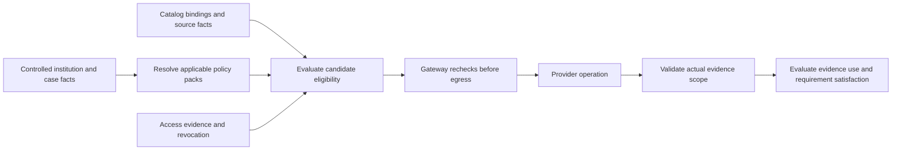

# Jurisdiction source authorization approach and implementation plan

Date: 2026-11-08. Status: reviewed design; runtime enforcement and authoring have been implemented. See the [implementation and deployment guide](jurisdiction-source-policy.md) for shipped behavior, configuration and remaining scope. This document preserves the catalog review and original approach. Scope: authorization of external capabilities and their underlying sources, plus acceptance and reuse of the resulting evidence.

Introduce a versioned **jurisdiction source policy** within the existing policy system. It should answer: **may this institution use this provider product, operation and dataset for this purpose, subject and applicable jurisdiction, through this processing route, and what may its evidence establish?** The catalog supplies discovery and supported-scope evidence; approved policy supplies authority; the Capability Gateway enforces the decision.

A country allowlist alone cannot express that decision. Source jurisdiction, subject jurisdiction, institutional policy jurisdiction and data processing location are different dimensions. Source acquisition permission and evidence sufficiency also need separate decisions: an authorized company-register lookup does not automatically complete beneficial-owner verification.

This extends the [canonical external capability model](../CANONICAL_EXTERNAL_CAPABILITY_MODEL.md), preserves the [capability naming ADR](capability-naming.md), and supplies the source-policy dependency of the [skill catalog production plan](skill-catalog-production-plan.md).

## Current catalog and enforcement review

The [inventory snapshot](jurisdiction-source-policy-audit.json) records counts and SHA-256 fingerprints from this working tree. It is planning evidence, not an authorization artifact.

| Observation | Current evidence | Implication |
| --- | --- | --- |
| Platform inventory | 83 capabilities, including 56 canonical families; 853 connectors; eight connector templates | Extend existing catalogs and binding identities. |
| Connector status | 16 `live_ready`, 835 `available`, two `quarantined` | Technical readiness is separate from tenant or jurisdiction authorization. The 16 have no canonical atlas binding attached. |
| Provider atlas | 376 provider/product/historical records; 824 legacy bindings; 825 canonical bindings | Catalog records are not all distinct active vendors. A connector and a canonical binding are different counting units. |
| Canonical binding readiness | All 825 disabled, jurisdiction status `proposed`, coverage `unknown`, no entitlement reference | A concrete jurisdiction suffix does not confer approval. |
| Unresolved jurisdiction | 748 of 825 bindings; 77 have proposed concrete tokens | Prioritize a small, evidenced scope rather than bulk approval. |
| Canonical runtime disposition | 809 connectors `alias_pending_approval`, 13 `migration_required`, two `quarantined` | Preserve semantic corrections and quarantine. Alias eligibility is not source authorization. |
| Existing skill coverage check | `evaluateConnectorCoverage` checks operator configuration when selected skill policy flags require it | Useful compatibility seam; not a complete jurisdiction policy evaluator. If all flags are false, the helper returns eligible. |
| Coverage representation | Entitlement boolean, uppercase two-letter jurisdictions or `*`, and snapshot/provider-hosted freshness | Cannot distinguish a dataset publisher, document issuer, incorporation subdivision, booking entity or transfer approval. Hosted freshness is a general attestation rather than a named dataset check. |
| Gateway placement | The helper is called inside `if (invocation.skill)`; delegated calls reject that selection field | Add one common authorization path for direct, skill-selected and delegated external calls. Existing envelope and adapter controls still apply today. |
| Wiring controls | Live wiring contracts already check approval, entitlement, purpose/legal basis, policy references, countries, datasets and processing regions | Reuse these constraints as lower-level controls and align semantics; do not introduce contradictory approval stores. |
| Skill qualification | Current working tree checks production qualifications against artifacts, plan, policy context, purpose and jurisdiction | Source authorization must complement this existing control and become part of its dependency basis. |

Primary implementation seams: [contracts](../../packages/contracts/src/index.ts), [gateway](../../apps/capability-gateway/src/app.ts), [wiring checks](../../apps/kyc-wiring/wiring/core.py), [connector persistence](../../packages/persistence/src/connectors.ts), [compiler bindings](../../packages/compiler/src/skill-bindings.ts), [policy engine](../../packages/policy-engine/src/index.ts), [policy authoring](../../apps/control-api/src/policy-authoring.ts), [skill qualification](../../packages/persistence/src/skill-qualifications.ts), and [connector generator](../../scripts/sync-connector-catalog.mjs). The source and vendored provider/binding/jurisdiction inventories checked in the snapshot match byte for byte.

`GET /v1/connectors?jurisdiction=gb&bindable=true` currently filters canonical scope and disposition. It does not establish permission to use that connector for a particular institution or case. The [sandbox coverage file](../../config/connector-coverage.sandbox.json) explicitly contains sandbox attestations and wildcard scopes; importing those entries must never create production approval.

## Research and design implications

These sources support the architecture and initial review checklist. They do not constitute a country-by-country provider approval list.

| Primary source | Relevant principle | Proposed application |
| --- | --- | --- |
| [NIST SP 800-162](https://csrc.nist.gov/pubs/sp/800/162/upd2/final), updated 2019 | Access decisions evaluate attributes of the requesting subject, target, operation and environment | Evaluate institutional identity, source binding, purpose and execution context together. |
| [FATF Recommendations](https://www.fatf-gafi.org/content/dam/fatf-gafi/recommendations/fatf-recommendations-2012.pdf), June 2026, R.10, R.17 and INR.17 | CDD uses reliable independent identification evidence; permitted reliance retains institutional responsibility. Third-party reliance differs from outsourcing/agency | Record evidence role and operating arrangement; a data API contract alone cannot establish eligibility for regulated third-party reliance. |
| [31 CFR 1020.220(a)(2)](https://www.ecfr.gov/current/title-31/subtitle-B/chapter-X/part-1020/subpart-B/section-1020.220) | A bank's CIP specifies documentary/non-documentary verification methods and responses when identity cannot be established | Author source and method requirements for the relevant US institutional scope; missing evidence stays unresolved. |
| [GDPR, Chapter V, Article 44](https://eur-lex.europa.eu/eli/reg/2016/679/oj/eng) | Transfers, including onward transfers, are subject to applicable Chapter V conditions | Evaluate processing/transfer routes separately from source and customer countries. Country matching alone cannot establish a permitted transfer. |

Research consulted on 2026-11-08. Detailed policy packs require jurisdiction-specific legal/compliance interpretation, current source access terms, contracts and operational evidence. The FATF PDF above is the June 2026 edition linked from its current publication page; the older similarly named October 2025 PDF should not be used as the current version.

## Policy model

### Keep jurisdiction dimensions explicit

| Dimension | Examples and authority |
| --- | --- |
| Institutional applicability | Contracting/booking legal entity, branch, applicable home/host regimes, product, channel, customer type and purpose; resolved from controlled institutional configuration and case facts |
| Subject scope | Incorporation/registration, residence, document issuer, account servicing, relevant operating countries; preserve multiple jurisdictions and unknown/conflicting facts |
| Semantic source jurisdiction | Registered country/subdivision/authority token interpreted using the capability's existing `jurisdictionBasis`; examples `gb`, `us_de`, `eu`, `un` |
| Dataset scope | Publisher, source dataset, list category, registry namespace, identifier/document types, covered subjects and evidence version/as-of |
| Data flow | Endpoint, processing/storage locations, subprocessors, onward transfer and approved transfer basis |

Keep existing platform IDs such as `screening.sanctions.v1`. Canonical keys such as `screening.sanctions.intelligence.us` continue to identify source semantics on bindings. Normalize through the jurisdiction registry; `gb` and legacy `GB` are representational variants, while `eu`, `un` and `us_de` are distinct registered scopes. Do not turn every two-letter authority token into a subject country. `unresolved` cannot support live routing. `global` requires an explicitly defined and evidenced scope; it cannot mean wildcard permission.

Resolve applicable policies from institutional context and controlled facts. A model-supplied country, request label or prompt is not authoritative. If facts are missing, conflicting or insufficient to determine applicable regimes, return a policy/context gap before egress.

### Reuse catalogs and separate four records

1. **Source binding facts:** enrich existing provider-capability bindings with stable source/dataset IDs, product, operation, capability-definition version, jurisdiction basis, field coverage, evidence role, API/mapping versions and processing route. Bind source facts to content digests. This describes supported behavior.
2. **Entitlement and access evidence:** identify tenant and contracting entity, permitted product/datasets/operations/purposes, legal basis/access conditions, validity period, approved endpoints, processing/subprocessor scope and evidence references. Public-access sources still require an evidenced access/data-use basis, which may be a public license rather than a commercial subscription. Store secret references separately.
3. **Jurisdiction source policy pack:** scope by institution/regime/product/purpose, declare acceptable source roles and methods, required datasets/attributes, authority and freshness requirements, corroboration, permitted processing routes, fallback equivalence and evidence-use obligations. Pin source approvals or narrowly scoped source classes with explicit membership snapshots. Record owner, reviewed legal basis, effective interval, digest, approval and revocation.
4. **Authorization decision:** immutable input-facts digest, applicable policy and binding digests, entitlement/access references, outcome, stable rule/reason IDs, obligations, evaluation time, validity bound and current revocation generation. Link acquisition, evidence and subsequent use to this decision.

Use the existing artifact registry and separation of duties for approval and revocation. Introduce a typed source authorization section and evaluator alongside current case-outcome gates in `@ehf/policy-engine`; reuse its deterministic OPA compilation and source/testing workflow. The current customer-acceptance input shape must be extended deliberately to handle source requests. Existing policy metadata's single jurisdiction string does not resolve multi-regime applicability by itself.

Business/policy owners approve source fitness; privacy/legal reviewers approve applicable access and processing conditions; procurement validates contracts; integration owners provide technical proof; independent approvers release the exact artifact. A provider-wide approval cannot silently cover another product, dataset, endpoint or operation.

### Composition and outcomes

Execution requires the intersection of envelope permission, approved applicable policy packs, approved source scope, current entitlement/access basis, technical readiness, data-flow conditions and required qualifications. Applicable packs combine by intersecting permissions and accumulating compatible obligations. Any hard deny wins. Contradictory obligations or unresolved applicability block execution for review. A more specific tenant/product rule may narrow permission; it cannot waive a parent prohibition implicitly.

Use source-specific outcomes `ALLOW`, `DENY`, `REVIEW_REQUIRED` and `UNRESOLVED` with stable reasons. Only `ALLOW` permits egress, after all preconditions are satisfied. `REVIEW_REQUIRED` is a work item, not temporary permission. A scoped exception can waive only a policy clause explicitly marked waivable, and cannot waive legal prohibitions, missing access rights or quarantine. An evaluator error or stale revocation view blocks the call. Explicit not-applicable evidence requirements are recorded separately and do not authorize a source call.

Acquisition permission does not mark a business requirement satisfied. After response validation, an evidence-use evaluation checks actual datasets, methods, fields, freshness, completeness and approved evidence roles. Supplemental evidence can be useful while the mandatory requirement remains open. Reusing cached evidence or existing canonical records needs its own permitted-use check for the new purpose and recipient. Preserve original historical decisions; record a new current-use decision when permissions or obligations change.

## Enforcement flow

At compilation/admission, pin policy packs, candidate binding versions, endpoint configuration digests and required authorization dimensions. Reject structurally incompatible candidates. Resolve case-specific eligibility at runtime; compilation cannot assert future entitlement or facts that are not yet available.

At dispatch, derive an immutable authorization context from trusted institution/case records and the admitted plan, with provenance and digest. Bind its reference to existing execution authority. Delegation may narrow this scope and must preserve its policy/parent references. A skill host cannot supply a replacement jurisdiction to broaden its dependency authority.

At the gateway, evaluate the same contract for every applicable adapter invocation, including direct workflow acquisition, skill candidate calls and delegated skill dependencies, before external side effects. Policy eligibility should precede cost optimization; every fallback is independently authorized for the same required evidence scope and appears in the pinned candidate set. Skip a candidate-specific denial only where fallback is permitted. A tenant/policy-wide prohibition, integrity failure or missing applicability must not trigger routing around the failure.

Retain wiring's contract checks as defense in depth. Pass a verifiable authorization reference/context to wiring and compare it with the actual operation contract. The source policy cannot override a wiring contract denial. For a cloud/model or retrieval capability that sends regulated case data externally, apply the relevant processing/data-use profile even if its canonical source binding is currently null. Internal deterministic operations need an explicit controlled classification rather than an adapter-name exemption. Inventory raw vendor-testing routes and worker egress too; constrain their live use to the same boundary or an explicitly isolated synthetic environment.

Check current revocation and access expiry immediately before outbound dispatch, including queued retries. A pinned policy preserves reproducibility but does not defeat emergency revocation. Bound caches by the earliest policy/access/decision expiry and the existing gateway revocation budget; include tenant, facts, source, endpoint/configuration, purpose and policy digests in cache keys. If freshness cannot be established within the approved bound, fail closed. Revocation during an in-flight call cannot undo data already transmitted; block subsequent dispatch and hold returned evidence from use pending the required current-use decision.

Persist decision references and actual requested/returned dataset scope in capability receipts and evidence lineage. Preflight-denied attempts need durable audit records too. Enforce retention, export/redistribution and recipient restrictions at evidence storage, context assembly and downstream use, not only at acquisition. Responses that are partial, stale or missing an obligated dataset leave the corresponding requirement open. Record dataset timing from validated observations or scoped provider attestations; a generic hosted-list statement cannot prove an unnamed required list is present.

## Representative catalog cases

These are design/acceptance examples, not new vendor qualifications.

| Existing source/binding | Policy treatment to prove |
| --- | --- |
| Companies House, proposed `business.registry.intelligence.gb` | A GB source can support an applicable cross-border institution's approved GB-company check; a German company's registration cannot be inferred from it. Acceptable fields and ownership evidence roles remain explicit. |
| OpenSanctions, current canonical scope unresolved | Admit a route only after its exact licensed dataset set, authority semantics and freshness are established. A US-authority sanctions requirement can concern a non-US subject. A PEP dataset cannot substitute for sanctions. |
| GLEIF, current reference binding unresolved | Resolve and qualify the precise LEI reference scope; do not treat LEI parent data as general natural-person UBO verification. |
| OpenCorporates, current proposed scope unresolved | Approve selected underlying registries, rights and provenance individually; “global” branding cannot confer blanket evidence sufficiency. |
| FinCEN BOI, semantic correction to ownership | Keep the existing registry operation blocked until its operation contract and access conditions are independently resolved; renaming the capability is insufficient. |
| Finantier, quarantined | Preserve quarantine through generation, policy selection and fallback. |
| OpenRouter/model and evidence-processing connectors marked `live_ready` | Require the applicable tenant/purpose/processing approval when they receive case data; technical status cannot authorize data disclosure. |

## Catalog and authoring experience

Extend the existing external-capability/connector catalog with a jurisdiction policy matrix. Rows represent source product + dataset + operation/binding; columns show institutional policy scope, semantic source scope, eligible subject scope, approved evidence role, entitlement/access validity, processing route, policy version, expiry and blockers. Keep proposed coverage separate from evaluated eligibility. Eligibility queries must use the same evaluator and authorization context as invocation, and include evaluation time and policy digest.

Show **discoverable**, **technically ready**, **authorized for this context**, and **evidence sufficient for this requirement** separately. Filter by institution, product, purpose, policy jurisdiction and source jurisdiction. Explain denials without exposing another tenant's contracts. Existing `bindable=true` retains its structural meaning; add an explicit context-aware eligibility operation rather than changing it into a misleading approval badge.

Policy Studio should support source rules, requirement roles, references, scope comparison, simulation and regression cases, approval history and impact previews for binding/dataset changes. Review screens should identify which workflows, source approvals and skill qualifications depend on a changed digest.

## Delivery sequence and acceptance

The sequence is dependency-driven. Indicative effort assumes one owning engineering team with policy, privacy, procurement and independent QA available; source contracting can run longer.

| Phase | Deliverable and code seams | Owner | Exit criteria |
| --- | --- | --- | --- |
| 0, 1 week | Confirm institutional pilot scope; produce a source-by-requirement matrix for US CDD plus one cross-border registry scenario; inventory acquisition, delegated and vendor-testing egress | Policy/domain + integration | Every required fact/dataset has a named candidate producer, evidence role, owner and explicit unresolved conditions. Use the current US journey as a planning assumption, not an approved jurisdiction pack. |
| 1, 1–2 weeks | Typed scope, access evidence, policy and decision contracts in `packages/contracts`; policy artifact persistence/approval; generator support for source facts and hashes | Platform contracts + policy engineering | Strict schemas; deterministic generation; immutable approved content; no proposal/sandbox entry imports as production authority; existing identity/naming preserved. |
| 2, 1–2 weeks | Applicability resolver and deterministic source evaluator in `packages/policy-engine`; compile/simulate through control API | Policy engineering + independent QA | Multi-regime composition, missing/conflicting inputs, source/evidence roles, expiry and revocation cases produce replayable decisions. |
| 3, 2–3 weeks | Compiler/admission pins; trusted runtime context; common gateway enforcement; wiring alignment; receipt/evidence provenance and downstream-use checks | Runtime/gateway + context/evidence owners | Direct, selected, delegated, retry and cached-evidence paths obey identical scope; denied calls produce zero provider requests; restart/revocation behavior demonstrated. |
| 4, 1–2 weeks, partly parallel with 3 | Catalog eligibility matrix and Policy Studio simulation/impact views via existing BFF and web catalog surfaces | Catalog/UI + policy owners | UI result agrees with evaluator for the same context/version; permissions and tenant isolation hold; unresolved scope is visible. |
| 5, duration depends on source evidence | Qualify the first complete journey; shadow decisions, reconcile differences, then enforce and canary | Business owner + release/operations + independent QA | Complete positive/negative journey evidence, current scoped approvals, runbooks, alerting and rollback. Production source authorization remains enforced during rollback. |

Keep legacy `connectorCoverage` as a temporary sandbox compatibility input; production evaluation needs the new scoped approved records. Migrate attestations to drafts, expand wildcard/prefix entries into reviewed source scope, and require reapproval. Do not silently reinterpret uppercase subject-country coverage as canonical dataset authority. Update generators and vendored artifacts together. Bind qualifications to the expanded policy/source dependency basis so source or dataset changes trigger reviewed requalification where relevant.

Start with the existing Companies House, sanctions and GLEIF candidates to exercise registry, dataset-authority and reference-evidence semantics. Their selection is a technical pilot proposal; eligibility depends on approved access and policy evidence. Qualify only the supported slice while the remaining inventory stays proposed or unresolved.

### Required acceptance cases

- Same source/subject, different booking entity or purpose: permission changes only according to the applicable approved pack.
- Non-US subject with an applicable US sanctions requirement: compare required dataset authority, not nationality. `GB`, `gb`, `eu`, `un`, `us_de`, unknown and conflicting scope cases remain distinct.
- Expired/revoked entitlement, policy or source approval; quarantine; endpoint/subprocessor change; stale/unavailable authorization data: zero new provider requests.
- Direct call, selected skill, delegated dependency, asynchronous retry and vendor-testing route: no alternate live path around source enforcement.
- Equivalent authorized fallback succeeds; unauthorized or weaker-evidence fallback is refused. Tenant-wide deny and context/integrity failures never cause route-around.
- Partial dataset response, missing fields, future/invalid timestamps, stale snapshot and hosted attestation missing a required dataset: no false requirement completion.
- Authorized supplemental LEI/register evidence leaves a mandatory UBO/identity requirement open when its method or attributes are absent.
- Changed purpose, tenant, recipient, processing route or access rights on cached evidence: re-evaluate permitted use; preserve historical decision provenance.
- Overlapping home/host packs and contradictory obligations: deterministic intersection or review hold, never arbitrary first-match approval.
- Tenant-isolated simulation, independent approval, changed-artifact invalidation, denied-attempt audit and redacted logs; approvals cannot be transferred by reseeding catalog status.

Operational measures: denied calls that nevertheless reached a provider (target zero), unauthorized evidence use (zero), policy gaps by requirement, expiring access/approvals, revocation propagation, policy decision p95, fallback frequency, source/dataset drift and missing-obligation rates. Set latency/cost targets from measured baselines; the current catalog does not establish them.

## Validation and remaining decisions

Review completed: JSON inventory and source/vendor copy comparison; gateway coverage/helper placement; wiring live blockers; policy authoring/compiler inputs; connector persistence/filter semantics; current production skill qualification; primary-source research. This is a planning review, not a live vendor certification or an end-to-end security audit.

Before building an approved pilot pack, accountable owners must supply the contracting/booking institution and branch, actual jurisdictions and product/purpose scope, current source contracts/access evidence, transfer conditions, accepted verification methods and source-quality thresholds. Those inputs constrain policy content; the schema, evaluator and enforcement foundations can proceed independently.
